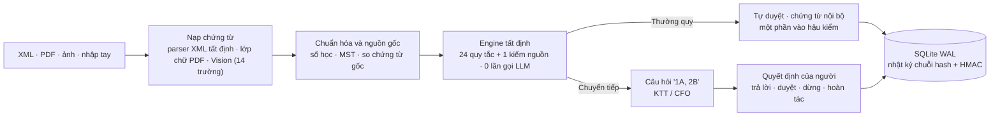

<div align="center">

# Tax Referee

**Trọng tài thuế GTGT đầu vào cho hóa đơn điện tử Việt Nam**
Tự xử lý hóa đơn thường quy · dừng đúng lúc · hỏi đúng người bằng một câu hỏi trả lời được ngay

[](https://github.com/khanhle1406/Tax-Referee/actions/workflows/ci.yml)
[](LICENSE)


[**Live demo**](https://limegreen-salamander-517622.hostingersite.com) ·
[**Verify (9 ca)**](https://limegreen-salamander-517622.hostingersite.com/verify) ·
[**Trung tâm tin cậy**](https://limegreen-salamander-517622.hostingersite.com/trust) ·
[**SOP**](https://limegreen-salamander-517622.hostingersite.com/sop) ·
[**Tài liệu**](docs/README.md)

MLAI Hackathon 2026 · Track VNG · Đề A — *The Escalation Referee* · Đội **Fprinciples**

</div>

> **Đội / người deploy (Demo Day 17/10):** đọc [docs/handoff/BAN-GIAO-DEMO-DAY-17-10.md](docs/handoff/BAN-GIAO-DEMO-DAY-17-10.md) trước — việc phải làm, kiểm tra sau deploy, chuẩn bị thuyết trình.

*English summary — Tax Referee is an input-VAT "escalation referee" for Vietnamese e-invoices. A deterministic rule engine (25 published SOP rules, zero LLM calls on the decision path) auto-approves routine invoices and escalates only three kinds of cases — unclear data, out of policy, or beyond the approver's authority — each with a single, answerable question routed to the right person. AI is confined to reading documents through an output allowlist; every action is written to a tamper-evident, HMAC-chained audit log. Security claims are provable live on `/trust` (12 attack probes run against the deployed code).*

---

## Mục lục

- [Vấn đề và giải pháp](#vấn-đề-và-giải-pháp)
- [Dùng thử trong 90 giây](#dùng-thử-trong-90-giây)
- [Tính năng chính](#tính-năng-chính)
- [Kiến trúc](#kiến-trúc)
- [Bảo mật hệ có agent AI](#bảo-mật-hệ-có-agent-ai)
- [Bắt đầu nhanh](#bắt-đầu-nhanh)
- [Cấu hình](#cấu-hình)
- [Kiểm thử và chất lượng](#kiểm-thử-và-chất-lượng)
- [Triển khai](#triển-khai)
- [API chính](#api-chính)
- [Cấu trúc thư mục](#cấu-trúc-thư-mục)
- [Bằng chứng và giới hạn](#bằng-chứng-và-giới-hạn)
- [Đóng góp, bảo mật, giấy phép](#đóng-góp-bảo-mật-giấy-phép)
- [Đội ngũ](#đội-ngũ)

---

## Vấn đề và giải pháp

Kế toán phải kiểm từng hóa đơn đầu vào trước khi khấu trừ thuế GTGT: MST, số học, thuế suất theo kỳ, chứng từ thanh toán không dùng tiền mặt, thẩm quyền phê duyệt. Sai một điều kiện là mất tiền thuế hoặc bị phạt; hỏi thừa thì người duyệt quá tải.

**Tax Referee** đọc hóa đơn (XML chuẩn quốc gia, PDF, ảnh), chạy **quy tắc tất định trước**, tự xử lý ca thường quy và chỉ chuyển cho người những ca thật sự cần, kèm **một câu hỏi có số liệu và hệ quả cho từng đáp án**:

| Kiểu dừng | Khi nào | Ví dụ câu hỏi hệ thống tạo |
|---|---|---|
| **Chưa rõ thông tin** | Dữ kiện thiếu, mờ hoặc mâu thuẫn làm thay đổi kết quả | *Tổng in trên hóa đơn 480.000₫ lệch tiền hàng + thuế = 495.000₫. A: 495.000₫ — sửa và đánh giá lại; hoặc B: 480.000₫ như in — yêu cầu NCC điều chỉnh?* |
| **Ngoài quy định** | Vi phạm điều kiện khấu trừ, hoặc khoản chi ngoài phạm vi tự duyệt (tài trợ, phạt, quà tặng, chi cá nhân…) | *“Tiếp khách đối tác - rượu vang” (3.300.000₫). A: Tiếp khách theo quy chế — khấu trừ 300.000₫; hoặc B: Chi cá nhân — loại 300.000₫ VAT?* |
| **Vượt thẩm quyền** | Từ hạn mức Kế toán trưởng (200 triệu), tách nhỏ hóa đơn để né hạn mức, hệ số K vùng đỏ | *330.000.000₫ ≥ hạn mức KTT. A: CFO phê duyệt, khấu trừ 30.000.000₫; hoặc B: Tạm dừng để thẩm tra hợp đồng?* |

Ca nhiều vấn đề được gộp thành các ý đánh số; người duyệt trả lời một lần (ví dụ *"1A, 2B"*). Hệ thống **không kết luận trên dữ liệu nghi vấn** và **không hỏi thừa**: phương thức thanh toán chỉ hỏi khi tổng tiền (cộng các hóa đơn cùng bên bán trong ngày) đạt 5 triệu (hóa đơn từ 01/7/2025), trạng thái MST chỉ hỏi từ ngưỡng trọng yếu 20 triệu.

## Dùng thử trong 90 giây

Không cần tài khoản — mỗi phiên demo có database riêng.

1. **Verify:** mở [`/verify`](https://limegreen-salamander-517622.hostingersite.com/verify) → **Chạy Verify**. 4 ca chung + 5 ca Đề A, PASS/FAIL, thời điểm chạy từng ca. Tab **Thử dữ liệu mới**: sửa JSON hoặc chọn ca mẫu, bỏ trống trường chưa biết — hệ thống chỉ hỏi dữ kiện thực sự làm đổi kết quả.
2. **Hộp chuyển tiếp:** trang chủ → **② Mở hộp chuyển tiếp — demo riêng** (4 ca mẫu) → mở một ca → đổi vai Kế toán trưởng/CFO → trả lời ngay trên hồ sơ (tab **Xử lý**, có nút **Dừng xử lý / Hoàn tác**) → tab **Lịch sử** xem nhật ký.
3. **Bảo mật:** mở [`/trust`](https://limegreen-salamander-517622.hostingersite.com/trust) → **Chạy 12 phép thử tấn công** → 12/12 đạt trên mã đang deploy.
4. **Phiên bản đang chạy:** [`/api/health`](https://limegreen-salamander-517622.hostingersite.com/api/health) — commit, policy, trạng thái HMAC, ngân sách AI, cảnh báo cấu hình.

<details>
<summary><b>4 trường hợp kiểm thử chung</b></summary>

| Ca | Dữ liệu đầu vào | Hành vi kỳ vọng |
|---|---|---|
| C-01 | Phí chuyển phát nhanh tài liệu 2.200.000₫, chuyển khoản | Tự xử lý, tạo chứng từ nội bộ |
| C-02 | Tài trợ giải chạy từ thiện 16.500.000₫ | Chuyển tiếp · Ngoài quy định |
| C-03 | Hóa đơn từ ảnh mờ | Chuyển tiếp · Chưa rõ thông tin |
| C-04 | MST người mua khác MST doanh nghiệp | Chuyển tiếp · Ngoài quy định |

Dữ liệu: [`data/verification/challengeCases.ts`](data/verification/challengeCases.ts). Chạy: `/verify` hoặc `npm test`.
</details>

## Tính năng chính

- **Đọc hóa đơn điện tử Việt Nam** — XML của Viettel, MISA, VNPT, FPT, Tổng cục Thuế (chặn DOCTYPE/ENTITY chống XXE); ảnh và PDF gốc qua Vision, bổ sung lớp chữ PDF khi có để đối chiếu.
- **25 quy tắc tất định, căn cứ theo ngày lập** — công khai tại [`/sop`](https://limegreen-salamander-517622.hostingersite.com/sop) (24 do engine kiểm, 1 do workflow thêm khi dữ liệu chưa xác minh); danh mục loại trừ thuế suất 8% đúng từng kỳ (NQ 204/2025: xăng, than, hóa chất, CNTT được 8% từ 01/7/2025), khung hóa đơn TT 78/2021 → TT 32/2025 → NĐ 254/2026 + TT 91/2026 (số hiệu và hiệu lực theo nguồn thứ cấp, chưa đọc toàn văn; [`lib/legalBasis.ts`](lib/legalBasis.ts)).
- **Một câu hỏi, đúng người** — có số tiền và VAT chờ quyết định; mỗi đáp án có hệ quả thật; người nhận theo thẩm quyền (KTT/CFO).
- **Con người nắm quyền kiểm soát** — người nhập không tự duyệt hay tự xác minh; ca từng cần CFO không hạ thẩm quyền khi sửa số tiền; hoàn tác không nới lỏng kiểm soát người khác đặt; công tắc dừng toàn hệ thống.
- **Nhật ký chống sửa** — chỉ ghi thêm (trigger SQLite), chuỗi SHA-256 nối HMAC, điểm neo có chữ ký phát hiện cắt đuôi/viết lại, chống hạ cấp chữ ký.
- **Hậu kiểm ngẫu nhiên** — 10% ca máy tự duyệt (gấp 3 ở vùng sát ngưỡng), chọn mẫu bằng HMAC khi có khóa audit (production tự sinh khóa); tỉ lệ đồng thuận người–máy kèm khoảng Wilson 95%.
- **Policy có phiên bản, nguyên tắc bốn mắt** — chạy thử trên hồ sơ gần nhất trước khi công bố; nới lỏng kiểm soát cần CFO khác người soạn.
- **Phát hiện gian lận thường gặp** — hóa đơn trùng kể cả khác cách ghi số, tách nhỏ để né hạn mức, cụm hóa đơn tiền mặt cùng bên bán trong ngày từ 5 triệu.

Chi tiết và cách tự thử: [docs/submission/tinh-nang-noi-bat.md](docs/submission/tinh-nang-noi-bat.md).

## Kiến trúc



| Lớp | Vai trò | Mã nguồn |
|---|---|---|
| Nạp chứng từ | XML tất định, lớp chữ PDF, ảnh qua Vision với allowlist đầu ra | [`app/api/documents/parse`](app/api/documents/parse/route.ts), [`lib/documentParser.ts`](lib/documentParser.ts), [`services/geminiService.ts`](services/geminiService.ts) |
| Quyết định | 25 quy tắc SOP (24 trong engine, 1 do workflow), 3 kiểu dừng, thứ tự ưu tiên duy nhất | [`services/policyEngine.ts`](services/policyEngine.ts), [`lib/riskTaxonomy.ts`](lib/riskTaxonomy.ts), [`lib/legalBasis.ts`](lib/legalBasis.ts) |
| Workflow | Revision, thẩm quyền, hoàn tác, hậu kiểm, công tắc dừng | [`services/workflowService.ts`](services/workflowService.ts), [`services/postAuditService.ts`](services/postAuditService.ts) |
| Chuyển tiếp | Câu hỏi một câu, cấu trúc đáp án có hệ quả | [`services/questionBuilder.ts`](services/questionBuilder.ts), [`services/handoffService.ts`](services/handoffService.ts) |
| Bằng chứng | Nhật ký chỉ ghi thêm, HMAC, điểm neo | [`lib/server/audit.ts`](lib/server/audit.ts) |
| Định danh và cách ly | Phiên, vai trò, mỗi phiên demo một SQLite | [`lib/server/auth.ts`](lib/server/auth.ts), [`lib/server/db.ts`](lib/server/db.ts), [`middleware.ts`](middleware.ts) |

**Không có vòng lặp agent.** Mỗi lượt đánh giá chạy một lần qua quy tắc — đường quyết định **0 lần gọi LLM**. AI chỉ ở khâu nạp chứng từ: đọc ảnh/PDF qua `DEV_LLM_*` (tối đa 1 lần, timeout 35 giây, chỉ nhận 14 trường nhìn thấy) và gợi ý tra cứu danh tính bên bán (tối đa 2 lần trong 18 giây). PDF được gửi nguyên tệp, đủ các trang, kèm lớp chữ tham chiếu nếu có; không dùng bộ dò văn bản tự chọn MST/số hóa đơn/tổng tiền. Trường mơ hồ như “TM/CK” giữ trạng thái chưa xác định. Máy chủ chỉ xác minh nhà cung cấp khi tự tải được trang HTTPS chính thức có cả tên pháp lý và MST; câu trả lời của AI không phải bằng chứng. Diễn đạt câu hỏi bằng AI tắt mặc định; nếu bật `QGEN_AI=1` thì timeout 3,5 giây và bị guard chặn khi thêm số liệu hoặc đổi người nhận/phương án. Lượt đánh giá có hạn; quá hạn → `ON_HOLD`, kết quả trễ bị loại. Dữ liệu nằm trên SQLite WAL bền qua khởi động lại (`npm run test:recovery`).

| Thành phần | Thật / giả lập |
|---|---|
| Quy tắc, câu hỏi, workflow, nhật ký, SQLite | **Thật**, chạy trên live |
| Parser XML (Viettel, MISA, VNPT, FPT, TCT) | **Thật**; file mẫu là XML công khai, MST thử nghiệm |
| Đọc ảnh/PDF | **Thật** qua API tương thích OpenAI được cấu hình bằng `DEV_LLM_*`; PDF có lớp chữ và PDF scan đều dùng AI đọc tệp gốc |
| Dữ liệu Verify và bộ hồi quy | **Tổng hợp**, nhãn viết theo SOP; không phải đánh giá độc lập |
| Ngân hàng, đối soát TCT, ERP, báo cáo thuế (nhóm **Mở rộng · beta**) | **Một phần giả lập**, ngoài phạm vi Đề A |
| Vai trò Kế toán viên / KTT / CFO trong demo | **Mô phỏng**, trong database riêng của phiên |

Kiến trúc, đánh đổi và lộ trình production: [docs/architecture/demo-to-production.md](docs/architecture/demo-to-production.md).

## Bảo mật hệ có agent AI

Agent AI **không có quyền quyết định**; rủi ro "agentic" chuyển sang dữ liệu — mỗi trường AI viết ra mà quy tắc dùng tới được kiểm soát như một quyền. Cột *Phép thử* ghi mã phép thử chạy trên mã đang deploy tại [`/trust`](https://limegreen-salamander-517622.hostingersite.com/trust). Ma trận quyền, ngân sách AI và danh tính agent đọc ảnh không có phép thử riêng trên `/trust`; chúng được kiểm bằng unit test trong [`tests/unit/`](tests/unit).

| Trụ | Cơ chế | Phép thử |
|---|---|---|
| **Định danh** | 8 principal (3 vai người, trọng tài tất định, 3 agent AI, webhook pháp lý); trọng tài ghi `SYSTEM_REFEREE` kèm policyHash/inputHash/commit; agent đọc ảnh ghi model + hash prompt | I1, I2 |
| **Đặc quyền tối thiểu** | Ma trận 20 quyền được test kiểm bằng hàm thật ([`tests/unit/authzMatrix.test.ts`](tests/unit/authzMatrix.test.ts)); KTT không duyệt ca CFO; hạ số tiền không hạ thẩm quyền | L1–L3 |
| **Ranh giới thực thi** | Đầu ra Vision chỉ 14 trường nhìn thấy; thao tác theo danh sách cho phép; ngân sách AI fail-closed (OWASP LLM10) | D1–D4 |
| **Cách ly** | Mỗi phiên một DB, phép thử chạy DB `:memory:`; chặn XXE; chứng từ tải lên (trừ PDF) phục vụ với CSP sandbox; nhật ký phát hiện sửa | S1–S3 |

Phân tích đầy đủ (mô hình mối đe dọa, STRIDE, lỗi tự phát hiện và bản sửa): [docs/security/threat-model.md](docs/security/threat-model.md).

## Bắt đầu nhanh

**Yêu cầu:** Node.js ≥ 20.19 (khuyến nghị 22, giống CI) kèm npm. Python 3 với PyMuPDF là tùy chọn (đọc lớp chữ PDF).

```bash
git clone https://github.com/khanhle1406/Tax-Referee.git
cd Tax-Referee
npm ci
cp .env.example .env.local    # khóa AI cần cho đọc ảnh/PDF; Verify và test không cần
npm run dev                   # http://localhost:3000
```

Development chỉ lắng nghe `127.0.0.1:3000`; nếu cổng đã dùng thì lệnh dừng thay vì mở server khác. Cấu hình AI riêng cho local có thể đặt trong `.env.development.local` (Git bỏ qua). Cache development nằm ở `.next-dev`, còn build production ở `.next`, tránh hai tiến trình ghi đè tệp của nhau.

| Lệnh | Mục đích |
|---|---|
| `npm run dev` | Chạy môi trường phát triển |
| `npm test` | 16 bộ kiểm thử, mỗi bộ trên database tạm riêng |
| `npm run test:unit` | Chỉ unit test (`node:test`) |
| `npm run typecheck` · `npm run lint` | Kiểm tra kiểu và lint |
| `npm run build` · `npm start` | Build và chạy bản production |
| `npm run test:api` | Smoke test HTTP (`TEST_BASE_URL=…`) |
| `npm run demo:reset` | Đặt lại dữ liệu demo |

## Cấu hình

Sao chép [`.env.example`](.env.example) thành `.env.local`. Không commit file môi trường thật.

| Biến | Bắt buộc | Ý nghĩa |
|---|---|---|
| `DEV_LLM_BASE_URL`, `DEV_LLM_API_KEY`, `DEV_LLM_MODEL` | Khi dùng tính năng AI | Một API OpenAI-compatible dùng chung cho sinh câu hỏi, đọc ảnh và hỗ trợ tra cứu; nguồn pháp lý vẫn phải được máy chủ xác minh |
| `TAX_REFEREE_DATA_DIR` / `TAX_REFEREE_DB_PATH` | Không | Thư mục dữ liệu bền (SQLite, chứng từ, khóa audit tự sinh) |
| `TAX_REFEREE_AUDIT_KEY` | Không | Khóa HMAC nhật ký (≥ 32 ký tự); production không đặt thì tự sinh file `.audit-key` (quyền 600) cạnh database |
| `TAX_REFEREE_AUDIT_SIGNED_SINCE` | Không | Mốc ISO: từ đó mọi sự kiện phải có chữ ký (chống hạ cấp) |
| `TAX_REFEREE_DEMO_PER_HOUR` | Không | Số phiên demo mỗi giờ mỗi IP (mặc định 200) |
| `TAX_REFEREE_PARSE_PER_HOUR`, `TAX_REFEREE_GROUNDING_PER_SESSION_HOUR` … | Không | Ngân sách gọi AI, mặc định 60 lần đọc ảnh/người/giờ ([`lib/server/aiBudget.ts`](lib/server/aiBudget.ts)) |
| `TAX_REFEREE_*_PASSWORD` | Không | Mật khẩu tài khoản nội bộ (không đặt thì production dùng mật khẩu ngẫu nhiên) |
| `QGEN_AI` | Không | `1` để bật AI diễn đạt câu hỏi (mặc định tắt) |
| `LEGAL_WEBHOOK_SECRET` | Không | Bí mật webhook cập nhật pháp lý (≥ 24 ký tự) |

## Kiểm thử và chất lượng

- **`npm test`**: 16 bộ — 103 kiểm tra unit (20 file trong [`tests/unit/`](tests/unit)) và 15 bộ hồi quy, gồm 72 ca red team. Bộ nào in ít kiểm tra hơn ngưỡng `minChecks` bị tính là FAIL.
- **Kiểm thử thuộc tính** (fast-check, ~1.500 hóa đơn sinh ngẫu nhiên, seed cố định) cho các bất biến của engine.
- **Ma trận quyền** gọi hàm thực thi với từng vai trò; **12 phép thử bảo mật** của `/trust` chạy cả trong CI.
- **CI** ([`.github/workflows/ci.yml`](.github/workflows/ci.yml)): Ubuntu và Windows — typecheck, lint, test; build sau khi test đạt.
- **Verify** tất định, không gọi AI: 9/9 trên live, có run ID và commit.

## Triển khai

- **Production:** Hostinger, ứng dụng Node.js quản lý qua hPanel. hPanel **tự deploy khi `main` thay đổi** (khoảng 1,5 phút sau merge; chờ 2–5 phút rồi kiểm). Commit được ghi lúc build; khóa audit tự sinh nếu chưa cấu hình.
- **Quy trình:** nhánh riêng → Pull Request → CI xanh → *Create a merge commit* → kiểm `/api/health`, `/verify`, `/trust`.
- **Tài liệu:** [RUNBOOK.md](RUNBOOK.md) · [deployment/HOSTINGER.md](deployment/HOSTINGER.md) · [docs/handoff/huong-dan-ban-giao.md](docs/handoff/huong-dan-ban-giao.md). Có sẵn [`Dockerfile`](Dockerfile) và [`compose.yaml`](compose.yaml) cho môi trường container.

## API chính

| Endpoint | Phương thức | Mô tả |
|---|---|---|
| `/api/health` | GET | Phiên bản đang chạy, trạng thái HMAC, ngân sách AI, cảnh báo cấu hình |
| `/api/verify?mode=judge` | GET | Chạy bộ Verify (4 + 5 ca), tất định |
| `/api/documents/parse` | POST | Đọc chứng từ (XML/PDF/ảnh) thành dữ liệu có nguồn gốc từng trường |
| `/api/evaluate` | POST | Đánh giá một hóa đơn, trả quyết định và câu hỏi chuyển tiếp |
| `/api/invoices/[id]/answer` | POST | Trả lời câu hỏi chuyển tiếp ("1A, 2B") |
| `/api/invoices/[id]/audit-action` | POST | Dừng, giữ thuế, hoàn tác, duyệt |
| `/api/audit` · `/api/audit/anchor` | GET | Nhật ký, kiểm chuỗi (`?verify=1`), điểm neo có chữ ký |
| `/api/policy` | GET · POST | Policy có phiên bản; soạn, chạy thử, công bố (bốn mắt) |
| `/api/post-audits` · `/api/post-audits/[id]` | GET · POST | Danh sách hậu kiểm và tỉ lệ đồng thuận (GET); ghi kết quả hậu kiểm một ca (POST) |
| `/api/system/capabilities` · `/api/security/probes` | GET · POST | Bảng quyền (GET) và chạy phép thử bảo mật của `/trust` (POST) |

Các API ghi kiểm tra phiên đăng nhập hoặc phiên demo ngay trong từng route (trừ đăng nhập/đăng xuất, tạo phiên demo, webhook có khóa bí mật và tải ảnh bằng mã QR). [`middleware.ts`](middleware.ts) chặn yêu cầu ghi từ trang khác (cross-site).

## Cấu trúc thư mục

```text
app/            Trang (Next.js App Router) và 47 route API
components/     Giao diện: workspace, hộp chuyển tiếp, Verify, Trung tâm tin cậy
services/       Nghiệp vụ: engine quy tắc, workflow, câu hỏi, policy, hậu kiểm, AI
lib/            Lõi dùng chung: schema (Zod), phân loại rủi ro, căn cứ pháp lý, server (DB, audit, auth)
data/           Hợp đồng quy tắc/SOP, sổ văn bản pháp luật, fixture kiểm chứng
tests/unit/     Unit test (node:test)
scripts/qa/     Bộ hồi quy và runner đa nền tảng; scripts/ops/ vận hành
deployment/     Hostinger, Docker, sao lưu
docs/           Tài liệu nộp thi, kiến trúc, bảo mật, nghiên cứu, bằng chứng, bàn giao
input-sample/   Chứng từ mẫu (XML, PDF, ảnh)
```

## Bằng chứng và giới hạn

**Bằng chứng chạy được:** Verify 9/9 và 12/12 phép thử bảo mật trên live (lưu tại [`docs/evidence/`](docs/evidence)); CI xanh trên mỗi PR.

**Giới hạn — nói thẳng:**
- **Độ chính xác:** Verify và 60 ca phát triển là dữ liệu tổng hợp đội tự gán nhãn; 72 ca red team do agent AI viết từ SOP (không đọc `services/policyEngine.ts`; nhãn do AI gán, chưa được người nghiệp vụ duyệt — [`data/verification/redteam/cases.json`](data/verification/redteam/cases.json)). Tất cả **chưa phải đánh giá độc lập**. Công cụ khóa nhãn và chấm độc lập có sẵn (`npm run labels:lock`, `npm run evaluate:independent`).
- **Người dùng thực tế:** buổi thử với người dùng do BTC điều phối diễn ra 16/10; BTC xác nhận buổi thử ổn, không có phản hồi chi tiết bằng văn bản, nên repo **không công bố số liệu người dùng** nào ([bộ câu hỏi](docs/submission/proposal-user-questions.md)).
- **Định danh:** demo dùng **vai trò mô phỏng** — một người đổi được 3 vai trong phiên demo (ngoài sandbox bị chặn); đăng nhập nội bộ là MVP. Production cần SSO/OIDC và MFA.
- **Phạm vi SOP:** "ngoài phạm vi" nhận diện bằng danh sách từ khóa, nên chi cá nhân ghi tên khác vẫn có thể lọt (ca bẫy U2 của buổi thử đã đóng ở `02b8a24`); đảo sang danh sách trắng hạng mục là việc tiếp theo.
- **Cô lập:** tiến trình đọc PDF không nhận biến bí mật nhưng chưa chạy trong container/UID riêng; khóa HMAC nằm cùng host với database; điểm neo do `/api/audit/anchor` cấp, người vận hành phải tự lưu ra ngoài.
- **Khác:** SQLite một instance; ảnh/PDF scan đi qua proxy AI bên thứ ba; chưa xác thực chữ ký số XML; tách nhỏ hóa đơn mới cộng dồn trong cùng ngày, cùng bên bán; ngày lập ở tương lai gần chưa bị chặn (chỉ chặn khi quá 6 tháng).
- **Pháp lý:** quy tắc mô tả SOP nội bộ; điều khoản luật được dẫn nguồn nhưng diễn giải cần kế toán xác nhận.

**Minh bạch quá trình làm:** thư mục [`brainstorming/`](brainstorming/README.md) là ghi chú nháp do AI hỗ trợ soạn, không phải bằng chứng. Lịch sử commit trước 14/10 có một bản nháp AI chứa 3 persona giả định kèm trích dẫn không có thật và một bảng số liệu không có lần chạy tương ứng; đội đã gỡ persona ở commit `3ace396` và gắn đính chính cho bảng số liệu ở commit `997ba93`; xem `brainstorming/opus-evaluation.md` (§6, §7). Lịch sử git không bị viết lại.

<details>
<summary><b>Phản hồi Sprint 1 → đã xử lý</b></summary>

| Góp ý (Doanh nghiệp / Ban kỹ thuật) | Đã làm |
|---|---|
| Dữ liệu trên RAM, mất audit khi khởi động lại | SQLite WAL bền vững + nhật ký nối chuỗi hash, test khởi động lại |
| Cần chặn XXE khi đọc XML | Từ chối `DOCTYPE`/`ENTITY` trước khi parse; test payload XXE trả 400 |
| Script test chưa thành bộ kiểm thử chuẩn | `npm test` (node:test + runner đa nền tảng), CI Ubuntu/Windows |
| Vòng lặp agent không có trần | Không còn vòng lặp: một lượt quy tắc, AI có timeout và ngân sách, lượt quá hạn → `ON_HOLD` |
| 2/3 kiểu dừng, "không đoán bừa", "không chuyển tiếp thừa" mới đạt một phần | Bảng phân loại 3 nhóm duy nhất; quy tắc "ngoài phạm vi SOP"; so với chứng từ gốc; ngưỡng trọng yếu; ca diễn tập giám khảo trong [`tests/unit/judgeRehearsal.test.ts`](tests/unit/judgeRehearsal.test.ts) |
| Gemini 429 làm Verify lỗi | Verify chạy tất định, không gọi AI |

Toàn bộ thay đổi theo mốc: [CHANGELOG.md](CHANGELOG.md).
</details>

## Đóng góp, bảo mật, giấy phép

- **Đóng góp:** [CONTRIBUTING.md](CONTRIBUTING.md) · [Quy tắc ứng xử](CODE_OF_CONDUCT.md) · [Lịch sử thay đổi](CHANGELOG.md)
- **Báo lỗ hổng bảo mật:** [SECURITY.md](SECURITY.md) (không mở issue công khai)
- **Trợ lý AI làm việc trên repo:** [AGENTS.md](AGENTS.md) · [CLAUDE.md](CLAUDE.md)
- **Giấy phép:** mã nguồn theo [MIT License](LICENSE). Dữ liệu và tài nguyên bên thứ ba (ảnh mẫu MC-OCR chỉ dùng cho nghiên cứu, XML mẫu công khai…) theo giấy phép riêng — xem [THIRD_PARTY_NOTICES.md](THIRD_PARTY_NOTICES.md).

## Đội ngũ

Đội **Fprinciples** — MLAI Hackathon 2026 · Track VNG:

- **Khánh Lê** ([@khanhle1406](https://github.com/khanhle1406)) — Lead, Core Architecture
- **Minh** ([@bminhnemhoi](https://github.com/bminhnemhoi)) — Core Logic, Hardening
- **Tiến** ([@Towfienes](https://github.com/Towfienes)) — Contributor, Documentation

Cảm ơn Ban tổ chức MLAI Hackathon 2026, Track VNG và doanh nghiệp đồng hành đã góp ý trong Sprint 1.
