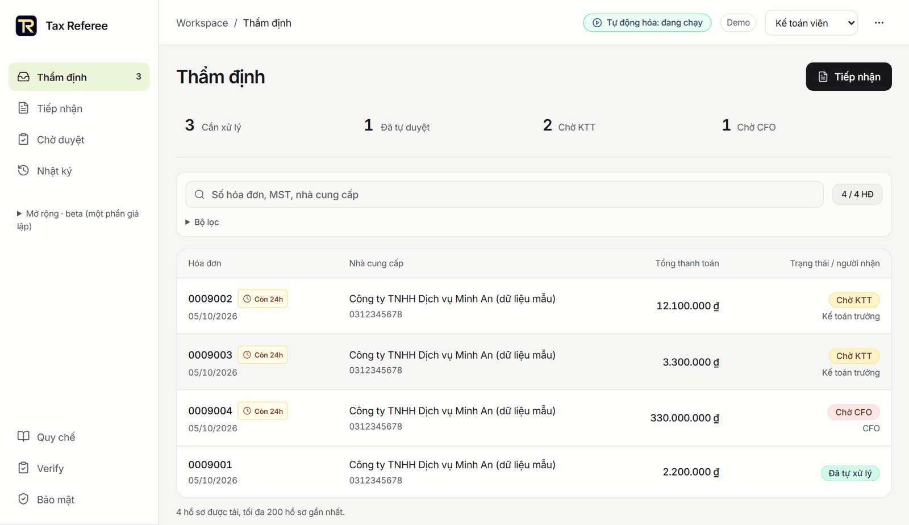
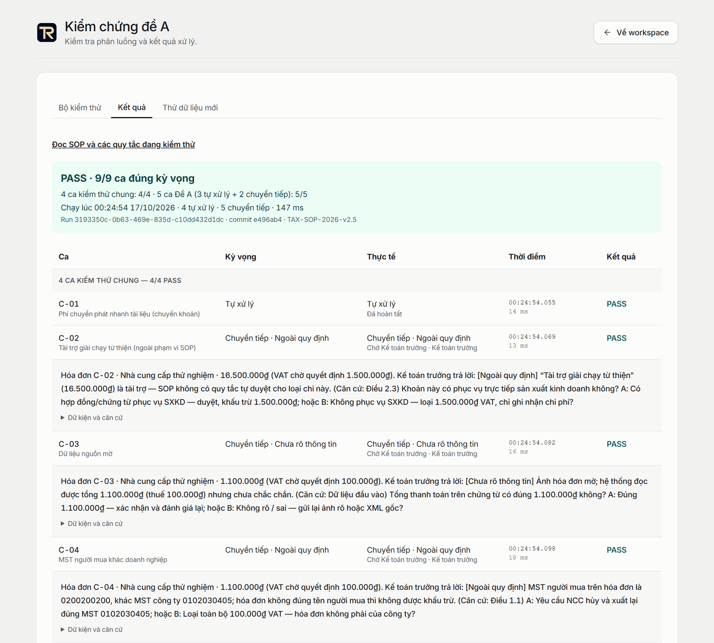
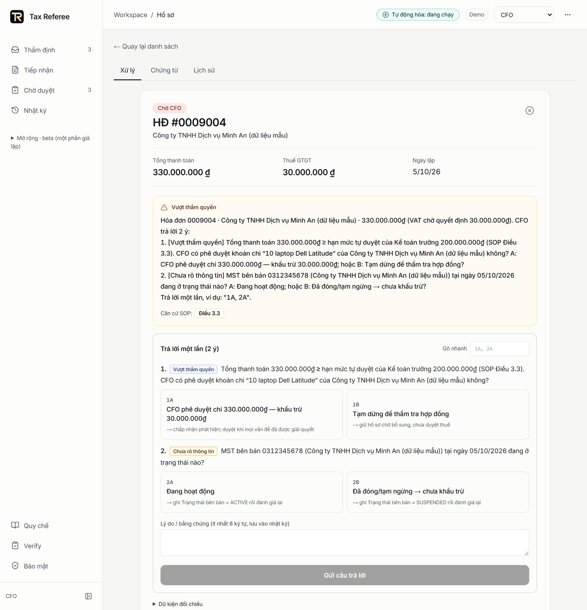
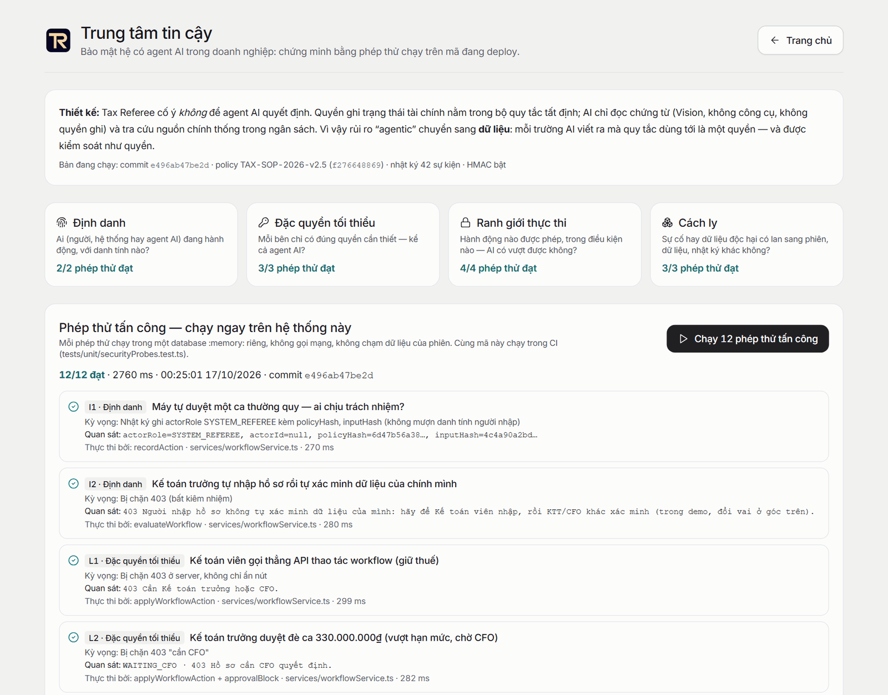
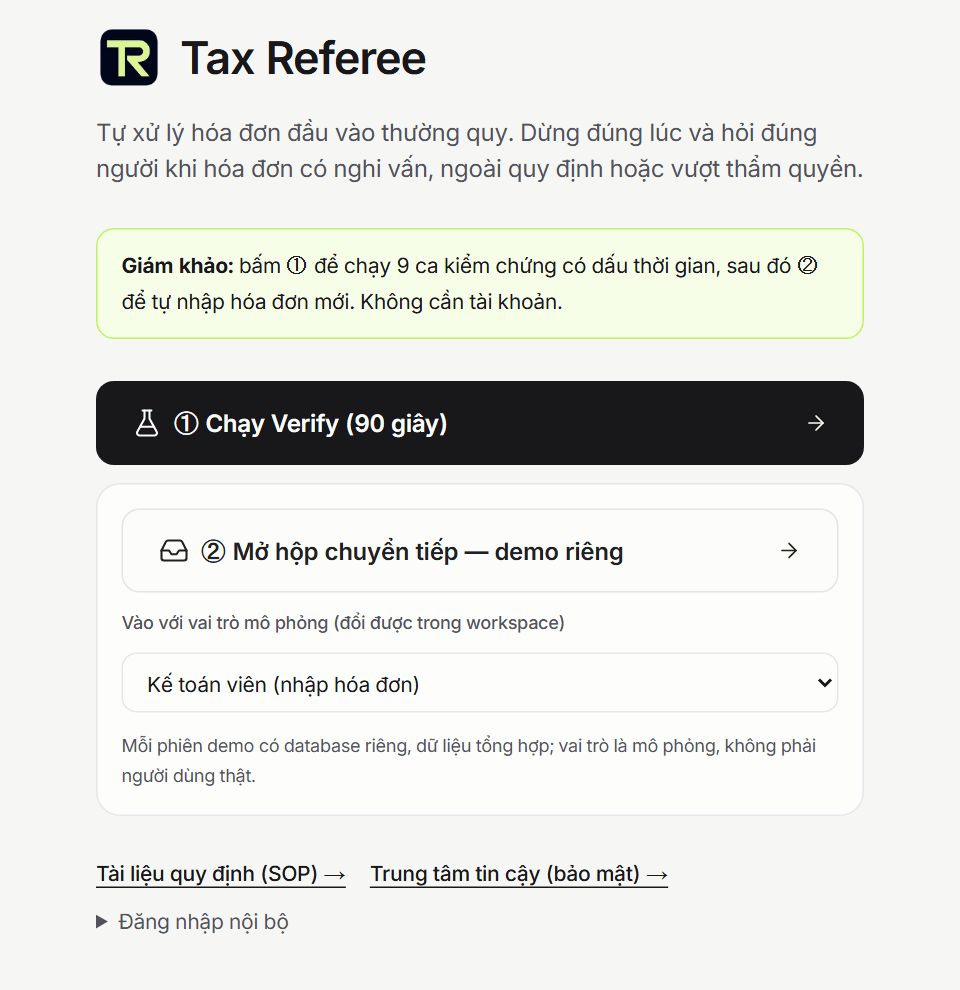
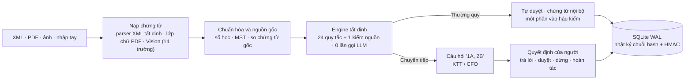

<div align="center">


# Tax Referee

**Trọng tài thuế GTGT đầu vào cho hóa đơn điện tử Việt Nam**<br>
Tự xử lý hóa đơn thường quy · dừng đúng lúc · hỏi đúng người bằng một câu hỏi trả lời được ngay

[](https://github.com/khanhle1406/Tax-Referee/actions/workflows/ci.yml)
[](https://github.com/khanhle1406/Tax-Referee/actions/workflows/codeql.yml)
[](LICENSE)


[**Live demo**](https://limegreen-salamander-517622.hostingersite.com) ·
[**Verify (9 ca)**](https://limegreen-salamander-517622.hostingersite.com/verify) ·
[**Trung tâm tin cậy**](https://limegreen-salamander-517622.hostingersite.com/trust) ·
[**SOP**](https://limegreen-salamander-517622.hostingersite.com/sop) ·
[**Tài liệu**](docs/README.md)

MLAI Hackathon 2026 · Track VNG · Đề A — *The Escalation Referee* · Đội **Fprinciples**

</div>

> **Đội / người deploy (Demo Day 17/10):** đọc [docs/handoff/BAN-GIAO-DEMO-DAY-17-10.md](docs/handoff/BAN-GIAO-DEMO-DAY-17-10.md) trước — việc phải làm, kiểm tra sau deploy, chuẩn bị thuyết trình. Demo theo lô trên máy local: [docs/handoff/KICH-BAN-DEMO-LO-17-10.md](docs/handoff/KICH-BAN-DEMO-LO-17-10.md).

<p align="center"></p>

*English summary — Tax Referee is an input-VAT "escalation referee" for Vietnamese e-invoices. A deterministic rule engine (25 published SOP rules, zero LLM calls on the decision path) auto-approves routine invoices and escalates only three kinds of cases — unclear data, out of policy, or beyond the approver's authority — each with a single, answerable question routed to the right person. AI is confined to reading documents through an output allowlist; every action is written to a tamper-evident, HMAC-chained audit log. Security claims are provable live on `/trust` (12 attack probes run against the deployed code).*

---

## Mục lục

- [Vấn đề và giải pháp](#vấn-đề-và-giải-pháp)
- [Dùng thử trong 90 giây](#dùng-thử-trong-90-giây)
- [Giao diện](#giao-diện)
- [Tính năng chính](#tính-năng-chính)
- [Xử lý theo lô và kênh nhận hóa đơn](#xử-lý-theo-lô-và-kênh-nhận-hóa-đơn)
- [Kiến trúc](#kiến-trúc)
- [Bảo mật hệ có agent AI](#bảo-mật-hệ-có-agent-ai)
- [Bắt đầu nhanh](#bắt-đầu-nhanh)
- [Cấu hình](#cấu-hình)
- [Kiểm thử và chất lượng](#kiểm-thử-và-chất-lượng)
- [Triển khai](#triển-khai)
- [API chính](#api-chính)
- [Cấu trúc thư mục](#cấu-trúc-thư-mục)
- [Bằng chứng và giới hạn](#bằng-chứng-và-giới-hạn)
- [Thuật ngữ](#thuật-ngữ)
- [Đóng góp, bảo mật, giấy phép](#đóng-góp-bảo-mật-giấy-phép)
- [Đội ngũ](#đội-ngũ)

---

## Vấn đề và giải pháp

Kế toán phải kiểm từng hóa đơn đầu vào trước khi khấu trừ thuế GTGT: MST, số học, thuế suất theo kỳ, chứng từ thanh toán không dùng tiền mặt, thẩm quyền phê duyệt. Sai một điều kiện là mất tiền thuế hoặc bị phạt; hỏi thừa thì người duyệt quá tải.

**Tax Referee** đọc hóa đơn (XML chuẩn quốc gia, PDF, ảnh), chạy **quy tắc tất định trước**, tự xử lý ca thường quy và chỉ chuyển cho người những ca thật sự cần, kèm **một câu hỏi có số liệu và hệ quả cho từng đáp án**:

| Kiểu dừng | Khi nào | Ví dụ câu hỏi hệ thống tạo |
|---|---|---|
| **Chưa rõ thông tin** | Dữ kiện thiếu, mờ hoặc mâu thuẫn làm thay đổi kết quả | *Tổng in trên hóa đơn 480.000₫ lệch tiền hàng + thuế = 495.000₫. A: 495.000₫ — sửa và đánh giá lại; hoặc B: 480.000₫ như in — yêu cầu NCC điều chỉnh?* |
| **Ngoài quy định** | Vi phạm điều kiện khấu trừ, hoặc khoản chi ngoài phạm vi tự duyệt (tài trợ, phạt, quà tặng, chi cá nhân…) | *“Tiếp khách đối tác - rượu vang” (3.300.000₫). A: Tiếp khách theo quy chế — khấu trừ 300.000₫; hoặc B: Chi cá nhân — loại 300.000₫ VAT?* |
| **Vượt thẩm quyền** | Từ hạn mức Kế toán trưởng (200 triệu), tách nhỏ hóa đơn để né hạn mức, hệ số K vùng đỏ | *330.000.000₫ ≥ hạn mức KTT. A: CFO phê duyệt, khấu trừ 30.000.000₫; hoặc B: Tạm dừng để thẩm tra hợp đồng?* |

Ca nhiều vấn đề được gộp thành các ý đánh số; người duyệt trả lời một lần (ví dụ *"1A, 2B"*). Hệ thống **không kết luận trên dữ liệu nghi vấn** và **không hỏi thừa**: phương thức thanh toán chỉ hỏi khi tổng tiền (cộng các hóa đơn cùng bên bán trong ngày) đạt 5 triệu (hóa đơn từ 01/7/2025), trạng thái MST chỉ hỏi từ ngưỡng trọng yếu 20 triệu.

## Dùng thử trong 90 giây

Không cần tài khoản — mỗi phiên demo có database riêng.

1. **Verify:** mở [`/verify`](https://limegreen-salamander-517622.hostingersite.com/verify) → **Chạy Verify**. 4 ca chung + 5 ca Đề A, PASS/FAIL, thời điểm chạy từng ca. Tab **Thử dữ liệu mới**: sửa JSON hoặc chọn ca mẫu, bỏ trống trường chưa biết — hệ thống chỉ hỏi dữ kiện thực sự làm đổi kết quả.
2. **Hộp chuyển tiếp:** trang chủ → **② Mở hộp chuyển tiếp — demo riêng** (4 ca mẫu) → mở một ca → đổi vai Kế toán trưởng/CFO → trả lời ngay trên hồ sơ (tab **Xử lý**, có nút **Dừng xử lý / Hoàn tác**) → tab **Lịch sử** xem nhật ký.
3. **Bảo mật:** mở [`/trust`](https://limegreen-salamander-517622.hostingersite.com/trust) → **Chạy 12 phép thử tấn công** → 12/12 đạt trên mã đang deploy.
4. **Phiên bản đang chạy:** [`/api/health`](https://limegreen-salamander-517622.hostingersite.com/api/health) — commit, policy, trạng thái HMAC, ngân sách AI, cảnh báo cấu hình.

<details>
<summary><b>4 trường hợp kiểm thử chung</b></summary>

| Ca | Dữ liệu đầu vào | Hành vi kỳ vọng |
|---|---|---|
| C-01 | Phí chuyển phát nhanh tài liệu 2.200.000₫, chuyển khoản | Tự xử lý, tạo chứng từ nội bộ |
| C-02 | Tài trợ giải chạy từ thiện 16.500.000₫ | Chuyển tiếp · Ngoài quy định |
| C-03 | Hóa đơn từ ảnh mờ | Chuyển tiếp · Chưa rõ thông tin |
| C-04 | MST người mua khác MST doanh nghiệp | Chuyển tiếp · Ngoài quy định |

Dữ liệu: [`data/verification/challengeCases.ts`](data/verification/challengeCases.ts). Chạy: `/verify` hoặc `npm test`.
</details>

## Giao diện

Ảnh chụp từ bản live ngày 17/10/2026, lúc live còn chạy commit `e496ab4` (trước khi PR #9–#12 được merge); dữ liệu mẫu tổng hợp của phiên demo. Ảnh các màn hình của vòng cải tiến 17/10 (Lô hóa đơn, phiếu giải trình, Hộp thư vào, Tổng quan, Lịch sử của tôi) chụp trên bản build local, nằm ở [`docs/submission/screens/`](docs/submission/screens).

| Verify một nút: 9/9 ca đúng kỳ vọng, có run ID và commit | Câu hỏi chuyển tiếp "1A, 2A" gửi CFO |
|---|---|
| [](docs/screenshots/verify.png) | [](docs/screenshots/handoff.png) |
| **Trung tâm tin cậy: 12/12 phép thử tấn công trên mã đang deploy** | **Trang chủ cho giám khảo: không cần tài khoản** |
| [](docs/screenshots/trust.png) | [](docs/screenshots/home.png) |

## Tính năng chính

- **Đọc đúng hóa đơn điện tử Việt Nam** — XML của Viettel, MISA, VNPT, FPT, Tổng cục Thuế (chặn DOCTYPE/ENTITY chống XXE); PDF có lớp chữ; ảnh và PDF scan qua Gemini Vision.
- **25 quy tắc tất định, căn cứ theo ngày lập** — công khai tại [`/sop`](https://limegreen-salamander-517622.hostingersite.com/sop) (24 do engine kiểm, 1 do workflow thêm khi dữ liệu chưa xác minh); danh mục loại trừ thuế suất 8% đúng từng kỳ (NQ 204/2025: xăng, than, hóa chất, CNTT được 8% từ 01/7/2025), khung hóa đơn TT 78/2021 → TT 32/2025 → NĐ 254/2026 + TT 91/2026 (số hiệu và hiệu lực theo nguồn thứ cấp, chưa đọc toàn văn; [`lib/legalBasis.ts`](lib/legalBasis.ts)).
- **Một câu hỏi, đúng người** — có số tiền và VAT chờ quyết định; mỗi đáp án có hệ quả thật; người nhận theo thẩm quyền (KTT/CFO).
- **Con người nắm quyền kiểm soát** — người nhập không tự duyệt hay tự xác minh; ca từng cần CFO không hạ thẩm quyền khi sửa số tiền; hoàn tác không nới lỏng kiểm soát người khác đặt; công tắc dừng toàn hệ thống.
- **Nhật ký chống sửa** — chỉ ghi thêm (trigger SQLite), chuỗi SHA-256 nối HMAC, điểm neo có chữ ký phát hiện cắt đuôi/viết lại, chống hạ cấp chữ ký.
- **Hậu kiểm ngẫu nhiên** — 10% ca máy tự duyệt (gấp 3 ở vùng sát ngưỡng), chọn mẫu bằng HMAC khi có khóa audit (production tự sinh khóa); tỉ lệ đồng thuận người–máy kèm khoảng Wilson 95%.
- **Policy có phiên bản, nguyên tắc bốn mắt** — chạy thử trên hồ sơ gần nhất trước khi công bố; nới lỏng kiểm soát cần CFO khác người soạn.
- **Phát hiện gian lận thường gặp** — hóa đơn trùng kể cả khác cách ghi số, tách nhỏ để né hạn mức, cụm hóa đơn tiền mặt cùng bên bán trong ngày từ 5 triệu.

Chi tiết và cách tự thử: [docs/submission/tinh-nang-noi-bat.md](docs/submission/tinh-nang-noi-bat.md).

## Xử lý theo lô và kênh nhận hóa đơn

Vòng cải tiến 17/10 thêm cách xử lý **theo lô có kiểm soát**: máy vẫn quyết từng hóa đơn bằng cùng engine tất định, nhưng hóa đơn trong lô chỉ vào sổ khi người có thẩm quyền chốt.

- **Lô hóa đơn** ([`services/batchService.ts`](services/batchService.ts), `app/api/batches/**`): tải nhiều file, đọc hết rồi xếp theo MST → ngày → số trước khi kiểm; kết quả chia nhóm (máy đề xuất duyệt, đã duyệt sau khi hỏi người, cần người quyết, tạm giữ, từ chối, không đọc được). File trùng mã băm trong cùng lô không thêm dòng mới. Chỉ gắn vào lô hóa đơn do chính người tạo lô nhập; mỗi lần gắn có sự kiện nhật ký `BATCH_ITEM_ATTACHED`; client không tự đặt nguồn Gmail/Zalo. Nhãn và mã lô theo giờ Việt Nam.
- **Phiếu giải trình** ([`lib/explainDecision.ts`](lib/explainDecision.ts)): mỗi dòng nói vì sao máy đề xuất duyệt (từng điều kiện kèm số, dùng chính hàm của engine) hoặc vì sao dừng (quy tắc, trường, VAT chờ quyết định); hóa đơn đã có người quyết thì phiếu nói theo kết quả cuối.
- **Trả lời nhóm** (KTT/CFO): chỉ gộp các câu hỏi cùng nội dung và cùng hệ quả đáp án, ví dụ "đã có ủy nhiệm chi chưa?" hay "mục đích tiếp khách". Câu xác nhận giá trị riêng của từng tờ (số tiền, MST, ngày đọc từ ảnh; ảnh mờ; số liệu lệch) không bao giờ gộp. Thẻ nhóm liệt kê từng hóa đơn; đáp án đi qua bước trả lời của từng hóa đơn (thẩm quyền, bất kiêm nhiệm giữ nguyên) kèm phiên bản hồ sơ người duyệt đã thấy, hồ sơ vừa đổi thì bị chặn (409).
- **Chốt lô** (KTT/CFO): ghi lý do; người tạo lô và người nhập hóa đơn không tự chốt (bất kiêm nhiệm); lô có hóa đơn từ hạn mức CFO thì CFO chốt. Khi chốt, từng hóa đơn đã duyệt được đánh dấu ghi sổ (`batch_items.posted_at`) và có sự kiện nhật ký riêng. Hóa đơn còn chờ hay tạm giữ lúc chốt, nếu được duyệt sau, phải **chốt bổ sung** trên cùng lô, cùng luật bất kiêm nhiệm và hạn mức CFO.
- **Sổ sách** (`app/api/ledger/**`): chỉ lấy hóa đơn đã duyệt không thuộc lô nào, hoặc đã được ghi sổ khi chốt lô. Tải XML/CSV sổ cái (`GET /api/ledger/export`) và đẩy chứng từ sang phần mềm kế toán (`POST /api/ledger/sync`) chỉ dành cho KTT/CFO (quyền `ledger.export`); xem trước danh sách (`GET /api/ledger/sync`) mở cho người đã đăng nhập.
- **Hộp thư vào — Gmail/Zalo** (`services/channels/**`, [`services/staffDirectory.ts`](services/staffDirectory.ts)): chỉ Kế toán viên (người nhập) bấm lấy thư. Thư của nhân viên có trong danh bạ, email qua SPF/DKIM (đọc header `Authentication-Results`, bỏ comment và chuỗi trong ngoặc kép trước khi đọc) hoặc Zalo user id có trong danh bạ, được máy kiểm ngay. Người gửi lạ hay giả địa chỉ chờ KTT/CFO xác nhận; sau khi xác nhận, file được xử lý dưới tên Kế toán viên đã lấy thư, và người xác nhận không được tự duyệt/chốt chính hóa đơn đó (bất kiêm nhiệm). XML đọc tất định; ảnh/PDF được lưu nhưng **chưa tự đọc** (xem [Giới hạn](#bằng-chứng-và-giới-hạn)). Mỗi thư tối đa 5 đính kèm, mỗi lượt tối đa 50 file và 10 file từ người gửi chưa xác thực; phần vượt bị từ chối, chỉ ghi siêu dữ liệu. File trùng trong cùng lượt tính một lần; hóa đơn đã nằm ở lô khác được đánh dấu trùng, không tạo lô rỗng. Mỗi file nhận có sự kiện nhật ký `CHANNEL_FILE_INGESTED` (mã nhân viên gửi, đã xác thực hay chưa, không ghi địa chỉ). Ở danh sách file nhận và tin đã gửi, Kế toán viên chỉ thấy địa chỉ đã che (email chỉ còn tên miền); KTT/CFO thấy đủ. Sau mỗi lượt có lô, KTT nhận tóm tắt và người gửi đã xác thực qua email nhận kết quả hóa đơn của mình; người gửi đã xác thực qua Zalo nhận tin báo đã nhận ảnh.
- **Phiên demo dùng kênh mô phỏng:** hộp thư và bot giả với hóa đơn mẫu đi đúng đường nhận diện người gửi, lưu file, máy kiểm, vào lô; tin gửi ghi trạng thái `SIMULATED`, không gọi mạng và không bao giờ dùng người nhận thật. Kênh thật chỉ bật có chủ đích trên máy của đội: [docs/handoff/KET-NOI-GMAIL-ZALO.md](docs/handoff/KET-NOI-GMAIL-ZALO.md).
- **Tổng quan** (chỉ KTT/CFO, [`services/dashboardService.ts`](services/dashboardService.ts)): việc đang chờ, máy tự xử lý bao nhiêu, VAT, lý do dừng, tốc độ trả lời, lô, kênh và người gửi.
- **Lịch sử của tôi** ([`services/historyService.ts`](services/historyService.ts)): hai thẻ "Tôi đã làm" và "Hóa đơn tôi gửi", chỉ bản ghi của chính người đăng nhập.
- **Trang [`/privacy`](app/privacy/page.tsx) — "Dữ liệu của bạn đi đâu":** từng loại dữ liệu đi đâu, AI thấy gì (đọc cấu hình đang chạy), ai xem được gì, chế độ không AI.

## Kiến trúc



| Lớp | Vai trò | Mã nguồn |
|---|---|---|
| Nạp chứng từ | XML tất định, lớp chữ PDF, ảnh qua Vision với allowlist đầu ra | [`app/api/documents/parse`](app/api/documents/parse/route.ts), [`lib/documentParser.ts`](lib/documentParser.ts), [`services/geminiService.ts`](services/geminiService.ts) |
| Quyết định | 25 quy tắc SOP (24 trong engine, 1 do workflow), 3 kiểu dừng, thứ tự ưu tiên duy nhất | [`services/policyEngine.ts`](services/policyEngine.ts), [`lib/riskTaxonomy.ts`](lib/riskTaxonomy.ts), [`lib/legalBasis.ts`](lib/legalBasis.ts) |
| Workflow | Revision, thẩm quyền, hoàn tác, hậu kiểm, công tắc dừng | [`services/workflowService.ts`](services/workflowService.ts), [`services/postAuditService.ts`](services/postAuditService.ts) |
| Chuyển tiếp | Câu hỏi một câu, cấu trúc đáp án có hệ quả | [`services/questionBuilder.ts`](services/questionBuilder.ts), [`services/handoffService.ts`](services/handoffService.ts) |
| Bằng chứng | Nhật ký chỉ ghi thêm, HMAC, điểm neo | [`lib/server/audit.ts`](lib/server/audit.ts) |
| Định danh và cách ly | Phiên, vai trò, mỗi phiên demo một SQLite | [`lib/server/auth.ts`](lib/server/auth.ts), [`lib/server/db.ts`](lib/server/db.ts), [`middleware.ts`](middleware.ts) |

**Không có vòng lặp agent.** Mỗi lượt đánh giá chạy một lần qua quy tắc — đường quyết định **0 lần gọi LLM**. AI chỉ ở khâu nạp chứng từ: đọc ảnh/PDF scan (tối đa 1 lần, timeout 35 giây, chỉ nhận 14 trường nhìn thấy) và tra cứu danh tính bên bán có grounding (tối đa 2 lần trong 18 giây), cả hai có ngân sách gọi. Diễn đạt câu hỏi bằng AI tắt mặc định; nếu bật `QGEN_AI=1` thì timeout 3,5 giây và bị guard chặn khi thêm số liệu hoặc đổi người nhận/phương án. Lượt đánh giá có hạn; quá hạn → `ON_HOLD`, kết quả trễ bị loại. Dữ liệu nằm trên SQLite WAL bền qua khởi động lại (`npm run test:recovery`).

| Thành phần | Thật / giả lập |
|---|---|
| Quy tắc, câu hỏi, workflow, nhật ký, SQLite | **Thật**, chạy trên live |
| Parser XML (Viettel, MISA, VNPT, FPT, TCT) | **Thật**; file mẫu là XML công khai, MST thử nghiệm |
| Đọc ảnh/PDF scan | **Thật** qua Gemini 2.5 Flash (proxy ShopAIKey) khi có khóa |
| Dữ liệu Verify và bộ hồi quy | **Tổng hợp**, nhãn viết theo SOP; không phải đánh giá độc lập |
| Ngân hàng, đối soát TCT, ERP, báo cáo thuế (nhóm **Mở rộng · beta**) | **Một phần giả lập**, ngoài phạm vi Đề A |
| Vai trò Kế toán viên / KTT / CFO trong demo | **Mô phỏng**, trong database riêng của phiên |
| Gmail / Zalo trong phiên demo | **Mô phỏng**: hộp thư và bot giả, hóa đơn mẫu, tin gửi ghi `SIMULATED`, không gọi mạng. Kênh thật chạy khi máy chủ cấu hình biến `GMAIL_*`/`ZALO_*` (ngoài phiên demo), hoặc khi đội bật `TAX_REFEREE_ALLOW_REAL_CHANNELS_IN_DEMO=1` trên máy của mình |
| Lô dựng sẵn ("Lô cuối tháng 10", "Lô tuần 2") | **Chỉ máy local** khi bật `TAX_REFEREE_DEMO_PRESET_BATCHES=1`; bản live không có |

Kiến trúc, đánh đổi và lộ trình production: [docs/architecture/demo-to-production.md](docs/architecture/demo-to-production.md).

## Bảo mật hệ có agent AI

Agent AI **không có quyền quyết định**; rủi ro "agentic" chuyển sang dữ liệu — mỗi trường AI viết ra mà quy tắc dùng tới được kiểm soát như một quyền. Cột *Phép thử* ghi mã phép thử chạy trên mã đang deploy tại [`/trust`](https://limegreen-salamander-517622.hostingersite.com/trust). Ma trận quyền, ngân sách AI và danh tính agent đọc ảnh không có phép thử riêng trên `/trust`; chúng được kiểm bằng unit test trong [`tests/unit/`](tests/unit).

| Trụ | Cơ chế | Phép thử |
|---|---|---|
| **Định danh** | 8 principal (3 vai người, trọng tài tất định, 3 agent AI, webhook pháp lý); trọng tài ghi `SYSTEM_REFEREE` kèm policyHash/inputHash/commit; agent đọc ảnh ghi model + hash prompt | I1, I2 |
| **Đặc quyền tối thiểu** | Ma trận 29 quyền (24 quyền của người) được test kiểm bằng hàm thật ([`tests/unit/authzMatrix.test.ts`](tests/unit/authzMatrix.test.ts)); KTT không duyệt ca CFO; hạ số tiền không hạ thẩm quyền | L1–L3 |
| **Ranh giới thực thi** | Đầu ra Vision chỉ 14 trường nhìn thấy; thao tác theo danh sách cho phép; ngân sách AI fail-closed (OWASP LLM10) | D1–D4 |
| **Cách ly** | Mỗi phiên một DB, phép thử chạy DB `:memory:`; chặn XXE; chứng từ tải lên (trừ PDF) phục vụ với CSP sandbox; nhật ký phát hiện sửa | S1–S3 |

Phân tích đầy đủ (mô hình mối đe dọa, STRIDE, lỗi tự phát hiện và bản sửa): [docs/security/threat-model.md](docs/security/threat-model.md).

## Bắt đầu nhanh

**Yêu cầu:** Node.js 22 (giống CI và production) hoặc 24, kèm npm. Python 3 với PyMuPDF là tùy chọn (đọc lớp chữ PDF).

```bash
git clone https://github.com/khanhle1406/Tax-Referee.git
cd Tax-Referee
npm ci
cp .env.example .env.local    # khóa AI chỉ cần cho đọc ảnh; Verify và test không cần
npm run dev                   # http://localhost:3000
```

| Lệnh | Mục đích |
|---|---|
| `npm run dev` | Chạy môi trường phát triển |
| `npm test` | 16 bộ kiểm thử, mỗi bộ trên database tạm riêng |
| `npm run test:unit` | Chỉ unit test (`node:test`) |
| `npm run typecheck` · `npm run lint` | Kiểm tra kiểu và lint |
| `npm run build` · `npm start` | Build và chạy bản production |
| `npm run test:api` | Smoke test HTTP (`TEST_BASE_URL=…`) |
| `npm run demo:reset` | Đặt lại dữ liệu demo |
| `npm run referee:diff` | So quyết định của engine trên mọi fixture với ảnh chụp baseline; báo từng ca đổi |
| `npm run demo:local` | Chạy bản build standalone trên `127.0.0.1:3060` với lô dựng sẵn (chỉ máy local; cần build trước hoặc thêm `-- --build`) |
| `npm run channels:check` | Kiểm kết nối Gmail/Zalo thật trước khi demo; không in token |

## Cấu hình

Sao chép [`.env.example`](.env.example) thành `.env.local`. Không commit file môi trường thật.

| Biến | Bắt buộc | Ý nghĩa |
|---|---|---|
| `SHOPAIKEY_API_KEY`, `SHOPAIKEY_BASE_URL`, `SHOPAIKEY_MODEL` | Chỉ khi đọc ảnh | Gemini Vision và tra cứu có grounding qua proxy |
| `TAX_REFEREE_DATA_DIR` / `TAX_REFEREE_DB_PATH` | Không | Thư mục dữ liệu bền (SQLite, chứng từ, khóa audit tự sinh) |
| `TAX_REFEREE_AUDIT_KEY` | Không | Khóa HMAC nhật ký (≥ 32 ký tự); production không đặt thì tự sinh file `.audit-key` (quyền 600) cạnh database |
| `TAX_REFEREE_AUDIT_SIGNED_SINCE` | Không | Mốc ISO: từ đó mọi sự kiện phải có chữ ký (chống hạ cấp) |
| `TAX_REFEREE_DEMO_PER_HOUR` | Không | Số phiên demo mỗi giờ mỗi IP (mặc định 200) |
| `TAX_REFEREE_PARSE_PER_HOUR`, `TAX_REFEREE_GROUNDING_PER_SESSION_HOUR` … | Không | Ngân sách gọi AI, mặc định 60 lần đọc ảnh/người/giờ ([`lib/server/aiBudget.ts`](lib/server/aiBudget.ts)) |
| `TAX_REFEREE_*_PASSWORD` | Không | Mật khẩu tài khoản nội bộ (không đặt thì production dùng mật khẩu ngẫu nhiên) |
| `QGEN_AI` | Không | `1` để bật AI diễn đạt câu hỏi (mặc định tắt) |
| `LEGAL_WEBHOOK_SECRET` | Không | Bí mật webhook cập nhật pháp lý (≥ 24 ký tự) |
| `DEV_LLM_ENABLED`, `DEV_LLM_BASE_URL`, `DEV_LLM_API_KEY`, `DEV_LLM_MODEL` | Không | LLM dành cho demo theo chuẩn OpenAI, dùng thay Gemini để đọc ảnh; mặc định tắt, chỉ dùng trên máy local |
| `GMAIL_IMAP_USER`, `GMAIL_APP_PASSWORD`, `GMAIL_NOTIFY_TO` | Không | Kênh Gmail thật: hộp thư nhận hóa đơn (IMAP), gửi tóm tắt cho KTT (SMTP) |
| `ZALO_BOT_TOKEN`, `ZALO_NOTIFY_CHAT_ID` | Không | Zalo Bot thật: nhận ảnh hóa đơn, gửi tóm tắt cho KTT |
| `TAX_REFEREE_ALLOW_REAL_CHANNELS_IN_DEMO` | Không | `1` = phiên demo dùng kênh thật và nạp danh bạ thật; chỉ máy của đội, mặc định tắt |
| `TAX_REFEREE_DEMO_PRESET_BATCHES` | Không | `1` = mỗi phiên demo mới có sẵn lô mẫu (`npm run demo:local`); chỉ máy local, mặc định tắt |
| `TAX_REFEREE_STAFF_SEED` | Không | Danh bạ người gửi thật (JSON mảng `{fullName, department, title, email, zaloUserId}`); không nạp vào phiên demo trừ khi bật cờ kênh thật |

Ba cờ chỉ dành cho máy local (`TAX_REFEREE_ALLOW_REAL_CHANNELS_IN_DEMO`, `TAX_REFEREE_DEMO_PRESET_BATCHES`, `DEV_LLM_ENABLED`) nếu bật trên production thì `/api/health` có cảnh báo tương ứng: `real_channels_in_demo`, `demo_preset_batches`, `dev_llm_enabled`. Cờ đăng nhập theo vai không mật khẩu `TAX_REFEREE_ALLOW_INTERNAL_ROLE_LOGIN` cũng được cảnh báo (`internal_role_login`).

## Kiểm thử và chất lượng

- **`npm test`**: 16 bộ — bộ unit (các file trong [`tests/unit/`](tests/unit); ngưỡng số kiểm tra xem `minChecks` trong [`scripts/qa/run-all.ts`](scripts/qa/run-all.ts)) và 15 bộ hồi quy, gồm 72 ca red team. Bộ nào in ít kiểm tra hơn ngưỡng `minChecks` bị tính là FAIL.
- **`npm run referee:diff`**: chạy lại engine trên 180 ca fixture và so với ảnh chụp quyết định ([`data/verification/decision-snapshot.json`](data/verification/decision-snapshot.json)); nhánh vòng cải tiến 17/10 cho kết quả không đổi so với baseline của `main`.
- **Kiểm thử thuộc tính** (fast-check, ~1.500 hóa đơn sinh ngẫu nhiên, seed cố định) cho các bất biến của engine.
- **Ma trận quyền** gọi hàm thực thi với từng vai trò; **12 phép thử bảo mật** của `/trust` chạy cả trong CI.
- **CI** ([`.github/workflows/ci.yml`](.github/workflows/ci.yml)): Ubuntu (Node 22 và 24) và Windows (Node 22) — typecheck, lint, test; build sau khi test đạt. Action ghim theo SHA, token chỉ quyền đọc.
- **Bảo mật chuỗi cung ứng:** CodeQL ([`.github/workflows/codeql.yml`](.github/workflows/codeql.yml)) quét JavaScript/TypeScript, Python và workflow khi push lên `main`, khi mở PR vào `main` và hằng tuần; Dependabot ([`.github/dependabot.yml`](.github/dependabot.yml)) đề xuất cập nhật phụ thuộc hằng tuần.
- **Verify** tất định, không gọi AI: 9/9 trên live, có run ID và commit.

## Triển khai

- **Production:** Hostinger, ứng dụng Node.js quản lý qua hPanel. hPanel **tự deploy khi `main` thay đổi** (khoảng 1,5 phút sau merge; chờ 2–5 phút rồi kiểm). Commit được ghi lúc build; khóa audit tự sinh nếu chưa cấu hình.
- **Phiên bản:** bằng chứng live sau deploy ngày 16/10/2026 là commit `e496ab4` (merge PR #8, đánh dấu `v1.0.0` trong [CHANGELOG](CHANGELOG.md); [bằng chứng](docs/evidence/live-2026-10-16-post-deploy.json)). `v1.1.0` (`package.json`) thêm bản sửa bảo mật đọc XML và hạ tầng repo. Repo đội chưa gắn tag phiên bản. Commit đang chạy trên live: xem [`/api/health`](https://limegreen-salamander-517622.hostingersite.com/api/health).
- **Quy trình:** nhánh riêng → Pull Request → CI xanh → *Create a merge commit* (không squash, không force-push) → kiểm `/api/health`, `/verify`, `/trust` sau deploy.
- **Tài liệu:** [RUNBOOK.md](RUNBOOK.md) · [deployment/HOSTINGER.md](deployment/HOSTINGER.md) · [docs/handoff/huong-dan-ban-giao.md](docs/handoff/huong-dan-ban-giao.md). Có sẵn [`Dockerfile`](Dockerfile) và [`compose.yaml`](compose.yaml) cho môi trường container.

## API chính

| Endpoint | Phương thức | Mô tả |
|---|---|---|
| `/api/health` | GET | Phiên bản đang chạy, trạng thái HMAC, ngân sách AI, cảnh báo cấu hình |
| `/api/verify?mode=judge` | GET | Chạy bộ Verify (4 + 5 ca), tất định |
| `/api/documents/parse` | POST | Đọc chứng từ (XML/PDF/ảnh) thành dữ liệu có nguồn gốc từng trường |
| `/api/evaluate` | POST | Đánh giá một hóa đơn, trả quyết định và câu hỏi chuyển tiếp |
| `/api/invoices/[id]/answer` | POST | Trả lời câu hỏi chuyển tiếp ("1A, 2B") |
| `/api/invoices/[id]/audit-action` | POST | Dừng, giữ thuế, hoàn tác, duyệt |
| `/api/audit` · `/api/audit/anchor` | GET | Nhật ký, kiểm chuỗi (`?verify=1`), điểm neo có chữ ký |
| `/api/policy` | GET · POST | Policy có phiên bản; soạn, chạy thử, công bố (bốn mắt) |
| `/api/post-audits` · `/api/post-audits/[id]` | GET · POST | Danh sách hậu kiểm và tỉ lệ đồng thuận (GET); ghi kết quả hậu kiểm một ca (POST) |
| `/api/system/capabilities` · `/api/security/probes` | GET · POST | Bảng quyền (GET) và chạy phép thử bảo mật của `/trust` (POST) |
| `/api/batches` · `/api/batches/[id]` | GET · POST | Danh sách và tạo lô (POST); chi tiết lô kèm nhóm kết quả, phiếu giải trình, nhóm câu hỏi (GET) |
| `/api/batches/[id]/items` · `/api/batches/[id]/answer` · `/api/batches/[id]/signoff` | POST | Gắn hóa đơn vào lô; trả lời nhóm (KTT/CFO); chốt lô và chốt bổ sung (KTT/CFO) |
| `/api/ledger/export` · `/api/ledger/sync` | GET · POST | Tải XML/CSV sổ cái và đẩy chứng từ (chỉ KTT/CFO); xem trước danh sách (GET `/sync`) |
| `/api/channels/pull` · `/api/channels/status` | POST · GET | Lấy hóa đơn từ Gmail/Zalo (Kế toán viên); trạng thái kênh (thật, mô phỏng, chưa cấu hình) |
| `/api/channels/messages` · `/api/channels/messages/[id]/assign` · `/api/channels/notifications` | GET · POST | File đã nhận; xác nhận người gửi lạ (KTT/CFO); tin đã gửi |
| `/api/staff` | GET · POST | Danh bạ người gửi; thêm người (KTT/CFO) |
| `/api/dashboard` · `/api/history` | GET | Tổng quan (KTT/CFO); lịch sử của chính người đăng nhập |

Các API ghi kiểm tra phiên đăng nhập hoặc phiên demo ngay trong từng route (trừ đăng nhập/đăng xuất, tạo phiên demo, webhook có khóa bí mật và tải ảnh bằng mã QR). [`middleware.ts`](middleware.ts) chặn yêu cầu ghi từ trang khác (cross-site).

## Cấu trúc thư mục

```text
app/            Trang (Next.js App Router) và 60 route API
components/     Giao diện: workspace, hộp chuyển tiếp, Verify, Trung tâm tin cậy
services/       Nghiệp vụ: engine quy tắc, workflow, câu hỏi, policy, hậu kiểm, lô, kênh Gmail/Zalo, tổng quan, AI
lib/            Lõi dùng chung: schema (Zod), phân loại rủi ro, căn cứ pháp lý, server (DB, audit, auth)
data/           Hợp đồng quy tắc/SOP, sổ văn bản pháp luật, fixture kiểm chứng
tests/unit/     Unit test (node:test)
scripts/        Bộ hồi quy, runner đa nền tảng, vận hành, benchmark — mục lục: scripts/README.md
deployment/     Hostinger, Docker, sao lưu
docs/           Tài liệu nộp thi, kiến trúc, bảo mật, nghiên cứu, bằng chứng, bàn giao, ảnh giao diện
input-sample/   Chứng từ mẫu (XML, PDF, ảnh)
public/         Logo, favicon, font Inter
brainstorming/  Ghi chú nháp do AI hỗ trợ soạn — không phải bằng chứng
.github/        CI, CodeQL, Dependabot, mẫu issue/PR
.claude/        Harness cho trợ lý AI: agent chuyên gia, hook chặn đọc bí mật
```

## Bằng chứng và giới hạn

**Bằng chứng chạy được:** Verify 9/9 và 12/12 phép thử bảo mật trên live sau deploy, kèm commit và trạng thái HMAC ([`docs/evidence/live-2026-10-16-post-deploy.json`](docs/evidence/live-2026-10-16-post-deploy.json)); CI xanh trên mỗi PR.

**Giới hạn — nói thẳng:**
- **Độ chính xác:** Verify và 60 ca phát triển là dữ liệu tổng hợp đội tự gán nhãn; 72 ca red team do agent AI viết từ SOP (không đọc `services/policyEngine.ts`; nhãn do AI gán, chưa được người nghiệp vụ duyệt — [`data/verification/redteam/cases.json`](data/verification/redteam/cases.json)). Tất cả **chưa phải đánh giá độc lập**. Công cụ khóa nhãn và chấm độc lập có sẵn (`npm run labels:lock`, `npm run evaluate:independent`).
- **Người dùng thực tế:** buổi thử với người dùng do BTC điều phối diễn ra 16/10; BTC xác nhận buổi thử ổn, không có phản hồi chi tiết bằng văn bản, nên repo **không công bố số liệu người dùng** nào ([bộ câu hỏi](docs/submission/proposal-user-questions.md)).
- **Định danh:** demo dùng **vai trò mô phỏng** — một người đổi được 3 vai trong phiên demo (ngoài sandbox bị chặn); đăng nhập nội bộ là MVP. Production cần SSO/OIDC và MFA.
- **Phạm vi SOP:** "ngoài phạm vi" nhận diện bằng danh sách từ khóa, nên chi cá nhân ghi tên khác vẫn có thể lọt (ca bẫy U2 của buổi thử đã đóng ở `02b8a24`); đảo sang danh sách trắng hạng mục là việc tiếp theo.
- **Cô lập:** tiến trình đọc PDF không nhận biến bí mật nhưng chưa chạy trong container/UID riêng; khóa HMAC nằm cùng host với database; điểm neo do `/api/audit/anchor` cấp, người vận hành phải tự lưu ra ngoài.
- **Đọc XML:** trích theo tên thẻ, chưa theo đường dẫn schema. Từ `v1.1.0`, CDATA, chú thích, processing instruction, tham chiếu ký tự được chuẩn hóa và cấu trúc mơ hồ (phần tử trùng tên, kể cả hai thẻ `<HTTToan>`; dòng hàng lồng) bị từ chối. Thẻ đồng nghĩa ưu tiên cao hơn vẫn có thể được chọn (phép kiểm số học bắt trường hợp số không khớp); bước chuyển chuỗi thành số còn dễ dãi. Phép kiểm trùng tên có thể từ chối nhầm hóa đơn có bảng tổng hợp theo thuế suất dùng `TaxAmount`/`VATAmount`/`TotalAmount` ngoài dòng hàng (khi đó dùng PDF hoặc nhập tay).
- **Khác:** SQLite một instance; ảnh/PDF scan đi qua proxy AI bên thứ ba; chưa xác thực chữ ký số XML; tách nhỏ hóa đơn mới cộng dồn trong cùng ngày, cùng bên bán; ngày lập ở tương lai gần chưa bị chặn (chỉ chặn khi quá 6 tháng).
- **Pháp lý:** quy tắc mô tả SOP nội bộ; điều khoản luật được dẫn nguồn nhưng diễn giải cần kế toán xác nhận.
- **Kênh Gmail/Zalo:** ảnh/PDF nhận qua kênh được lưu nhưng **chưa tự đọc** (trạng thái `QUEUED`, nhãn "Ảnh/PDF đã lưu — chưa tự đọc"); muốn đọc thì tải ảnh lên ở màn Lô hóa đơn hoặc Tiếp nhận. Zalo Bot viết theo tài liệu bot.zaloplatforms.com; ảnh nằm ngoài các tên miền CDN Zalo đã biết bị từ chối (an toàn), cần bổ sung sau khi xem payload thật. Tra cứu MST bên bán khi tải chứng từ có thể gửi MST tới dịch vụ tra cứu bên thứ ba (VietQR; Xinvoice và doanhnghiep.vn nếu cấu hình khóa) và tới công cụ tìm kiếm của nhà cung cấp AI giới hạn nguồn `.gov.vn`.
- **Lô dựng sẵn:** số trên màn hình (khoảng 10 máy đề xuất duyệt, 12 cần người, 1 tạm giữ, 1 lỗi; lô 24 dòng) phụ thuộc engine hiện tại và không có test khóa số chính xác; khi trình bày đọc theo màn hình.

**Minh bạch quá trình làm:** thư mục [`brainstorming/`](brainstorming/README.md) là ghi chú nháp do AI hỗ trợ soạn, không phải bằng chứng. Lịch sử commit trước 14/10 có một bản nháp AI chứa 3 persona giả định kèm trích dẫn không có thật và một bảng số liệu không có lần chạy tương ứng; đội đã gỡ persona ở commit `3ace396` và gắn đính chính cho bảng số liệu ở commit `997ba93`; xem `brainstorming/opus-evaluation.md` (§6, §7). Lịch sử git không bị viết lại.

<details>
<summary><b>Phản hồi Sprint 1 → đã xử lý</b></summary>

| Góp ý (Doanh nghiệp / Ban kỹ thuật) | Đã làm |
|---|---|
| Dữ liệu trên RAM, mất audit khi khởi động lại | SQLite WAL bền vững + nhật ký nối chuỗi hash, test khởi động lại |
| Cần chặn XXE khi đọc XML | Từ chối `DOCTYPE`/`ENTITY` trước khi parse; test payload XXE trả 400 |
| Script test chưa thành bộ kiểm thử chuẩn | `npm test` (node:test + runner đa nền tảng), CI Ubuntu/Windows |
| Vòng lặp agent không có trần | Không còn vòng lặp: một lượt quy tắc, AI có timeout và ngân sách, lượt quá hạn → `ON_HOLD` |
| 2/3 kiểu dừng, "không đoán bừa", "không chuyển tiếp thừa" mới đạt một phần | Bảng phân loại 3 nhóm duy nhất; quy tắc "ngoài phạm vi SOP"; so với chứng từ gốc; ngưỡng trọng yếu; ca diễn tập giám khảo trong [`tests/unit/judgeRehearsal.test.ts`](tests/unit/judgeRehearsal.test.ts) |
| Gemini 429 làm Verify lỗi | Verify chạy tất định, không gọi AI |

Toàn bộ thay đổi theo mốc: [CHANGELOG.md](CHANGELOG.md).
</details>

## Thuật ngữ

| Viết tắt | Nghĩa |
|---|---|
| GTGT / VAT | Thuế giá trị gia tăng; "VAT đầu vào" là thuế trên hóa đơn mua vào, được khấu trừ nếu đủ điều kiện |
| MST | Mã số thuế (bên bán, bên mua) |
| KTT | Kế toán trưởng — duyệt ca dưới hạn mức 200 triệu |
| CFO | Giám đốc tài chính — duyệt ca từ hạn mức KTT trở lên hoặc vượt thẩm quyền |
| SOP | Quy chế nội bộ về khấu trừ; 25 quy tắc công khai tại [`/sop`](https://limegreen-salamander-517622.hostingersite.com/sop) |
| UNC | Ủy nhiệm chi — chứng từ chuyển khoản qua ngân hàng |
| MCCQT | Mã của cơ quan thuế trên hóa đơn điện tử có mã |
| Hệ số K | Doanh số / (tồn đầu + mua đã duyệt + mua mới); ngưỡng nội bộ cảnh báo lô hàng lớn |
| HMAC | Chữ ký khóa bí mật nối vào chuỗi hash của nhật ký, phát hiện sửa đổi |

## Đóng góp, bảo mật, giấy phép

- **Đóng góp:** [CONTRIBUTING.md](CONTRIBUTING.md) · [Quy tắc ứng xử](CODE_OF_CONDUCT.md) · [Lịch sử thay đổi](CHANGELOG.md) · [Trích dẫn](CITATION.cff)
- **Báo lỗ hổng bảo mật:** [SECURITY.md](SECURITY.md) (không mở issue công khai)
- **Trợ lý AI làm việc trên repo:** [AGENTS.md](AGENTS.md) · [CLAUDE.md](CLAUDE.md)
- **Giấy phép:** mã nguồn theo [MIT License](LICENSE). Dữ liệu và tài nguyên bên thứ ba (ảnh mẫu MC-OCR chỉ dùng cho nghiên cứu, XML mẫu công khai…) theo giấy phép riêng — xem [THIRD_PARTY_NOTICES.md](THIRD_PARTY_NOTICES.md).

## Đội ngũ

Đội **Fprinciples** — MLAI Hackathon 2026 · Track VNG:

- **Khánh Lê** ([@khanhle1406](https://github.com/khanhle1406)) — Lead, Core Architecture
- **Minh** ([@bminhnemhoi](https://github.com/bminhnemhoi)) — Core Logic, Hardening
- **Tiến** ([@Towfienes](https://github.com/Towfienes)) — Contributor, Documentation

Cảm ơn Ban tổ chức MLAI Hackathon 2026, Track VNG và doanh nghiệp đồng hành đã góp ý trong Sprint 1.
