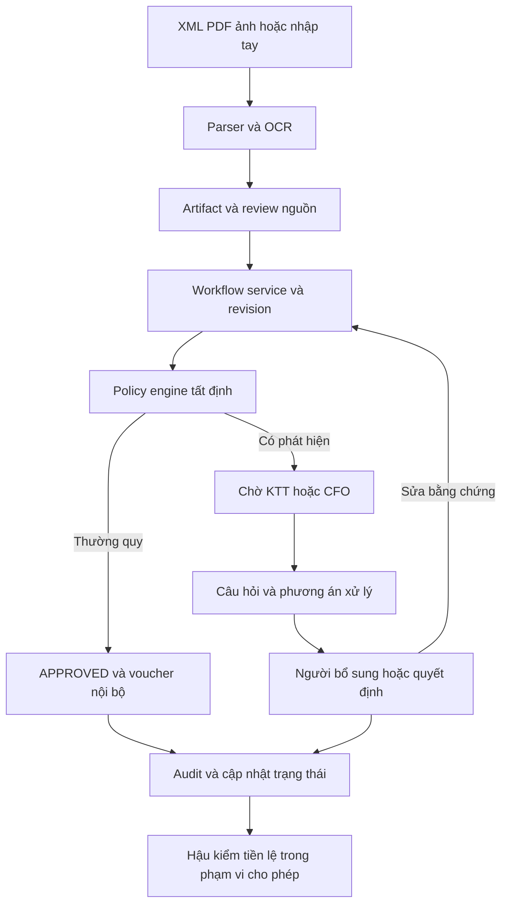

# Đánh giá và kế hoạch hoàn thiện Tax Referee theo câu A

Ngày rà soát: 10/10/2026. Mốc mã nguồn: `1045e3e` — `test: align precedent safety fixture with scoped policy`. Hạn khóa bài theo đề: 15/10/2026; Demo Day: 17/10/2026. Các lịch dưới đây dùng giờ Việt Nam.

## 1. Kết luận và phạm vi

Tax Referee đã có nền tảng vận hành khá đầy đủ cho **A — Bộ điều phối chuyển tiếp**: quy tắc tất định phân luồng, ba nhóm rủi ro, thường quy tự duyệt và tạo chứng từ nội bộ, phân quyền người xử lý, dừng/hoàn tác, lưu SQLite, audit, phản hồi hiệu chỉnh ngưỡng và Verify 4/5/15 ca. Không cần viết lại backend hoặc xây lại giao diện từ đầu.

**Chưa đủ cơ sở kết luận dự án đã hoàn thiện theo đề**, chủ yếu ở năm điểm:

1. Chưa có bằng chứng live URL công khai, Docker/Linux và toàn bộ đường tiếp nhận hoạt động đúng trên hạ tầng nộp bài.
2. Chưa có tập đánh giá độc lập đã khóa nhãn, số FN/FP độc lập hoặc bằng chứng thử với ít nhất ba người trực tiếp làm nghiệp vụ.
3. Trải nghiệm người xử lý còn thiên về kỹ thuật: sửa hồ sơ bằng JSON, đọc audit JSON, nhiều trạng thái tiếng Anh và câu hỏi chưa luôn đủ ngữ cảnh để trả lời ngay.
4. Quy chế, cấu hình, quy tắc chạy thật và tài liệu nộp bài có chỗ lệch nhau; một số claim cũ vẫn còn xuất hiện cạnh tài liệu mới đã đính chính.
5. Còn các khoảng trống cần kiểm chứng/hardening: OCR worker khi triển khai, kiểm thử chất lượng câu hỏi AI, kiểm thử policy theo kết quả nghiệp vụ, phục hồi tác vụ đang chạy và giới hạn tài nguyên demo.

Ưu tiên từ nay đến 15/10: **hoàn thiện một vòng công việc câu A, chứng minh nó chạy trên dữ liệu mới, và thu bằng chứng người thật**. Ngân hàng, TCT, ERP, dashboard thuế là phần hỗ trợ; không nên để chúng chiếm thời gian của ba việc này.

### Cách đọc trạng thái

- **Đã kiểm chứng local:** đã đọc mã và chạy kiểm tra trong lượt rà soát này.
- **Đã có triển khai:** thấy đường mã thực thi, nhưng không đồng nghĩa đã nghiệm thu trên live hoặc với người dùng thật.
- **Thiếu bằng chứng:** chưa tìm thấy bằng chứng phù hợp trong repository; không khẳng định hoạt động ngoài repository chưa từng xảy ra.
- **Rủi ro cần tái hiện:** suy ra từ đường mã/cấu hình, cần test mục tiêu trước khi gọi là lỗi runtime đã xác nhận.

### Phạm vi kiểm tra thực tế

- Đọc toàn bộ nội dung và các bảng trong `Challenge_Brief_OrganizationAI_VN.docx`, tập trung câu A, mục 3, 4, 5 và quy định bằng chứng.
- Đọc các đường chính trong `app`, `components`, `services`, `lib`, dữ liệu Verify, deployment, bộ đánh giá và báo cáo QA. Tra graph có sẵn để định vị; kết quả graph không đủ cho kết luận tuân thủ nên đối chiếu trực tiếp source.
- Đọc ảnh QA đã lưu `FIX-VERIFY-5.png`, `FIX-MOBILE-NAV.png` để bổ trợ đánh giá UI. Đây là ảnh từ vòng QA trước, không phải phiên browser mới của lượt này.
- Chạy lại TypeScript và acceptance với DB memory/thư mục dữ liệu tạm. Không dùng database nghiệp vụ, không gửi ảnh tới provider, không sửa UI/backend.
- Chưa chạy build mới, browser E2E mới, live URL, Docker/Linux, tài khoản/provider thật hoặc kiểm toán pháp lý toàn diện. Không dùng kết quả local để suy ra những phần này đã đạt.
- Kế hoạch này đánh giá độ khớp của sản phẩm với đề và với SOP do dự án công bố; không xác nhận nội dung pháp luật thuế trong SOP là chính xác. Phần nguồn luật cần nghiệp vụ kiểm tra riêng trước khi công bố.

## 2. Đối chiếu yêu cầu đề bài

Đề yêu cầu **ba bộ kiểm tra có vai trò khác nhau**: ít nhất 15 ca dữ liệu nội bộ; 5 ca câu A gồm 3 thường quy + 2 chuyển tiếp; và 4 ca chung của Verify có ít nhất một ca từ chối/chuyển tiếp. Tập độc lập Sprint 2 là yêu cầu riêng. Con số ít nhất 20 ca độc lập là quy ước hiện có của dự án/runner, không phải số lượng bắt buộc được câu A quy định.

| Yêu cầu | Hiện trạng có bằng chứng | Phần còn thiếu | Ưu tiên |
|---|---|---|---|
| Quy trình thường quy và tài liệu quy định rõ | Có SOP, cấu hình policy, luồng tiếp nhận → đánh giá → duyệt/chuyển tiếp | Đồng bộ SOP đọc được với rule chạy thật và phiên bản được audit | P0 |
| Tự động xử lý thường quy hoàn toàn | `evaluateWorkflow` ghi APPROVED, thuế được duyệt, voucher nội bộ, audit trong transaction; test đạt | Chứng minh trên URL công khai với đầu vào mới; không yêu cầu bấm duyệt bổ sung cho routine | P0 |
| Ít nhất 15 ca có ca không rõ, ngoài quy định, vượt quyền | `regression_15` đạt 15/15 | Giữ ma trận bao phủ, thêm ca biên và dữ liệu mới; không cộng ca trùng giữa các bộ | P1 |
| Ba nhóm không chắc chắn | Có `UNCERTAIN_INFO`, `OUT_OF_POLICY`, `EXCEED_AUTHORITY`; lưu nhiều findings | Hiển thị tiếng Việt, giải thích nhóm chính và rủi ro đồng thời; kiểm tra đúng nhóm trên tập độc lập | P1 |
| Câu hỏi cụ thể, trả lời được ngay | Có template A/B, câu hỏi kèm hóa đơn/số tiền ở nhiều nhánh; có Q-Gen | Chưa có chấm chất lượng độc lập; câu hỏi nguồn thiếu có thể chỉ yêu cầu đối chiếu nhiều trường; Q-Gen cần guard ngữ nghĩa | P0 |
| Không chuyển tiếp mọi ca | Bộ 5 đạt đúng 3 tự động/2 chuyển tiếp | Đo FP trên ca thường quy mới và đo mức hoàn tất thật, không chỉ phân loại | P0 |
| Không khẳng định trên dữ liệu nghi vấn | Source review phía server, chặn duyệt, giữ thuế 0, loại voucher; nhiều test đạt | Kiểm thử input/OCR lạ, câu giải thích AI, cách UI diễn đạt 0/chưa xác định và confidence | P0 |
| Verify câu A một thao tác, 90 giây | Có bộ 5, kết quả/timestamp/câu hỏi/người nhận; local đạt | Diễn tập trên live; hiển thị nhóm chuyển tiếp rõ hơn và điều hướng tới SOP/ngữ cảnh | P0 |
| Tự điều chỉnh ngưỡng từ feedback | Đã có backend và UI hậu kiểm; ≥10 ca, ngưỡng trong trần CFO, version, rollback; test đạt | Chứng minh thay đổi trên phản hồi thật; báo cáo trước/sau và scope rõ; kiểm tra safety gate với ngưỡng ứng viên | P0 |
| FN/FP trên tập độc lập | Có runner, từ chối dữ liệu chưa khóa/không đủ mẫu | `independent-labels.json` đang `AWAITING_HUMAN_LABELS`, `cases: []`; chưa có kết quả độc lập | P0 |
| ≥3 nhân sự thật và ≥1 cải tiến từ feedback | Có protocol và CSV mẫu | CSV đo lường/cải tiến chỉ có header; thiếu xác nhận gốc, đo trước/sau, feedback → commit → retest | P0 |
| Live URL không cần đăng ký | Landing có Verify và demo riêng từng phiên | Chưa có bằng chứng URL live được kiểm tra; domain trong Nginx là placeholder | P0 |
| 4 ca Verify chung + runbook | Bộ 4 đạt 4/4; có `docs/runbook-final.md` | `RUNBOOK.md` gốc và cheat sheet cũ lệch UI và số liệu; cần một hướng dẫn chuẩn | P0 |
| Public repo giữ lịch sử sprint | Có Git history local và URL repo trong README | Chưa kiểm tra anonymous access, bản remote và lịch sử đầy đủ; không squash/force-push | P0 |
| 5 slide, video ≤3 phút, build log một trang | Có PPTX 5-slide trong `docs/submission`, bản nội dung slide, build log và kịch bản video | Chưa thấy bản video thành phẩm trong danh sách file khảo sát; cần kiểm tra PPTX cuối, thời lượng video, claim và quyền truy cập | P0 |
| Người dùng biết ai làm gì, khi nào, dựa vào đâu | Có event/audit hash chain, revision, input, before/after, policy | Tóm tắt dễ hiểu, timestamp nhất quán, policy snapshot đúng evaluation; không gọi hash chain là Merkle | P1 |
| Dừng, ghi đè, hoàn tác | Có backend guard và controls; local test đạt cả kết quả đến muộn sau dừng | Diễn tập bằng người không biết code; làm rõ hoàn tác nội bộ không đảo giao dịch ERP bên ngoài | P0 |

### Liên hệ với thang điểm

Không nên tự chấm phần trăm hoàn thành hoặc dự báo điểm chỉ từ test pass. Các nhóm có rủi ro mất điểm lớn hiện nay:

- **Vận hành 40 điểm:** live, hai đầu vào mới, Verify 4 ca và slide/video. Live, Verify, public repo còn là ba điều kiện kiểm tra tuân thủ có thể khiến bài dừng trước chấm chuyên môn.
- **Người dùng thực tế 20 điểm:** hồ sơ hiện chưa chứng minh ba người thật, trích dẫn, cải tiến và tác động tiêu cực.
- **Human-in-the-loop và audit 20 điểm:** backend có nền tảng tốt; khả năng tự thao tác và đọc hiểu của giám khảo cần hoàn thiện.
- **Xác thực câu A 20 điểm:** vòng chung kết chấm phát hiện đúng 8 điểm, không chuyển tiếp thừa 6 điểm, chất lượng câu hỏi 6 điểm. Tối ưu tốc độ OCR đơn thuần không thay thế ba tiêu chí này.

## 3. Phần đã hoàn thành cần giữ lại

### 3.1. Kiến trúc đang có

- Next.js App Router + React + Tailwind/Radix; API và nghiệp vụ cùng repository.
- SQLite file, WAL và migrations đã có trong `lib/server/db.ts`. Kết luận “mọi dữ liệu chỉ nằm trên RAM” trong đánh giá Sprint 1 không còn đúng với mã hiện tại. Verify dùng DB memory để cách ly là chủ đích đúng.
- `services/jevService.ts` xác định local policy engine là thẩm quyền phân loại; AI hỗ trợ trích xuất và diễn đạt. Giữ nguyên ranh giới này.
- `services/workflowService.ts` tập trung transaction, revision/evaluation guard, dừng/tiếp tục, giữ thuế, hoàn tác và hiệu ứng voucher/macro.
- `services/feedbackService.ts` đã hiệu chỉnh ngưỡng, có ràng buộc scope/trần CFO và rollback. Không ghi thành “chưa có học từ phản hồi”.
- Các lỗi QA cũ về anonymous API, cách ly sao kê, JSON boolean, rollback import, CLOSED thiếu ngày, TCT contract, XML, signature UI… đã có sửa trong `FIX-REPORT.md` và nhiều kiểm tra lại đạt. Không đưa nguyên danh sách lỗi cũ thành backlog mở.

### 3.2. Kết quả chạy lại ngày 10/10

| Kiểm tra | Kết quả lượt này | Giới hạn diễn giải |
|---|---|---|
| `npm run typecheck` | PASS | Không thay thế build/browser |
| `test:manifest` qua `test:acceptance` | 4/4, 5/5, 15/15 | Hồi quy tổng hợp; các bộ có ca trùng |
| `test:workflow` | 20 kiểm tra đạt | Có pause, late result, idempotency, authority, feedback, rollback |
| `test:ai-fallback` | 2 kiểm tra đạt | Thiếu key/timeout mô phỏng; không đo chất lượng model thật |
| `test:review-regressions` | 4 kiểm tra đạt | Phiên demo/nội bộ và revision, legacy decisions |
| `test:qa` | 39 kiểm tra đạt | Mock provider; không chứng minh OCR độc lập |

`test:acceptance` kết thúc exit code 0. Log có lỗi Q-Gen giả lập phục vụ kiểm tra fallback/race; không phải thất bại suite. Không cộng các con số trên thành số mẫu độc lập, không suy ra FN/FP bằng 0 ngoài bộ hồi quy.

## 4. Khoảng trống cụ thể trong sản phẩm

### 4.1. Triển khai OCR chưa khớp cấu hình mặc định

**Bằng chứng:** `.env.example` chọn `DOCUMENT_IMAGE_ENGINE=local-ocr`, `LOCAL_OCR_URL=http://127.0.0.1:3004`; `services/receiptOcrService.ts` gọi worker `/ocr`. `compose.yaml` chỉ khai báo service `app`. Dockerfile cài PyMuPDF/Pillow/Poppler, chưa đóng gói worker RapidOCR và dependencies của `scripts/ocr/local-ocr/requirements.txt`.

**Kết luận:** gói triển khai hiện chưa tự cung cấp worker mà cấu hình mẫu yêu cầu. `127.0.0.1` trong container app cũng không trỏ tới worker chạy trên host hoặc container khác. Chưa chạy Docker trong lượt này nên không khẳng định toàn bộ upload chắc chắn thất bại; cần kiểm chứng fallback thật.

**Cần làm:** chọn duy nhất một profile triển khai cho bài nộp. Nếu giữ OCR local, thêm container worker, dùng DNS nội bộ `http://ocr:3004`, bind worker trong container phù hợp và chỉ mở private network; đóng gói model, warm-up/readiness. Nếu dùng Vision từ xa, công bố profile đó, key server và phương án khi provider lỗi. Không dùng tốc độ local macOS để quảng bá latency Linux/live.

### 4.2. SOP và quy tắc chạy thật chưa có một nguồn nhất quán

**Bằng chứng:** seed policy trong `lib/server/db.ts` có `policyText: ''`, `rules: []`; modal rơi về `data/sopText.ts`. `policyEngine.ts` chạy logic TypeScript + config, không biến văn bản SOP sửa tự do thành rule. SOP Điều 3.3 mô tả một số loại giao dịch từ 200 triệu, còn engine tính `isExceedKtt` theo trị tuyệt đối tổng tiền và tạo findings thẩm quyền. Phần chi tiếp khách trong SOP diễn đạt cấm, trong khi engine có `INTERNAL_POLICY_GUEST_ENTERTAINMENT` và tiền lệ có giới hạn.

**Tác động:** giám khảo xây ca mới dựa trên SOP có thể kỳ vọng khác chương trình. Sửa text và publish không chứng minh hành vi đã thay đổi tương ứng.

**Cần làm:** nghiệp vụ chốt từng điều khoản; tách quy chế nội bộ, điều kiện dữ liệu và quy tắc có căn cứ pháp lý. Tạo bảng `điều SOP → ruleId → điều kiện → nhóm → người nhận → phương án → test`. Hiển thị tham số thực thi từ config; ghi rõ text mô tả không tự sửa logic. Quy tắc chưa xác minh nguồn phải đánh dấu giới hạn, không công bố như kết luận luật đã xác nhận.

### 4.3. Gate publish policy mới đang kiểm tra hình dạng, chưa kiểm tra đúng nghiệp vụ

**Bằng chứng:** `validatePolicyBundle` chạy tối đa 200 hóa đơn hiện có và kiểm tra `RefereeDecisionSchema`; không đối chiếu nhãn kỳ vọng hay mức thay đổi FN/FP. Không có hóa đơn thì báo lỗi; hóa đơn có quyết định sai nhưng đúng schema vẫn không bị phát hiện bởi gate này.

**Cần làm:** dùng bộ safety/regression cố định có expected outcomes để chặn policy làm mất guard; thêm dry-run so sánh policy cũ/mới và giải thích hồ sơ đổi nhóm. Không dùng holdout độc lập làm dữ liệu tinh chỉnh policy. Chỉ publish sau gate và ghi version/hash vào audit.

### 4.4. Chất lượng câu hỏi chuyển tiếp cần được nghiệm thu riêng

**Bằng chứng:** engine có nhiều template cụ thể và bước thay đuôi câu chung bằng options. Tuy nhiên `RULE_SOURCE_REVIEW` trong workflow gom các trường chưa xác minh thành một câu yêu cầu đối chiếu; kết quả dựa trên primary finding có thể chưa dẫn người dùng giải quyết hết nhiều findings. Trong `jevService.ts`, Q-Gen được thay trực tiếp `plainExplanation` và `actionableQuestion` sau validate schema, dù status/options vẫn khóa theo rule.

**Rủi ro:** backend không cho duyệt sai nhưng câu chữ có thể thiếu ngữ cảnh, sai người nhận, thêm số tiền không có nguồn hoặc gây hiểu nhầm rằng đã đủ điều kiện. Schema string hợp lệ không chứng minh nội dung phù hợp.

**Cần làm:** xây question contract và rubric ba mức theo đề; dùng template làm fallback; test Q-Gen sai số tiền, thiếu findings, đề nghị hành động ngoài options và prompt injection trong nội dung hóa đơn. Thất bại guard chỉ thay câu diễn đạt bằng template, không làm mất quyết định an toàn.

### 4.5. Bổ sung dữ liệu vẫn bắt người dùng sửa JSON

**Bằng chứng:** `WorkflowControls.tsx` có textarea toàn bộ invoice; khi xác nhận, gửi `confirmedFields` bằng toàn bộ `item.review.unresolvedFields` cùng một lý do chung.

**Tác động UI:** KTT/CFO phải biết tên field và JSON; dễ xác nhận hàng loạt mà chưa xem từng nguồn. Backend vẫn có guard, nhưng tương tác chưa thể hiện đầy đủ trách nhiệm xác minh từng trường.

**Cần làm:** form có kiểu dữ liệu, chỉ rõ trường thiếu/nghi vấn; cho sửa từng trường, xem nguồn, đánh dấu xác nhận riêng và nhập nguồn bằng chứng. JSON chuyển vào “Nâng cao”. Gửi đúng các trường người dùng xác nhận, giữ unresolved cho phần còn lại, chạy lại toàn bộ rules sau sửa.

### 4.6. Audit đầy đủ về dữ liệu nhưng khó đọc, một số nhãn còn suy diễn

**Bằng chứng:** `WorkflowAuditHistory.tsx` hiển thị event type, actor ID và payload JSON. Bảng tổng hợp trong `ProductionWorkspace.tsx` có fallback actor theo nhóm, `canOverride: true`, `taxDefenseDossierReady: true` và căn cứ mặc định. Đây là giá trị UI, không đủ để chứng minh quyền hay artifact thật. `recordAction` đọc policy đang active khi ghi event, trong khi evaluation bắt đầu đã chụp policy trước đó.

**Cần làm:** timeline tiếng Việt, actor/role từ event thật, diff trước/sau theo field, link artifact, liên kết evaluation và policy snapshot. Quyền/hồ sơ sẵn sàng lấy từ backend. Kiểm tra race đổi policy trong lúc Q-Gen chờ để audit không gắn nhầm policy. Gọi đúng cơ chế “chuỗi hash audit”; không tuyên bố chống sửa tuyệt đối hoặc Merkle tree.

### 4.7. Các vấn đề UI nhỏ nhưng tác động trực tiếp tới điều phối

- **SLA quay vòng:** `renderSlaBadge` dùng `24 - (elapsedHours % 24)`. Hồ sơ quá 24 giờ có thể hiện lại “còn giờ”. Sửa dùng deadline cố định, hiển thị “quá hạn”, lưu thời điểm chuyển tiếp có nghĩa nghiệp vụ. Đây là lỗi công thức xác định được từ source; SLA 24h là quy ước sản phẩm, không phải yêu cầu đề.
- **Tên trạng thái chưa phân biệt rõ:** `APPROVED` hiển thị chung “Đã tự xử lý / phê duyệt”; cần phân biệt auto-approved và human-approved qua actor/event. `PAUSED`, `ON_HOLD` cần diễn giải khác nhau.
- **Verify thiếu cột nhóm rủi ro trong bảng chính:** backend trả `riskGroup`, nhưng `Item`/table hiện chưa hiển thị trường này. Thêm ba nhãn tiếng Việt, không chỉ ROUTINE/ESCALATED.
- **Căn cứ hardcode:** `app/verify/page.tsx` dùng câu căn cứ cố định cho ROUTINE; lấy từ decision/policy thay vì template không gắn với evaluation.
- **Công cụ mở rộng có thông điệp không đồng nhất:** đã có banner nói demo/adapter, nhưng nội dung bên trong vẫn có câu như “đối soát cổng thuế” dễ bị hiểu là đã nối trực tiếp. Đồng bộ copy ngay tại CTA/kết quả.
- **Loading và empty gộp:** audit dùng “Chưa có sự kiện hoặc đang tải”; tách trạng thái loading, empty, error và nút thử lại.
- **Tính bảo trì:** Workspace 1.434 dòng, InputForm 1.915 dòng, PolicyViewer 835 dòng. Tách đúng các phần đang sửa; không refactor toàn bộ trước hạn.

### 4.8. Hiệu chỉnh ngưỡng có sẵn nhưng chưa được chứng minh ở vận hành

**Bằng chứng:** service tính candidate từ ≥10 feedback, giảm chuyển tiếp thừa với không bỏ sót trên chính feedback, không vượt trần; có version/audit/rollback. UI đã gửi hậu kiểm và rollback. Gate an toàn hiện chạy các probe qua `evaluateInvoiceLocally` trước khi ghi `best.threshold`; lời gọi probe không truyền candidate threshold như một candidate policy riêng.

**Cần làm:** chấm candidate trong môi trường cách ly đã cài ngưỡng đề xuất, chứng minh nó không giải tỏa DATA_QUALITY/STATUTORY/AUTHORITY; mở rộng ca sát ngưỡng, khác NCC, khác mục đích, hết hạn và đa phát hiện. Hiển thị rõ số mẫu, ngưỡng cũ/mới, phạm vi, thời điểm và vì sao đổi/không đổi. Tách feedback hiệu chỉnh khỏi tập độc lập cuối.

### 4.9. Phục hồi và kiểm soát tài nguyên chưa được nghiệm thu đủ

- Đường lỗi thông thường đã chuyển `EVALUATING` về `ON_HOLD`, nhưng chưa thấy lease/recovery tự động cho tác vụ bị kill process giữa chừng. Sau restart, guard có thể tiếp tục chặn hồ sơ còn EVALUATING. Đây là rủi ro cần test kill giữa tác vụ; recovery test giữ dữ liệu đã hoàn tất không đủ thay thế.
- PDF và Apple Vision helper còn dùng `execSync`; cần đo ảnh hưởng khi nhiều request đồng thời trước khi tối ưu. Worker OCR cũng serialize inference. Không hứa throughput dựa trên phép đo một ảnh.
- Demo có hạn cookie/cache, nhưng tài liệu xác nhận còn cần dọn DB/artifact hết hạn. Bổ sung cleanup theo retention, quota upload/demo và theo dõi dung lượng.
- QA fix report nêu chưa migrate dữ liệu cũ có boolean dạng số. Chỉ cần migration nếu giữ dữ liệu từ bản cũ; không tự sửa/xóa dữ liệu thật. Backup → dry-run → migrate → xác minh counts/hash trước khi dùng lại.

### 4.10. Tài liệu cũ vẫn có claim không được bằng chứng hiện hành hỗ trợ

`RUNBOOK.md` còn tên nút/tab cũ, số FN/FP/STP của bộ 42 ca và bảng tự gán điểm. `docs/judge-cheat-sheet-8-mins.md` còn ví dụ ba nhân sự có tên, trong khi protocol mới cấm dùng tên/trích dẫn brainstorming làm chứng cứ. README có cảnh báo đầu trang nhưng phần dưới vẫn giữ nhiều nội dung cũ.

**Cần làm:** chọn `docs/runbook-final.md` làm nguồn chuẩn rồi cập nhật/đánh dấu tài liệu lịch sử. Kiểm tra lại PPTX, không chỉ Markdown slide. Tách “hồi quy tổng hợp”, “ảnh thật công khai”, “dữ liệu doanh nghiệp được phép dùng”, “holdout độc lập” và “người dùng thật”. Ảnh lấy từ Internet không chứng minh có thử nghiệm nhân sự nghiệp vụ.

## 5. Thiết kế UI mục tiêu

Giữ nền giao diện hiện tại: bề mặt sáng, chữ rõ, số tiền canh phải/tabular, một bộ icon. Ưu tiên thứ tự thông tin, trạng thái và khả năng thao tác; chưa cần đổi bộ nhận diện, thêm animation hoặc làm dashboard mới.

### 5.1. Trang đầu và Verify

- Giữ hai CTA đang có: **Chạy Verify** và **Thử dữ liệu mới**.
- Mở SOP tóm tắt trực tiếp từ landing/Verify: phạm vi, trường bắt buộc, ba lý do dừng, ma trận thẩm quyền, version. Giám khảo không cần tạo hồ sơ để đọc quy định.
- Verify cung cấp hai nút dễ thấy “4 ca chung” và “5 ca chuyển tiếp”; có thể giữ select 15 ca trong phần nâng cao. Mỗi nút chạy cả bộ bằng một thao tác.
- Bảng: ca → kỳ vọng → thực tế → nhóm chuyển tiếp → người nhận → workflow/voucher/audit → PASS/FAIL. Câu hỏi đặt ngay dưới ca, không giấu sau JSON.
- Timestamp/run ID/version/hash và nguồn tổng hợp hiển thị rõ. Nút tải JSON/CSV kết quả giúp tái lập; không hiện số liệu độc lập khi chưa có báo cáo độc lập.
- Form input mới dùng chung schema với Workspace, nói rõ MST người mua/policy đang thử. JSON vẫn có cho giám khảo kỹ thuật; lỗi input hiển thị theo field.

### 5.2. Tiếp nhận và kiểm tra nguồn

Luồng bốn bước nhẹ: **Chọn chứng từ → Kiểm tra dữ liệu → Chạy phân luồng → Xem kết quả**.

- Desktop: chứng từ gốc bên trái, trường dữ liệu bên phải. Mobile: hai tab “Chứng từ”/“Dữ liệu”, giữ kết quả nghi vấn và CTA chính dễ tìm.
- Mỗi trường có nhãn “Đọc từ nguồn”, “Chưa xác minh” hoặc “Đã được người dùng xác nhận”; không dùng cùng một màu xanh cho OCR candidate và dữ kiện được xác nhận.
- Khi thiếu tiền/thuế/MST, hiển thị “Chưa xác định”; không trình bày placeholder 0 như số liệu thật.
- Xác nhận từng trường kèm lý do/nguồn, không mặc định tick. Hiển thị còn bao nhiêu trường chưa được giải quyết.
- Trạng thái xử lý nói đúng bước: đang tải, đang đọc, cần bổ sung, đã phân luồng. Timeout cho phép retry, đổi file hoặc nhập tay, giữ dữ liệu đã nhập.
- Lỗi form có summary liên kết tới field và lỗi inline; sau submit lỗi, focus tới summary. Thông báo không chỉ bằng toast/màu.

### 5.3. Inbox điều phối

- Hàng chính: số hóa đơn, nhà cung cấp, tiền, trạng thái, nhóm chính, người/role cần xử lý, thời gian chờ.
- Bộ lọc trọng tâm: cần tôi xử lý, thiếu thông tin, ngoài quy định, vượt quyền, đang dừng, đã hoàn tất. “Tất cả” và mở rộng đặt sau.
- Tách hiển thị tự xử lý và được con người phê duyệt; thường quy đủ dữ liệu kết thúc ngay, không thêm bước bulk confirm bắt buộc.
- SLA đúng deadline; cần người phụ trách thì lấy ownership thật, không suy từ người đang đăng nhập.
- Sau 409 stale revision: thông báo hồ sơ đã đổi, tải bản mới và cho xem diff. Không tự gửi lại quyết định cũ.

### 5.4. Màn hình xử lý ngoại lệ

Thứ tự thông tin bắt buộc:

1. Hóa đơn nào, số tiền, dữ liệu nào chưa chắc chắn.
2. Vì sao dừng, điều SOP tương ứng và người có quyền xử lý.
3. Câu hỏi cụ thể và câu trả lời có cấu trúc.
4. Các phát hiện đồng thời, phần đã xử lý/phần còn mở.
5. Hành động và tác động sau khi chọn: chờ bổ sung, chạy lại, từ chối hay duyệt nội bộ.

Ví dụ cấu trúc câu hỏi, không phải dữ liệu thật: “HĐ X có tổng tiền đọc được A, trong khi bảng dòng hàng là B. Anh/chị xác nhận A hay B từ chứng từ gốc, hoặc yêu cầu người nộp gửi lại ảnh rõ hơn?” Chỉ nêu A/B khi cả hai candidate có bằng chứng; không bịa hai lựa chọn để đạt format.

- Nhóm chưa rõ thông tin: input sửa/đính kèm nguồn, không chỉ nút “đồng ý”.
- Nhóm ngoài quy định: điều khoản, lý do, phương án thực thi được; phân biệt ngoại lệ nội bộ có thể được cấp quyền và ràng buộc không thể bỏ qua.
- Nhóm vượt quyền: gửi đúng cấp; KTT không thấy CTA duyệt có vẻ khả dụng khi server sẽ từ chối.
- Dừng/tiếp tục/hoàn tác có lý do và mô tả hiệu ứng. Nút hoàn tác nêu thao tác sắp đảo, không dùng tên chung khiến người dùng đoán.

### 5.5. Audit và hậu kiểm

- Timeline tóm tắt: **Ai — làm gì — lúc nào — căn cứ nào — thay đổi gì**.
- Diff trước/sau hiển thị số tiền, trạng thái, thuế được duyệt, voucher; dữ liệu thô trong phần nâng cao.
- Thấy rõ một sự kiện hoàn tác tham chiếu sự kiện gốc nào. Có link chứng từ và policy/evaluation tương ứng.
- Hậu kiểm hiển thị tiền lệ phù hợp với hồ sơ, tiến độ đủ mẫu, biểu đồ/bảng nhỏ ngưỡng trước/sau và lịch sử rollback. Không quảng bá “AI tự học chính xác hơn” chỉ vì thu thập đủ 10 phản hồi.

### 5.6. Tiêu chí UI dùng để nghiệm thu

Các ngưỡng này là mục tiêu nội bộ đề xuất, không phải số liệu đã đạt:

- Người mới tìm được Verify/SOP/nhập mới trong 30 giây, không cần hướng dẫn miệng.
- Verify câu A và đọc được kết quả trong 90 giây trên live; toàn kịch bản sơ loại trong 8 phút.
- Người làm nghiệp vụ trả lời được câu hỏi trong một lượt đối với ca đã đủ bằng chứng; không buộc họ hiểu JSON.
- Thử viewport 375, 768, 1366px; bảng rộng cuộn trong vùng bảng, không làm trang tràn ngang.
- Keyboard qua upload/form/modal/duyệt/audit; Escape đóng modal và trả focus; trạng thái disabled giải thích được; nội dung không phụ thuộc màu.
- Đo tương phản chữ thường ≥4,5:1, focus nhìn thấy, nút icon có tên; hỗ trợ reduced motion. Không suy ra đạt accessibility chỉ từ thư viện Radix.

## 6. Kế hoạch backend và hợp đồng dữ liệu

### 6.1. Giữ kiến trúc hiện có, bổ sung đúng điểm thiếu

- Giữ Next.js + SQLite persistent volume + workflow service + policy engine. Chưa cần chuyển PostgreSQL/microservices chỉ để đáp ứng đề.
- Tất cả hành động thay trạng thái tiếp tục đi qua workflow; giữ transaction, revision/evaluation guard và quyền server.
- Routine hoàn tất ở **chứng từ nội bộ**. ERP hiện là export payload; ghi rõ đầu ra này trong SOP và Slide 2, không gọi là đã hạch toán hệ thống bên ngoài.
- Không thay luật bằng LLM. Không tự nới thẩm quyền hoặc loại bỏ nguồn nghi vấn khi hiệu chỉnh ngưỡng.

### 6.2. Hợp đồng đề xuất

Đây là phần cần bổ sung dần vào schema hiện tại, không phải tất cả đều là field đang có:

| Thành phần | Dữ liệu cần có | Quy tắc |
|---|---|---|
| Xác nhận nguồn | `field`, `originalValue`, `confirmedValue`, `artifactId`, `evidence`, `confirmedBy`, `confirmedAt` | Xác nhận riêng từng trường; sửa giá trị làm mất hiệu lực xác nhận cũ |
| Evaluation | revision, policy version/hash, engine version, findings, question version, nguồn trích xuất | Snapshot bất biến tại thời điểm đánh giá; kết quả cũ không áp cho revision mới |
| Câu hỏi | summary, recipientRole, requiredFields, options, evidenceRefs | Chỉ dùng dữ kiện có nguồn; khớp quyền và findings; fallback khi Q-Gen vi phạm |
| Workflow response | status, revision, evaluationId, allowedActions, blockedReason, voucherId | UI dùng cùng contract; không suy lại quyền phía client |
| Audit presentation | actor/role, event label, before/after diff, evaluation/policy references | Trình bày từ event thật; raw payload vẫn giữ |
| Tác vụ đang chạy | attempt ID, startedAt, deadline/lease, revision | Kết quả muộn/attempt cũ bị bỏ; recovery về trạng thái an toàn |
| Hiệu chỉnh | scope/version, candidate threshold, sample IDs, safety result, old/new metrics | Không dùng holdout để chọn ngưỡng; lưu đủ để rollback và giải thích |

### 6.3. API và phần việc cụ thể

| API/module | Việc cần hoàn thiện | Điều kiện chấp nhận |
|---|---|---|
| `/api/evaluate`, `workflowService` | Form xác nhận theo field, evidence, stale conflict; snapshot policy khi ghi audit | Field chưa xác minh vẫn chặn; dữ liệu sửa chạy lại tất cả findings |
| `/api/invoices/[id]/audit-action` | Trả target của undo, effect summary; giữ role guard | UI và server đồng ý về tác động; gửi lặp/stale không lặp hiệu ứng |
| `/api/audit`, `audit.ts` | Presentation DTO và các link nguồn/version | Truy được input, người, thời gian, lý do, before/after của một quyết định bất kỳ |
| `/api/verify`, `verificationService` | Risk group, run ID, error count/rate, export kết quả; validate mode | Bảng chung 4 ca và bộ A 5 ca riêng biệt, timestamp thật, ERROR không bị coi PASS |
| `policyService` | Regression gate nghiệp vụ, diff policy, nguồn SOP thực thi | Policy đúng schema nhưng làm lọt ca nguy hiểm bị chặn publish |
| `feedbackService`, `/api/feedback` | Candidate validation cách ly; DTO trạng thái hiệu chỉnh và idempotent feedback | Retry không tạo feedback lặp; rollback có version/audit; ranh giới an toàn giữ nguyên |
| `documents/parse`, OCR worker | Profile deployment đầy đủ, health/readiness, timeout/fallback, metadata engine | XML/PDF/ảnh mới đều có đầu ra hợp lý; provider/worker lỗi không sinh dữ kiện chắc chắn |
| Demo/session/storage | Retention, quota, cleanup có dry-run; health theo dependency | Không đọc chéo phiên, không xóa phiên còn hoạt động; live không đầy disk sau nhiều lượt thử |

### 6.4. Kiểm soát chất lượng và khả năng phục hồi

- Chạy timeout tổng của request với budget riêng cho OCR/Q-Gen; Q-Gen là phụ trợ nên không giữ UI chờ quá lâu khi template đã đủ.
- Nếu process chết giữa EVALUATING, recovery đánh dấu attempt hết hạn thành ON_HOLD, ghi audit và cho retry. Không tự duyệt khi chưa biết kết quả.
- Thử 3–5 phiên đồng thời trên cấu hình demo để phát hiện blocking/queue; đo thời gian chờ riêng, tỷ lệ lỗi, p50/p95. Đây là phép thử mục tiêu, không phải cam kết tải doanh nghiệp.
- Mọi public endpoint có giới hạn body/file, timeout và rate limit ở đường deploy thực. Kiểm thử Nginx quota trong tình huống hai giám khảo chung IP; không để polling gây 429 hàng loạt.
- Health phân biệt web còn sống và OCR sẵn sàng; log request/run ID, error code, thời gian, model/profile không chứa API key hoặc raw chứng từ nhạy cảm.
- Backup/restore gồm DB, WAL và artifact; thử trên volume riêng. Dữ liệu demo và dữ liệu nội bộ luôn cách ly.

## 7. Kế hoạch dữ liệu độc lập và thử nghiệm người dùng

### 7.1. Tập độc lập

1. Chốt policy dùng để chấm trước khi gán nhãn cuối; tách development fixtures, feedback hiệu chỉnh và holdout.
2. Chuẩn bị **ít nhất 20 ca** theo runner hiện có; đề xuất 10 thường quy và 10 chuyển tiếp, bao phủ cả ba nhóm cùng một số ca đa phát hiện. Con số này phục vụ khả năng thực hiện trong thời gian còn lại, không đủ để khẳng định chất lượng trên toàn ngành.
3. Không lấy nguyên ca Verify/hồi quy rồi đổi ID để gọi độc lập. Có ca mới do người nghiệp vụ tự đặt theo SOP; dùng dữ liệu ẩn danh được phép hoặc tổng hợp và ghi rõ nguồn.
4. Người nghiệp vụ gán `expectedStatus`, `expectedRiskGroup`, `expectedRequiresCFO`, lý do và ngày trước khi chạy; đối chiếu bất đồng nếu có. Khóa file/hash và policy/commit.
5. Chạy `evaluate:independent`; ghi tất cả ca, kể cả ERROR. Runner hiện chấm policy/workflow với `forceLocalOnly`, chưa chấm OCR hoặc chất lượng Q-Gen: cần hai phép đánh giá riêng cho những phần đó.
6. Nếu sửa policy theo lỗi holdout, chuyển tập đó thành regression và dùng tập mới cho tuyên bố độc lập tiếp theo; giữ báo cáo cũ.

| Chỉ số | Cách tính/báo cáo |
|---|---|
| FN | Số ca cần chuyển tiếp nhưng bị tự xử lý / tổng ca cần chuyển tiếp |
| FP | Số ca thường quy bị chuyển tiếp / tổng ca thường quy |
| Đúng nhóm | Số ca chuyển tiếp đúng nhóm / tổng ca có nhãn chuyển tiếp; kèm confusion matrix |
| Đúng người nhận | Số ca chọn đúng KTT/CFO / tổng ca chuyển tiếp |
| Error rate | Số ERROR / toàn tập; báo riêng, không giấu bằng FN/FP thấp |
| Hoàn tất routine | Routine đúng và APPROVED, có voucher/audit / tổng routine kỳ vọng |
| STP | Hồ sơ thực sự tự hoàn tất / toàn bộ hồ sơ; không tráo với routine completion |
| Câu hỏi | Mức 0: chung chung; 1: cụ thể nhưng cần tra cứu thêm; 2: đủ để trả lời ngay; báo số ca từng mức |
| OCR | Đúng theo field trên field có ground truth; báo field thiếu/bịa, tỷ lệ cần người sửa và latency cold/cache riêng |

Mục tiêu release nội bộ: không có FN hoặc tự duyệt dữ liệu bị gắn cờ trên bộ acceptance/holdout; công bố FP và mọi ca không đạt trung thực. FN quan sát 0 trên mẫu nhỏ không đồng nghĩa rủi ro thực tế bằng 0. Nếu không đạt, giữ ca thất bại, sửa guard và đánh giá lại đúng quy trình.

### 7.2. Ba người dùng thực tế

- Tuyển ba người đang trực tiếp làm quy trình kế toán/kiểm tra chứng từ; không dùng ba tài khoản demo hay thành viên đội đóng vai thay cho ba nhân sự thật.
- Ghi danh tính, chức danh, đơn vị, vai trò công việc và đồng thuận. Xác nhận do chính người tham gia viết; giữ bản gốc an toàn, bản công khai ẩn thông tin theo sự đồng ý, cung cấp bản đủ danh tính cho BTC qua kênh phù hợp khi cần xác thực.
- Mỗi người dự kiến 45–60 phút: làm quen, baseline không dùng hệ thống, tác vụ có hệ thống và phỏng vấn. Dùng hai bộ tương đương, đảo thứ tự AB/BA; thời gian onboarding ghi riêng.
- Tác vụ: thường quy; thiếu dữ liệu; ngoài quy định; vượt quyền; bổ sung và đánh giá lại; dừng/hoàn tác và tìm audit. Có thể ghép các thao tác vào cùng hồ sơ để không quá tải.
- Đo thời gian chủ động, chờ, lỗi nghiệp vụ, số thao tác, số lần phải xem nguồn/hỏi đồng nghiệp; giữ raw observations và số mẫu.
- Hỏi về áp lực xử lý hàng đợi, xu hướng tin gợi ý AI, công việc xác minh mới phát sinh, lúc nào vẫn muốn trao đổi với đồng nghiệp. Báo ít nhất một bất cập thật, không tạo lời phê bình giả để đủ checklist.
- Chọn ít nhất một feedback có ID → issue → thay đổi code/UI → commit → ảnh trước/sau → người tham gia thử lại. Không gắn ngược feedback cho một tính năng đã làm từ trước.

### 7.3. Bộ bằng chứng cuối

Giữ các file hiện có và điền dữ liệu thật vào `measurements.csv`, `improvement-trace.csv`; lưu nhãn/báo cáo độc lập có version; thêm manifest bằng chứng gồm ngày, commit, policy, nguồn mẫu, người xác nhận và đường dẫn. Tách thư mục tài liệu riêng tư khỏi public repo. Số liệu Slide 3 phải truy ngược được tới phép đo; Slide 5 lấy giới hạn từ lỗi/bất cập đã quan sát.

## 8. Backlog có thể giao việc

P0 = cần trước khóa bài vì ảnh hưởng tuân thủ, an toàn hoặc bằng chứng cốt lõi. P1 = cải thiện chất lượng, thực hiện sau P0 hoặc khi feedback xác nhận quan trọng. P2 = sau cuộc thi. Ước lượng là giờ công tập trung, chưa tính thời gian đợi hạ tầng/người dùng; không phải thời gian đã thực hiện.

| ID | Ưu tiên | Hạng mục và nơi sửa chính | Phụ thuộc | Phụ trách đề xuất | Giờ | Nghiệm thu |
|---|---|---|---|---|---:|---|
| A01 | P0 | Chuẩn hóa SOP/rule mapping: `data/sopText.ts`, `policyEngine`, policy seed/modal | Nghiệp vụ chốt phạm vi | Backend + nghiệp vụ | 4–6 | Mỗi rule chính có điều SOP/test; sửa text không giả vờ đổi rule |
| A02 | P0 | Gói live/worker: Dockerfile, Compose, env, runbook | Hạ tầng/domain; chọn OCR profile | Backend/DevOps | 6–8 | HTTPS, demo/Verify/3 định dạng, health, restart/restore đạt |
| A03 | P0 | Form bổ sung theo field thay JSON chính: `WorkflowControls`, `/api/evaluate`, schemas | A01 | UI + backend | 6–8 | Xác nhận từng trường, stale 409, chưa đủ nguồn vẫn giữ hồ sơ |
| A04 | P0 | Contract câu hỏi + Q-Gen guard + ca đa findings | A01 | Backend + nghiệp vụ | 4–6 | Câu hỏi khớp số tiền/người nhận/options; lỗi AI fallback an toàn |
| A05 | P0 | Verify hiển thị nhóm, export, input mới/SOP | A01 | UI | 3–4 | 4/5/15 đúng; ca mới không cần JSON; 90 giây trên live |
| A06 | P0 | Timeline audit, quyền/nhãn từ dữ liệu thật, policy snapshot | A03 | UI + backend | 4–6 | Người mới tìm được ai/lý do/input/effect; undo truy về event gốc |
| A07 | P0 | Candidate threshold validation và trạng thái hậu kiểm | A01 | Backend | 4–6 | ≥10 feedback đổi ngưỡng có scope; holdout tách biệt; rollback đúng |
| A08 | P0 | Nhãn độc lập, runner metadata/rubric và báo cáo | A01; model/policy được khóa | Nghiệp vụ + QA | 5–7 | ≥20 ca mới, hash, FN/FP/ERROR, đúng nhóm và câu hỏi |
| A09 | P0 | Ba người dùng, đo trước/sau, xác nhận gốc | Đặt lịch ngay; A02/A03 cho phiên cuối | Nghiệp vụ + QA | 6–8 | 3 người đúng vai trò; raw measurements; ít nhất một bất cập |
| A10 | P0 | Triển khai cải tiến từ feedback + retest | A09 | Người sở hữu phần bị phản hồi | 3–5 | Feedback → commit → trước/sau → xác nhận retest |
| A11 | P0 | Tái hiện kill giữa EVALUATING, phục hồi an toàn; kiểm tra quota/retention demo | A02 | Backend/QA | 3–5 | Không tự duyệt sau restart; retry được; disk/demo được giới hạn |
| A12 | P0 | Đồng bộ runbook/README/cheat sheet/slide, video/build log | A08–A10; A02 | QA + người trình bày | 5–7 | Đủ 6 hạng mục, đúng 5 slide, video ≤180s, không claim thiếu nguồn |
| A13 | P0 | Clone sạch, E2E desktop/mobile/keyboard, diễn tập live 8 phút và 5 ca mới | A02–A07, A11 | QA + một người chưa biết code | 5–7 | Không trợ giúp dev; đủ bằng chứng và lỗi còn lại được công bố |
| A14 | P1 | Sửa SLA, nhãn trạng thái, loading/error/empty, overflow | Có thể ghép A03/A06 | UI | 2–3 | Không quay vòng SLA; keyboard/focus và trạng thái nhất quán |
| A15 | P1 | Đo tải 3–5 phiên, async subprocess nếu cần, tối ưu câu query/polling | A02; sau ổn định | Backend | 3–5 | Đo được p95/lỗi; không tối ưu làm mất dữ kiện OCR |
| A16 | P1 | Tách component/hook đúng phần đang sửa, giảm `any` ở contract | A03/A06 | UI + backend | 3–5 | Không đổi hành vi; typecheck/acceptance giữ nguyên |
| A17 | P2 | ERP/bank/TCT trực tiếp, ký số thật, tự cập nhật luật, đa tenant lớn | Sau khóa bài | Nhóm sản phẩm | Tách kế hoạch | Có đối tác/API/nghiệp vụ và kiểm thử riêng |

Tổng A01–A13 khoảng **58–83 giờ công**; A14–A16 thêm 8–13 giờ. Giả định ít nhất hai người có thể đóng góp tập trung trong 5 ngày còn lại và một người hỗ trợ nghiệp vụ/QA. Nếu chỉ có một người phát triển, bỏ A15/A16, giảm trang hậu kiểm thành bảng đơn giản, chỉ làm timeline tối thiểu; không cắt live, bằng chứng ba người dùng, tập độc lập, guard nguồn và video. A10 có giờ dự phòng vì chưa biết phản hồi thật là gì.

## 9. Lịch thực hiện tới ngày khóa bài

| Ngày | UI | Backend/triển khai | Nghiệp vụ/QA và bằng chứng | Cổng hoàn thành cuối ngày |
|---|---|---|---|---|
| 10/10 | Chốt flow, form field và timeline tối thiểu | A01; chọn profile OCR; bắt đầu A02 | Liên hệ/đặt lịch 3 người; chuẩn bị hai bộ tác vụ; bắt đầu gán nhãn | Phạm vi/SOP thống nhất; có đầu mối hạ tầng và lịch thử người |
| 11/10 | A03, A05 | A02, A04; hợp đồng source confirmation | Test URL từ máy khác, kiểm input mới; khóa hướng dẫn gán nhãn | Luồng thường quy/ngoại lệ chạy trên HTTPS; form sửa không cần JSON |
| 12/10 | A06; sửa SLA/copy dễ gây nhầm | A07; policy/audit version; bắt đầu A11 | Phiên thử người 1–2; ghi feedback; không dùng holdout để sửa | Có feedback thật, audit đọc được, điều chỉnh ngưỡng có kiểm soát |
| 13/10 | A10 theo feedback; hoàn thiện lỗi form/a11y | Sửa vấn đề từ test; khóa candidate để đánh giá | Phiên thử người 3; chạy holdout sau khóa; retest cải tiến | Đủ 3 người, ít nhất 1 cải tiến, báo cáo độc lập hoặc công bố rõ phần chưa đạt |
| 14/10 | Chỉ sửa lỗi chặn nghiệm thu | A13, restart/restore, kill giữa tác vụ, release candidate | Chạy 8 phút và 5 ca mới; ghi video; cập nhật PPTX/build log | Bộ nộp đầy đủ, lỗi P0 đã giải quyết hoặc ghi rõ chưa đạt |
| 15/10 | Freeze UI | Tag/commit cuối, kiểm tra repo public, backup và live smoke | Kiểm link, đúng 5 slide/video ≤3 phút; nộp sớm theo giờ BTC xác nhận | Khóa bài; giữ nguyên history và snapshot bằng chứng |
| 16–17/10 | Diễn tập trên bản đã nộp | Kiểm tra hạ tầng; phục hồi đúng bản khi cần | Chuẩn bị phản biện và test mới của giám khảo | Không thay đổi bản khóa ngoài quy định BTC |

Đề cho ngày khóa, chưa cho giờ cụ thể trong nội dung đã đọc; đội cần xác nhận giờ nộp, không tự mặc định 23:59. Nếu hạ tầng chưa sẵn sàng cuối 11/10, dừng việc mở rộng UI để hoàn tất A02. Nếu chưa đặt được ba nhân sự, chuyển nguồn lực tuyển người ngay; code không thay thế yêu cầu này.

## 10. Ma trận nghiệm thu cuối

| Nhóm | Ca bắt buộc | Kết quả cần quan sát |
|---|---|---|
| Thường quy | 3 ca chuẩn + ca mới đúng SOP | Tự APPROVED, có voucher/audit, không cần con người duyệt thêm |
| Không rõ dữ kiện | Thiếu MST/ngày/tiền; ảnh mờ; tổng tiền mâu thuẫn | UNCERTAIN_INFO, câu hỏi theo field, không quyết toán thuế/voucher |
| Ngoài quy định | Một ca nội bộ và một ca ràng buộc không được ghi đè | Phân biệt quyền ngoại lệ; CFO không xóa nguồn nghi vấn hoặc guard bất khả vượt |
| Vượt quyền | Dưới, bằng, trên trần; số âm cần dùng trị tuyệt đối theo SOP đã chốt | Đúng role; KTT bị chặn ở server khi cần CFO |
| Đa phát hiện | Vượt quyền + thiếu bằng chứng + ngoài quy định | Giải quyết một finding không tự giải quyết phần còn lại |
| Input mới | 2 ca người khác đặt theo SOP, trong đó 1 bất thường | Không phụ thuộc ID/tên NCC/bố cục mẫu; lỗi/từ chối hợp lý |
| Workflow | Pause khi đang đánh giá, resume, sửa nguồn, undo, gửi lặp, stale | Không có kết quả muộn tự duyệt; hiệu ứng chỉ một lần; audit nối đúng |
| Policy | Policy mới đúng schema nhưng sai safety expectation; đổi policy lúc AI chờ | Publish bị chặn ở ca nguy hiểm; audit/evaluation trỏ đúng snapshot |
| Học ngưỡng | 9 rồi 10 ca; khác scope; candidate nguy hiểm; rollback | Chưa đủ mẫu không đổi; đủ mẫu chỉ đổi trong envelope; rollback có log |
| Hạ tầng | Worker/provider down, timeout, restart, kill giữa tác vụ, restore | Có trạng thái an toàn và retry; không mất DB/artifact; không kẹt vô hạn |
| Cách ly | Hai demo + nội bộ; anonymous API; accountant trái quyền | Không đọc/ghi chéo, 401/403/409 đúng contract |
| UI | 375/768/1366; keyboard, focus, lỗi upload, audit trống | Có hành động tiếp theo rõ ràng, không yêu cầu sửa JSON, không nhầm 0 với unknown |
| Đo lường | Holdout khóa; ba người thật; feedback cải tiến | Có raw data, người/nguồn xác nhận, mẫu số; không giả lập kết quả |
| Nộp bài | Live, Verify, public repo, 5-slide, video, build log | Truy cập bằng trình duyệt sạch; link đúng bản cuối, không cần cài/đăng ký |

Các kiểm tra nên chạy trong môi trường tách riêng: `npm run typecheck`, `npm run test:acceptance`, production build, `test:api`, `test:recovery`, các ca mới ở bảng trên và browser walkthrough. Khi chạy API/recovery, dùng DB/thư mục riêng theo runbook; không chạy reset hoặc thử migration trên dữ liệu người dùng đang làm việc.

Để tránh “Verify pass nhưng sản phẩm fail”, A13 phải chạy qua HTTP/browser trên đúng release candidate và môi trường live, có ca chưa nằm trong fixture; không chỉ gọi trực tiếp service. Lưu commit, policy hash, thời gian và profile OCR cùng kết quả.

## 11. Điều kiện được gọi là hoàn thiện

- [ ] Live HTTPS và repo công khai được kiểm tra từ phiên trình duyệt sạch/máy khác.
- [ ] Verify 4 ca chung và 5 ca câu A hoạt động, 3 routine tự hoàn tất/2 chuyển tiếp, có timestamp và câu hỏi cụ thể.
- [ ] Ít nhất 15 ca nội bộ, ca mới của người ngoài và ca đa findings đạt kiểm tra an toàn.
- [ ] SOP hiển thị khớp config/rules; nguồn pháp lý và phạm vi giả lập được công bố rõ.
- [ ] Người nghiệp vụ bổ sung từng trường, trả lời ngoại lệ, dừng và hoàn tác mà không phải sửa JSON.
- [ ] Audit giải thích được ai/lúc nào/input/lý do/effect và trỏ đúng version.
- [ ] Hiệu chỉnh ngưỡng đã được minh chứng trong phạm vi cho phép, có rollback và kiểm tra không vượt guard.
- [ ] Có báo cáo FN/FP độc lập với số ca/mẫu số/lỗi; OCR và Q-Gen không bị gộp với chất lượng policy.
- [ ] Có ba nhân sự thật, xác nhận gốc, đo trước/sau, một bất cập thật và một cải tiến truy vết từ feedback.
- [ ] Docker/OCR profile, restart/restore và tác vụ chết giữa chừng được nghiệm thu.
- [ ] PPTX đúng 5 slide, video tối đa 3 phút, build log một trang và runbook clone sạch; claim thống nhất.
- [ ] Không còn P0 chặn bài nộp; những giới hạn P1/P2 được công bố đúng trên Slide 5.

Nếu thiếu bằng chứng nào thì giữ trạng thái “chưa nghiệm thu” ở chính mục đó. Đề nêu rõ kế hoạch chưa triển khai không được tính như phần mềm vận hành; tài liệu này là backlog hành động, không phải bằng chứng đã hoàn thành.

## 12. Nguồn đối chiếu trong repository

Các đường dẫn dưới đây tương đối với thư mục `brainstorming` chứa tài liệu; vị trí hàm/component giúp tìm lại khi số dòng thay đổi.

| Nguồn | Nội dung đã dùng |
|---|---|
| Đề bài gốc (`Challenge_Brief_OrganizationAI_VN.docx` của BTC, đã gỡ khỏi bản hiện tại của repo; vẫn còn trong lịch sử git) | Câu A; sản phẩm nộp; bảng chấm điểm; quy định bằng chứng; hạn 15/10 và Demo Day 17/10 |
| [Workflow](../services/workflowService.ts) | `evaluateWorkflow`, `approvalBlock`, `applyWorkflowAction`, `recordAction`, `recordBankEvidence` |
| [Policy engine](../services/policyEngine.ts) | Ba nhóm, nhiều findings, ngưỡng quyền, template và câu hỏi |
| [SOP](../data/sopText.ts) và [Policy service](../services/policyService.ts) | Nội dung quy chế, publish/rollback và gate hiện tại |
| [Điều phối AI](../services/jevService.ts) | Quyền phân loại local và Q-Gen chỉ thay diễn đạt |
| [Database](../lib/server/db.ts) và [Audit](../lib/server/audit.ts) | SQLite/migrations/sandbox, policy seed, audit hash chain |
| [Feedback](../services/feedbackService.ts) | Điều chỉnh ngưỡng, sample threshold, safety gate và rollback |
| [Workspace](../components/ProductionWorkspace.tsx) | SLA, trạng thái, audit presentation, navigation và nhãn |
| [Can thiệp](../components/WorkflowControls.tsx) và [Timeline](../components/WorkflowAuditHistory.tsx) | Sửa JSON, xác nhận fields, hậu kiểm, raw audit |
| [Tiếp nhận](../components/InteractiveInputForm.tsx) | Upload, dữ liệu nguồn và quy trình hiển thị kết quả |
| [Verify UI](../components/VerifyHarness.tsx), [Verify page](../app/verify/page.tsx), [Verify service](../services/verificationService.ts) | Ba bộ test, input mới, metrics, timestamp và cách trình bày |
| [Tập Verify](../data/verification/challengeCases.ts) | Bộ 4/5/15 và provenance |
| [Runner độc lập](../scripts/qa/evaluate-independent.ts), [nhãn](../docs/evidence/independent-labels.json) | Trạng thái nhãn trống, yêu cầu ≥20, metric và giới hạn local-only |
| [Protocol người dùng](../docs/evidence/user-study-protocol.md), [measurements](../docs/evidence/measurements.csv), [improvement trace](../docs/evidence/improvement-trace.csv) | Bằng chứng chưa được điền và phương pháp dự kiến |
| [Dockerfile](../Dockerfile), [Compose](../compose.yaml), [env mẫu](../.env.example), [OCR service](../services/receiptOcrService.ts) | Lệch worker/profile và gói triển khai |
| [QA fix report](../docs/qa-2026-10-10/FIX-REPORT.md), [implementation status](../docs/implementation-status.md) | Phân biệt lỗi cũ đã sửa và phần chưa nghiệm thu |
| [Performance](../docs/qa-2026-10-10/PERFORMANCE.md) | Phép đo OCR cũ có nhiều profile; không gộp thành SLA live |
| [Runbook hiện hành](../docs/runbook-final.md), [runbook cũ](../RUNBOOK.md), [cheat sheet cũ](../docs/judge-cheat-sheet-8-mins.md) | Chỗ cần đồng bộ hướng dẫn và claim |
| [Nội dung slide](../docs/presentation-5-slides.md), PPTX cũ `Tax-Referee-5-slides-final.pptx` (đã gỡ ở commit `9c0632c`; bản nộp 15/10: [Tax-Referee-5-slides.pptx](../docs/submission/Tax-Referee-5-slides.pptx)) | Đã có artifact slide, cần kiểm tra/cập nhật bản cuối theo bằng chứng |

## Cập nhật thực hiện ngày 10/10/2026

Đã triển khai các cải tiến mã/UI/vận hành theo kế hoạch và đưa bản chạy lên HTTPS Hostinger. Xem [báo cáo thực hiện](bao-cao-cai-tien-va-trien-khai-2026-10-10.md) cho từng A01–A13, kiểm thử, đường dẫn bằng chứng và giới hạn. A08–A10 cùng số liệu slide/video vẫn cần nhãn và người dùng thật; không đánh dấu hoàn thành bằng dữ liệu tổng hợp. Profile live dùng Vision trên shared hosting; worker Docker có gói triển khai nhưng chưa được nghiệm thu thực tế.
