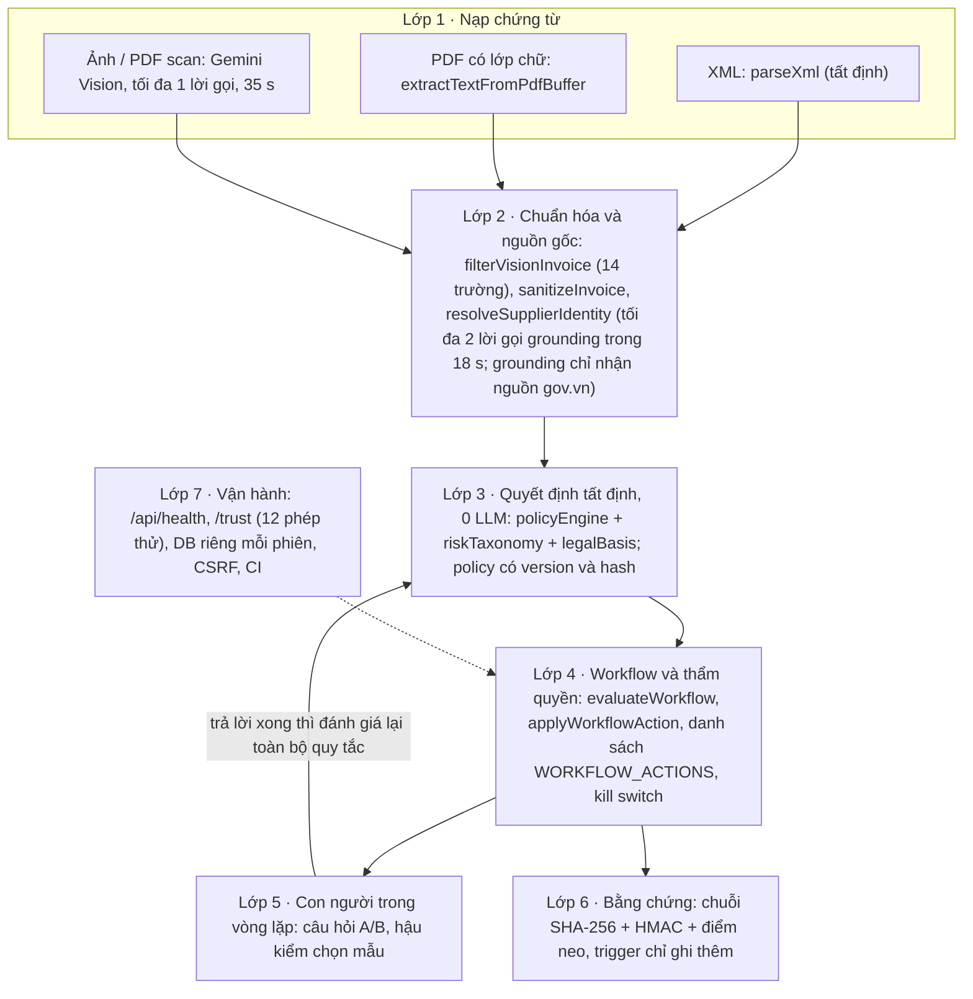
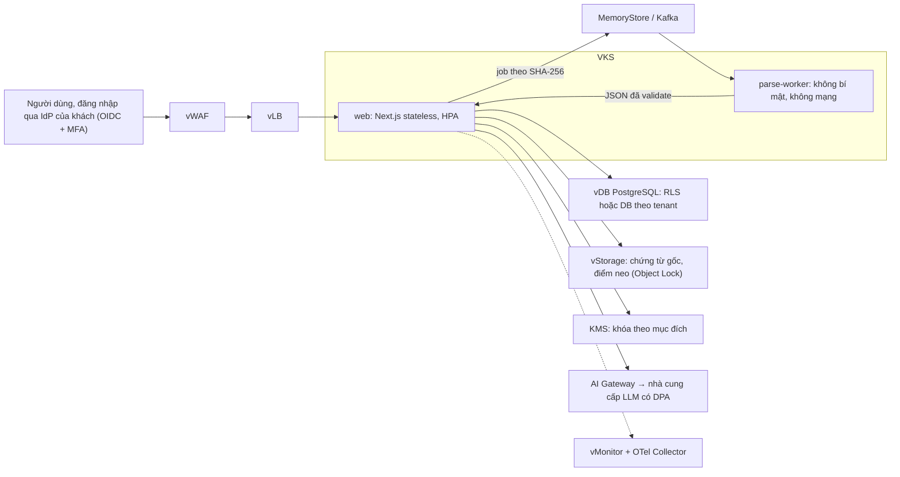

# Kiến trúc và lộ trình từ demo lên production

> Trả lời câu hỏi Q2 của BTC Track VNG: kiến trúc, đánh đổi và những gì cần để đi từ demo hackathon lên production.
> Phạm vi: mã trên `main` từ merge PR #7 (`d882768`, gồm nội dung PR #6); PR #8 (`e496ab4`) bổ sung tự sinh khóa audit và ghi commit vào bản build. Cập nhật 16/10/2026. Những chỗ trong bài ghi live 16/10 còn `hmac:false` và commit `unknown` là trạng thái trước deploy; sau deploy PR #8, live báo commit `e496ab4`, HMAC bật (`keySource: file`) ([`live-2026-10-16-post-deploy.json`](../evidence/live-2026-10-16-post-deploy.json)).
> Quy ước: khẳng định về hệ thống đều kèm file và hàm trên `main`. Mục tiêu nào chưa đo được thì ghi **đề xuất**. Các khung OWASP, NIST, SRE chỉ là chuẩn tham chiếu tự nguyện; tài liệu không tuyên bố tuân thủ chuẩn nào.

**Tóm tắt.** AI chỉ đọc dữ kiện, luật tất định ra quyết định, con người giữ thẩm quyền, nhật ký làm bằng chứng. Đường quyết định không gọi LLM lần nào. Cho hackathon, đội chủ ý chọn cách đơn giản: SQLite, xử lý đồng bộ, monolith, HMAC đối xứng. Đội biết rõ mỗi lựa chọn sẽ vỡ ở đâu và khi nào phải chuyển sang phương án khác.

## 1. Kiến trúc hiện tại theo 7 lớp

Sơ đồ đầy đủ ở [`docs/diagrams/03-architecture.png`](../diagrams/03-architecture.png). Bản rút gọn:

| Lớp | Làm gì | File và hàm chính |
|---|---|---|
| 1. Nạp chứng từ | Nhận XML, PDF, ảnh; trả 413 nếu body lớn hơn 16 MB hoặc tệp lớn hơn 15 MB. Bản gốc ghi một lần (cờ `wx`) kèm SHA-256. XML có `DOCTYPE`/`ENTITY` bị từ chối (chặn XXE). Chỉ ảnh và PDF scan mới gọi Vision, và phải còn ngân sách | `app/api/documents/parse/route.ts` (`handlePOST`), `lib/documentParser.ts` (`assertValidXml`, `parseXml`), `lib/server/pdfToImage.ts`, `services/geminiService.ts` (`extractInvoiceImageWithGeminiVision`), `lib/server/aiBudget.ts` (`allowVisionCall`) |
| 2. Chuẩn hóa và nguồn gốc | Vision chỉ được trả 14 trường nhìn thấy trên chứng từ; mọi key khác bị loại và ghi vào `droppedKeys`. Prompt cố định, không chứa tên file. Danh tính agent (`agent:vision@model#hash`) đi theo hồ sơ. Danh tính bên bán chỉ được gắn `VERIFIED` khi tra cứu MST có cấu trúc xác nhận, hoặc khi agent grounding trích dẫn được nguồn https `*.gov.vn` | `filterVisionInvoice`, `buildVisionPrompt`, `VISION_PROMPT_SHA256` (`services/geminiService.ts`); `sanitizeInvoice` (`lib/documentParser.ts`); `resolveSupplierIdentity` (`services/supplierIdentityResolver.ts`); `lookupByTaxCode` (`services/taxLookupService.ts`); `GROUNDING_BUDGET_MS`, `GROUNDING_MAX_CALLS` (`services/officialSupplierLookupService.ts`) |
| 3. Quyết định tất định | Áp quy tắc luật và SOP. Ba loại dừng theo thứ tự ưu tiên OUT_OF_POLICY > EXCEED_AUTHORITY > UNCERTAIN_INFO. Căn cứ pháp lý chọn theo ngày lập hóa đơn. Công bố policy nới lỏng theo nguyên tắc bốn mắt | `services/policyEngine.ts` (`evaluateInvoiceLocally`), `lib/riskTaxonomy.ts` (`GROUP_PRECEDENCE`), `lib/legalBasis.ts`, `services/jevService.ts` (`queryJevReferee`), `services/policyService.ts` (`publishPolicy`, `policyLoosening`, `rollbackPolicy`) |
| 4. Workflow và thẩm quyền | Máy trạng thái có revision fence (`assertCurrent`) và lease đánh giá 60–300 s. Chỉ nhận thao tác trong danh sách trắng. Chỉ duyệt khi hồ sơ đang ở `WAITING_*` hoặc `FORWARDED`. Sửa dữ liệu không làm hạ thẩm quyền xuống dưới CFO. Người nhập không được tự xác minh. Hoàn tác không được nới lỏng kiểm soát do người khác đặt | `services/workflowService.ts` (`evaluateWorkflow`, `applyWorkflowAction`, `WORKFLOW_ACTIONS`, `approvalBlock`, `undoCandidate`); `services/automationControl.ts` (`setAutomationPaused`); `lib/capabilities.ts` (8 principal, 20 quyền) |
| 5. Con người trong vòng lặp | Câu hỏi chuyển tiếp có cấu trúc "1A, 2B"; mỗi đáp án ghi sẵn hệ quả. Hậu kiểm chọn mẫu ca máy tự duyệt bằng HMAC khi có khóa audit (thiếu khóa thì dùng SHA-256 thường, đoán trước được), phân tầng các ca sát ngưỡng. Tỉ lệ đồng thuận kèm khoảng Wilson 95% | `services/questionBuilder.ts` (`fieldAsk`), `services/handoffService.ts` (`buildHandoff`, `checkHandoff`), `answerHandoff`, `services/postAuditService.ts` (`postAuditDraw`, `stratifiedRate`), `services/feedbackService.ts` (`wilson95`) |
| 6. Bằng chứng và nhật ký | Mỗi sự kiện ghi `actorRole` (hệ thống là `SYSTEM_REFEREE`), `policyHash`, `inputHash`, `contractVersion`, `commit`. Chuỗi hash cộng HMAC; điểm neo phát hiện cắt đuôi và viết lại. Trigger chặn UPDATE/DELETE (migration 20–21). `TAX_REFEREE_AUDIT_SIGNED_SINCE` chống hạ cấp HMAC | `lib/server/audit.ts` (`appendAuditEvent`, `verifyAuditChain`, `auditAnchor`, `verifyAgainstAnchor`), `recordAction` (`services/workflowService.ts`), `lib/server/db.ts` |
| 7. Vận hành | Health công bố commit, policy, ngân sách AI và cảnh báo cấu hình. Trang /trust chạy 12 phép thử trên mã đang deploy. Mỗi phiên demo có file SQLite riêng (AsyncLocalStorage); phép thử chạy trên `:memory:`. Có chặn CSRF. CI chạy trên Ubuntu và Windows | `app/api/health/route.ts`, `lib/server/runtimeInfo.ts` (`configWarnings`), `lib/server/buildInfo.ts` (`runningCommit`), `services/securityProbeService.ts`, `app/trust/page.tsx`, `lib/server/db.ts` (`withDemoDatabase`, `runIsolated`), `middleware.ts`, `.github/workflows/ci.yml` |

**Bất biến kiến trúc, mỗi bất biến có test giữ:**
1. Đầu ra LLM không trực tiếp chọn trạng thái, người duyệt hay thao tác. LLM chỉ điền dữ kiện (14 trường, kể cả số tiền) qua `filterVisionInvoice`; quyết định do `evaluateInvoiceLocally` đưa ra. Giới hạn: số tiền đọc sai vẫn ảnh hưởng gián tiếp tới định tuyến và số thuế được duyệt. Giữ bởi `executionBoundaries.test.ts` (ca trước/sau ranh giới) và phép thử D2, D4.
2. Thao tác workflow chỉ thuộc `WORKFLOW_ACTIONS`; client không đặt được tên sự kiện audit. Giữ bởi phép thử D1.
3. Thẩm quyền chỉ đi lên: ca từng cần CFO mà người khác CFO sửa dữ liệu thì vẫn chờ CFO (`authorityFloor`). Giữ bởi phép thử L3.
4. Máy chỉ tự duyệt khi tự động hóa không bị dừng, không có mức sàn CFO và mọi dữ kiện cần thiết đã được xác minh (`evaluateWorkflow`). Giữ bởi `automationSwitch.test.ts` (dừng tự động hóa) và `executionBoundaries.test.ts` (mức sàn CFO).

**Số lời gọi AI (theo hằng số trong mã, xem `aiRuntimeInfo`):**

| Đường | Lời gọi LLM | Trần và ngân sách |
|---|---|---|
| Ra quyết định (`evaluateInvoiceLocally`) | 0 | Q-Gen (gọi trong `evaluateWorkflow` sau khi quyết định đã khóa) tắt mặc định (`QGEN_AI`). Khi bật: thêm 1 lời gọi diễn đạt câu hỏi, 3,5 s, không được đổi người nhận, số liệu hay phương án |
| Đọc ảnh / PDF scan | tối đa 1 Vision | 35 s; 60 lần/giờ/người dùng, 600 lần/giờ toàn tiến trình; vượt trần trả 429 |
| Tra cứu danh tính bên bán (mọi loại chứng từ, kể cả XML, khi chưa có bản ghi cục bộ và tra cứu MST có cấu trúc không xác nhận được) | tối đa 2 lời gọi grounding | 18 s; 60 lần/giờ/phiên, 300 lần/giờ toàn tiến trình; vượt trần trả `SOURCE_UNAVAILABLE` (fail-closed) |
| XML, PDF có lớp chữ | 0 Vision | Đọc tất định |

**Triển khai hiện tại.** Hostinger chạy Node 22 qua Passenger, một instance duy nhất. hPanel tự deploy mỗi khi `main` thay đổi. Dữ liệu nằm trong SQLite WAL, bí mật đặt trong biến môi trường (`deployment/HOSTINGER.md`, `deployment/hostinger-bootstrap.cjs`).

## 2. Các đánh đổi do đội quyết định

| # | Hackathon chọn | Lý do | Cái giá | Khi nào chuyển sang phương án production |
|---|---|---|---|---|
| 1 | **Luật tất định quyết định**; LLM chỉ trích dữ kiện | Kiểm toán và tái lập được (`policyHash`, `inputHash`). Agent đọc ảnh bị chiếm hay lệnh chèn trong tên hàng đều không đổi được quyết định (phép thử D2, D4). Tương ứng mẫu Action-Selector / Dual LLM (arXiv 2506.08837) | Độ phủ ngữ nghĩa thấp: khoản chi lạ có thể lọt. Ca U2 "tiệc cưới người thân giám đốc" vẫn tự duyệt cho tới khi thêm từ khóa ở commit `02b8a24` | **Không** giao quyền quyết định cho LLM. Nếu cần độ phủ cao hơn, LLM chỉ được *gắn cờ thêm* (chỉ siết, không nới), và phải qua cổng đánh giá trên tập vàng |
| 2 | **SQLite WAL, mỗi phiên demo một file** (`withDemoDatabase`) | Cách ly kiểu silo: giám khảo thử song song không đụng dữ liệu nhau. Chỉ một writer nên chuỗi audit đơn giản. Không cần vận hành DB trên shared hosting | Chỉ chạy được một instance. Backup từng file. Không truy vấn chéo tenant. Migration lan dần theo từng file | Khi cần hơn một instance hoặc HA, khi có tenant trả phí đầu tiên, hoặc khi cần RPO tính bằng phút: chuyển PostgreSQL. Tenant lớn dùng DB riêng; tenant nhỏ dùng chung có RLS |
| 3 | **Gọi AI đồng bộ** trong request `/api/documents/parse` | UX đơn giản (tải ảnh lên là thấy trường); ít thành phần | Một request có thể chờ các lời gọi AI tới 35 s + 18 s, chưa kể các tra cứu không dùng AI. `execSync` (PyMuPDF, timeout 3 s) chặn event loop của instance duy nhất. Một lần đo ảnh trên live mất khoảng 7,8 s (`deployment/HOSTINGER.md`) | Khi p95 đọc ảnh vượt SLO, khi có nhập lô, hoặc khi nhiều người tải cùng lúc: chuyển sang hàng đợi + worker, idempotency theo SHA-256 (đã có cache theo content hash) |
| 4 | **Proxy ShopAIKey** cho Vision và grounding | Nhanh, rẻ, một endpoint | Thêm một bên trung gian chưa có DPA. Ảnh hóa đơn có thể chứa dữ liệu cá nhân, nên đây là chuyển dữ liệu ra nước ngoài. Key được gửi cả trong query `?key=` lẫn header (`extractInvoiceImageWithGeminiVision`) | Trước dữ liệu thật đầu tiên: dùng nhà cung cấp có pháp nhân và DPA, đi qua AI Gateway. Tenant không cho xuất dữ liệu thì dùng "chế độ không xuất dữ liệu" (XML + nhập tay + OCR nội bộ; service `ocr` trong `compose.yaml`, chưa chạy trên host shared) |
| 5 | **Danh sách đen từ khóa** (`SENSITIVE_ITEMS`, danh mục ngoài phạm vi SOP trong `services/policyEngine.ts`) | Chạy được ngay trên mô tả hàng hóa tự do | Fail-open với khoản lạ (U2). Báo nhầm (ví dụ "INTERNET" từng bị coi là viễn thông, phải sửa ở `02b8a24`). Mỗi lần vá là sửa tay | Production: dùng danh sách trắng hạng mục theo SOP của từng tenant, khoản ngoài danh mục thì chuyển người. Chạy shadow để đo tỉ lệ chuyển người trước khi bật |
| 6 | **HMAC đối xứng**: khóa trong env, điểm neo ký HMAC | Không cần hạ tầng. Phát hiện được người sửa file DB hoặc bản backup mà không có khóa (`tests/unit/auditIntegrity.test.ts`) | Khóa nằm cùng host và cùng tiến trình: người giữ khóa giả được cả chuỗi lẫn điểm neo. Một khóa dùng cho ba mục đích: MAC, điểm neo, chọn mẫu hậu kiểm (`postAuditDraw`). Không có key_id nên không xoay khóa được. Chữ ký điểm neo so bằng `!==`. Điểm neo không gắn tenant. Thiếu khóa thì fail-open | Khi khách cần bằng chứng trước bên thứ ba (kiểm toán, cơ quan thuế): chuyển sang KMS, khóa theo mục đích (HKDF), Ed25519 cho điểm neo, định kỳ đẩy điểm neo lên bucket WORM |
| 7 | **Monolith Next.js**: UI, API, parser và gọi AI cùng một tiến trình | Một artefact deploy; hợp với Passenger một instance và đội nhỏ | Tiến trình con PyMuPDF thừa hưởng toàn bộ biến môi trường vì `execSync` không truyền `env` (`lib/server/pdfToImage.ts`). Lỗi trình đọc PDF có thể dẫn tới thực thi mã (CERT VU#951662, MuPDF ≤ 1.27.0). Không scale riêng được phần nặng | Trước khi nhận tệp từ người ngoài tổ chức ở quy mô thật: tách parse-worker không có bí mật, không có mạng, rootfs read-only, chạy non-root, giới hạn CPU/RAM |

## 3. Cái gì vỡ trước khi mở rộng

| Kịch bản | Cái vỡ | Bằng chứng trong mã | Việc phải làm |
|---|---|---|---|
| **Nhiều instance** | Giới hạn tần suất nằm trong bộ nhớ: ngân sách AI và giới hạn phép thử bị nhân theo số instance. Chuỗi audit giả định một writer. WAL không chia sẻ được giữa các máy. Cache kết nối DB phiên nằm riêng trong từng tiến trình | `allowRate` (`lib/server/rateLimit.ts`, một `Map`); `appendAuditEvent` đọc hash cuối rồi ghi (`lib/server/audit.ts`); tài liệu SQLite: mọi tiến trình phải trên cùng máy; `demoDatabases` (`lib/server/db.ts`) | Limiter và hàng đợi dùng store chung. Nối chuỗi audit trong transaction có khóa theo tenant (advisory lock hoặc SERIALIZABLE). PostgreSQL |
| **100 tenant** | Mỗi lần mở một file, toàn bộ DDL và bước đối chiếu 21 migration chạy lại; đổi schema lan dần theo từng file. Backup phải dừng app rồi nén cả thư mục. Đếm phiên bằng cách đọc thư mục. Mọi tenant dùng chung một khóa audit | `initializeDatabase`, `applyMigrations`, `demoCount` (`lib/server/db.ts`); `docker compose stop app` (`deployment/backup.sh`) | Migration có phiên bản, chạy tập trung. Sao lưu liên tục và PITR. Khóa theo tenant trong KMS |
| **1 triệu hóa đơn** | Mỗi transaction ghi đều quét toàn bảng `invoices` (cộng `json_extract`), không có index theo `status`. Kiểm chuỗi đọc toàn bộ audit vào RAM. `audit_events` không có index `entity_id` nhưng hoàn tác và gỡ giữ thuế lại truy vấn theo cột này. Payload ghi hai lần vào hai bảng audit | `recomputeMacro` (`services/workflowService.ts`); `verifyAuditChain` (`.all()`), `verifyAgainstAnchor` (`OFFSET`); `undoCandidate`, `RELEASE_TAX_HOLD`; `recordAction` ghi vào `audit_events` và `immutable_audit_trail` | Cột sinh + index, hoặc bảng tổng theo kỳ cập nhật trong cùng transaction. Kiểm chuỗi tăng dần từ checkpoint đã ký. Index `audit_events(entity_id)`. Gộp còn một nhật ký |
| **Cấu hình fail-open** | Thiếu `TAX_REFEREE_AUDIT_KEY` app vẫn chạy: HMAC tắt, điểm neo không ký, mẫu hậu kiểm rơi về SHA-256 thuần nên đoán trước được. Live ngày 16/10 hiện `hmac:false` và commit `unknown` | `auditKey` (`lib/server/audit.ts`); `postAuditDraw`; `configWarnings` chỉ cảnh báo, `/api/health` vẫn trả 200 `ok` | Readiness check trả 503 (hoặc từ chối khởi động) khi thiếu khóa hay commit; synthetic monitor gọi `/api/health`. Commit `unknown` đã sửa trong mã ở `8bcfbb0` (đọc `.git`), có hiệu lực sau lần deploy tới |

## 4. "AI rà soát, đội quyết bằng test"

Trong đợt audit ngày 16/10, các tác tử tự động đưa ra nhiều đề xuất sửa. Đội không áp dụng nguyên văn: mỗi đề xuất được đối chiếu với test hiện có hoặc với ràng buộc thật của môi trường chạy. Dưới đây là các trường hợp kiểm lại được trong repo.

| Đề xuất tự động | Vì sao không nhận | Đội chọn | Bằng chứng |
|---|---|---|---|
| Giới hạn ngân sách AI theo IP | Giám khảo trong hội trường dùng chung một NAT: một người dùng hết hạn mức là chặn cả phòng | Ngân sách theo người dùng/phiên, cộng một trần toàn tiến trình, fail-closed | `allowVisionCall(userId)`, `allowGroundingCall(sessionKey)` (`lib/server/aiBudget.ts`); `tests/unit/aiBudget.test.ts`. Chỗ duy nhất còn giới hạn theo IP là tạo phiên demo; hướng dẫn deploy nâng lên 300/giờ với ghi chú "giám khảo dùng chung NAT hội trường" (`docs/handoff/huong-dan-ban-giao.md`, A5c) |
| Cấm hoàn tác hoàn toàn (để không ai "gỡ" được kiểm soát) | Làm vỡ luồng tự sửa lệnh dừng nhầm: dừng rồi hoàn tác phải trả hồ sơ về Đã duyệt và khôi phục chứng từ nội bộ | Hoàn tác không được nới lỏng kiểm soát do *người khác* đặt; không gỡ được lệnh giữ theo luật hay lệnh giữ thuế do hậu kiểm "không đồng ý" | `undoCandidate` (`services/workflowService.ts`); `scripts/qa/test-api-smoke.ts`, `scripts/qa/test-workflow-safety.ts`; `tests/unit/executionBoundaries.test.ts` (hai ca hoàn tác) |
| Chạy `python3 -I` để cô lập tiến trình con đọc PDF | `-I` bỏ qua mọi biến `PYTHON*`, kể cả `PYTHONPATH` (tài liệu Python). Trên Hostinger, PyMuPDF được nạp qua `PYTHONPATH` (`deployment/hostinger-bootstrap.cjs`). Lỗi import bị nuốt (`extractTextFromPdfBuffer`), nên mọi PDF có chữ sẽ âm thầm chuyển sang Vision: chậm hơn, tốn ngân sách, sai nhãn nguồn | Không dùng `-I`; thay bằng truyền `env` tối thiểu (`pdfChildEnv`: giữ `PATH`, `PYTHONPATH`, locale; bỏ mọi khóa bí mật — commit `1d4b8d9`, có test). Tách worker/container để cô lập ở tầng hệ điều hành vẫn là việc sau Demo Day | Ràng buộc môi trường kiểm bằng đọc mã; bước kiểm PDF có lớp chữ sau deploy nằm trong checklist A5c |
| Ép schema số chặt lên JSON thô của Vision | Vision có thể trả `"55.000.000"` hay ngày dạng `dd/mm/yyyy`; schema chặt sẽ loại các giá trị mà `sanitizeInvoice` (`parseVndNumber`) được viết ra để chuẩn hóa | Lọc theo danh sách trắng tên key trước (`filterVisionInvoice`), chuẩn hóa sau | `tests/unit/executionBoundaries.test.ts` (ca "Vision chỉ được khai 14 trường") |

Nguyên tắc chung: AI rà soát đưa ra giả thuyết; test và ràng buộc vận hành làm trọng tài; phán đoán cuối cùng thuộc về đội.

## 5. Lộ trình

**D0, đã làm ngày 16/10 (chỉ những gì có trong PR #6):**

| Hạng mục | Commit | Test |
|---|---|---|
| Ranh giới đầu ra của agent đọc ảnh (14 trường, prompt không chứa tên file, provenance) | `7f9b698` | `executionBoundaries.test.ts` (thêm ở `e479ac2`) |
| Workflow: chuyển trạng thái ngược không nới lỏng; thẩm quyền không hạ theo số tiền; bất kiêm nhiệm; `guardedFields` | `e479ac2` | `executionBoundaries.test.ts` |
| Ngân sách gọi AI theo người dùng (Vision) và theo phiên (grounding), fail-closed; 413 trước khi đọc body | `e88eace` | `aiBudget.test.ts` |
| Bốn mắt cho policy: danh mục có hiệu lực, rollback nới lỏng phải do CFO; nguồn NCC nhập tay luôn là `MANUAL` | `d133d9e` | `policyMakerChecker.test.ts` |
| `/api/health` có cảnh báo cấu hình và khối `ai`; chống hạ cấp HMAC | `482f831` | `auditIntegrity.test.ts` (chống hạ cấp); cảnh báo cấu hình chưa có test |
| Engine: cụm tiền mặt không phụ thuộc thứ tự nhập; giảm báo nhầm 8%; đóng ca bẫy U2 sau buổi thử | `ee53558`, `02b8a24` | `sameDayCashCluster.test.ts`, `keywordCoverage.test.ts` |
| Trang /trust, 12 phép thử, ma trận quyền khớp hàm thật | `cc4dc8d` | `securityProbes.test.ts`, `authzMatrix.test.ts` |
| `runningCommit` đọc `.git` khi nền tảng deploy bằng git | `8bcfbb0` | (kiểm qua `/api/health`) |

Việc vận hành tối 16/10 (đặt `TAX_REFEREE_AUDIT_KEY` theo A5c) không phải mã nguồn. Tài liệu này không xác nhận trạng thái trên live.

**30 ngày:**
- Danh tính: SSO OIDC với IdP của khách, bắt buộc MFA cho KTT/CFO. Băm token phiên, vì hiện token thô đang là khóa chính của bảng `sessions` (`login`, `lib/server/auth.ts`). Bất kiêm nhiệm xét theo người thật của IdP, không theo tài khoản vai trò.
- Cách ly: parse-worker trong sandbox (không bí mật, không mạng, read-only, non-root), chỉ trả JSON đã validate.
- Hàng đợi idempotent theo content hash. Tái dùng các trạng thái sẵn có của `capture_sessions` (WAITING/UPLOADED/PROCESSING/READY/FAILED).
- Dữ liệu: PostgreSQL + RLS, hoặc DB riêng cho mỗi tenant có quản lý; migration có phiên bản; sao lưu liên tục và diễn tập khôi phục, sau mỗi lần khôi phục chạy `verifyAuditChain` và đối chiếu điểm neo.
- Khóa: tách khóa theo mục đích (HKDF), thêm `key_id`, so chữ ký bằng `timingSafeEqual`, đưa tenant vào thân điểm neo. Có readiness check (mục 3).
- Quan sát: OpenTelemetry, mỗi span gắn `evaluationId`, `policyHash`, agent. Không ghi ảnh hay prompt (PII).
- CI: quét lỗ hổng phụ thuộc, quét bí mật, SBOM; ký image.

**90 ngày:**
- Nguồn sự thật: XML có chữ ký (kiểm XMLDSig; hiện `signature_status` luôn là `UNVERIFIED`) cộng dữ liệu hóa đơn của cơ quan thuế qua kênh được phép. Không tra được thì xếp UNCERTAIN_INFO, không tự duyệt.
- Sao kê ngân hàng thay cho ô tự khai `hasBankSlip`.
- Policy engine dạng bảng hoặc khai báo (Cedar/OPA) cho đa tenant, để CFO đọc được.
- Shadow run khi đổi policy, model hay prompt (`VISION_PROMPT_SHA256` đã cho biết đang chạy prompt nào); chỉ chuyển khi không làm giảm chất lượng trên tập vàng.
- KMS + Ed25519 cho điểm neo; định kỳ neo nhật ký lên bucket WORM.
- System card và bản tự phân loại rủi ro theo Luật AI (mục 8).

## 6. SLO đề xuất

Chưa có SLO công bố; các con số dưới đây đều là **đề xuất**, cần đo baseline trước khi cam kết.

| SLI | Mục tiêu đề xuất | Hiện trạng đo | Khi vượt ngưỡng |
|---|---|---|---|
| Độ sẵn sàng của API thẩm định | ≥ 99,5 %/tháng | Chưa đo; chỉ có `/api/health` | Đóng băng phát hành |
| p95 thời gian đánh giá XML (không tính tra cứu NCC lần đầu) | < 1 s | Chưa đo p95 | Điều tra truy vấn (mục 3) |
| p95 đọc ảnh, từ lúc tải lên đến khi có trường | < 15 s, sau khi có hàng đợi | Một lần đo khoảng 7,8 s; không phải p95 | Chuyển sang xử lý bất đồng bộ |
| **SLO an toàn:** ca máy tự duyệt vi phạm quy tắc luật, phát hiện qua hậu kiểm | 0 ca | Hậu kiểm có sẵn (`listPostAudits`); chưa có dữ liệu thật | Tự bật kill switch (`setAutomationPaused`) và đóng băng thay đổi policy |
| Tỉ lệ đồng thuận hậu kiểm | Cận dưới Wilson 95 % ≥ 98 % | `wilson95` đã có. Nếu không có ca bất đồng nào, phải có ít nhất 189 ca hậu kiểm mới đạt mốc này | Tăng tỉ lệ hậu kiểm; xem lại quy tắc liên quan |

## 7. Ánh xạ lên VNG Cloud (GreenNode)

Chỉ dùng các dịch vụ mà luồng nghiên cứu ngày 16/10 đã tra trong tài liệu GreenNode. Các nguồn này chưa qua vòng kiểm trích dẫn độc lập, nên phải xác nhận lại với VNG trước khi cam kết.

| Thành phần | Dịch vụ | Lý do | Mức xác minh |
|---|---|---|---|
| Lớp biên | [vWAF](https://vngcloud.vn/events/vwaf-web-application-firewall-bao-ve-website-doanh-nghiep) → vLB | WAF lớp 7 đặt trước cân bằng tải | vWAF có bài giới thiệu; **chưa xác minh tính năng chi tiết**. vLB thấy trong [mục lục](https://docs.greennode.ai/llms.txt) |
| Web stateless + parse-worker | VKS (Kubernetes) | HPA cho web; namespace worker có NetworkPolicy, không mount bí mật | Thấy trong mục lục |
| Cơ sở dữ liệu | [vDB PostgreSQL Cluster](https://docs.greennode.ai/vdb/relational-database-service-rds/postgresql-cluster.md) | 1 writer + 1–9 reader, tự failover; Multi-AZ chỉ có ở HCM | Có trang riêng; **tài liệu không nêu PITR hay mã hóa lưu trữ** |
| Hàng đợi, limiter dùng chung | vDB MemoryStore (MDS) hoặc Kafka (KDS) | Thay `Map` trong bộ nhớ; job idempotent | Thấy trong mục lục; chưa đọc chi tiết |
| Chứng từ gốc, điểm neo WORM | [vStorage + Object Lock](https://docs.greennode.ai/vstorage/object-storage/object-storage-han02/features-of-object-storage/working-with-bucket/working-with-buckets-via-vstorage-portal/object-lock.md) | Lưu một lần, không sửa được; bản sao khác vùng | Object Lock **chỉ thấy tài liệu cho HAN02**, chưa thấy cho HCM |
| Khóa | [KMS](https://docs.greennode.ai/key-management-system.md) (Customer Managed Keys) | Khóa gốc cho audit và mã hóa artefact | **Không nêu ký bất đối xứng, HSM hay tự xoay khóa**; nếu thiếu thì dùng KMS bọc khóa Ed25519 |
| Danh tính workload | [IAM](https://docs.greennode.ai/identity-and-access-management-iam.md) | Mỗi workload một service account; liên kết SSO | Có trang riêng; **không nói đến MFA** |
| Cửa ra LLM | [AI Gateway](https://docs.greennode.ai/ai-stack/ai-gateway.md); [MaaS](https://docs.greennode.ai/ai-stack/model-as-a-service.md) là ứng viên thay ShopAIKey | Rate limit theo request hoặc token, cache, metrics | MaaS **không nêu nơi đặt dữ liệu hay chính sách lưu giữ**: không được nói "dữ liệu ở Việt Nam" khi chưa có văn bản xác nhận |
| Quan sát | [vMonitor](https://docs.greennode.ai/vmonitor/vmonitor-platform-la-gi.md) + OTel Collector | Metrics, log, synthetic gọi `/api/health` | **Không nêu traces hay OTel**; backend trace tự vận hành |
| Sao lưu, image | Backup Center, vContainer Registry | Sao lưu tập trung; image đã ký | Thấy trong mục lục |

Không tìm thấy Secret Manager hay API Gateway riêng. Phương án thay thế: Kubernetes Secret mã hóa bằng KMS, hoặc Vault tự vận hành.

## 8. Pháp lý khi lên production

Mọi mục dưới đây là **nguồn thứ cấp, cần đối chiếu Công báo** trước khi trích nguyên văn. Đây không phải ý kiến pháp lý.

| Văn bản | Tác động lên Tax Referee | Việc cần làm |
|---|---|---|
| Luật BVDLCN 91/2025/QH15, hiệu lực 01/01/2026 ([hethongphapluat](https://hethongphapluat.com/luat-bao-ve-du-lieu-ca-nhan-2025/dieu-8)) | Điều 8: phạt tới 5 % doanh thu năm trước với vi phạm chuyển dữ liệu xuyên biên giới, tới 3 tỷ đồng với vi phạm khác. Không nên dựa vào ưu đãi cho doanh nghiệp nhỏ: ưu đãi đó có thể không áp dụng cho bên xử lý dữ liệu nhạy cảm | Ký DPA với khách (khách là bên kiểm soát); lập nhật ký xử lý; cung cấp API xuất và xóa dữ liệu theo chủ thể |
| NĐ 356/2025/NĐ-CP, thay NĐ 13/2023 từ 01/01/2026 ([thuvienphapluat](https://thuvienphapluat.vn/van-ban/Quyen-dan-su/Nghi-dinh-356-2025-ND-CP-huong-dan-Luat-Bao-ve-du-lieu-ca-nhan-687428.aspx), [Luật Việt An](https://luatvietan.vn/diem-moi-cua-nghi-dinh-356-2025-so-voi-nghi-dinh-13-2023-ve-huong-dan-bao-ve-du-lieu-ca-nhan.html)) | Dữ liệu ngân hàng và lịch sử giao dịch thuộc nhóm nhạy cảm; bảng `bank_transactions` (`lib/server/db.ts`) thuộc phạm vi này. Phải có hồ sơ đánh giá tác động (Mẫu 09 cho chuyển ra nước ngoài, Mẫu 10 cho xử lý) và báo cáo vi phạm trong 72 giờ (Mẫu 08) | Lập hồ sơ cho luồng ảnh hóa đơn gửi tới mô hình; runbook báo cáo vi phạm 72 giờ; không dẫn NĐ 13/2023 như văn bản còn hiệu lực |
| Dữ liệu trong hóa đơn: TT 86/2024/TT-BTC | Từ 01/7/2025, cá nhân và hộ kinh doanh dùng số định danh 12 số thay MST, nên MST trên hóa đơn có thể là dữ liệu cá nhân | Che vùng thông tin người mua trước khi gửi Vision (tùy chọn); hoặc chế độ không xuất dữ liệu |
| Dữ liệu ra nước ngoài | Ảnh hóa đơn đi qua ShopAIKey tới mô hình Gemini. Chính sách Gemini API lưu prompt và output 55 ngày để giám sát lạm dụng ([Google](https://ai.google.dev/gemini-api/docs/abuse-monitoring); nguồn chính thức, đã kiểm) | Nhà cung cấp có pháp nhân và DPA; ghi rõ trong DPA dữ liệu nào rời Việt Nam |
| Lưu trữ tại Việt Nam: NĐ 53/2022/NĐ-CP, Điều 26 | Phạm vi áp dụng với doanh nghiệp trong nước được diễn giải khác nhau; vị trí máy chủ Hostinger hiện chưa rõ | Đặt DB, object và backup production tại trung tâm dữ liệu trong nước |
| Lưu trữ chứng từ ≥ 10 năm (NĐ 174/2016/NĐ-CP) và Luật GDĐT 20/2023/QH15, Điều 10 (toàn vẹn) | Nghĩa vụ giữ chứng từ va chạm với quyền xóa dữ liệu cá nhân; bản demo hiện chỉ có quota và dọn dữ liệu demo | Tách "giả danh hóa trường cá nhân" khỏi "xóa chứng từ kế toán"; lưu bản gốc lên WORM |
| Luật AI 134/2025/QH15 (hiệu lực 01/3/2026) và NĐ 142/2026/NĐ-CP (hiệu lực 01/5/2026) | Đội là nhà cung cấp; doanh nghiệp dùng sản phẩm là bên triển khai. Phải tự phân loại rủi ro trước khi đưa vào sử dụng; sự cố báo sơ bộ trong 72 giờ hoặc 5 ngày làm việc | System card (AI chỉ trích xuất; con người giữ thẩm quyền; giới hạn đã biết); bản tự phân loại kèm lập luận; runbook sự cố AI |
| Hóa đơn điện tử: NĐ 254/2026/NĐ-CP và TT 91/2026/TT-BTC, hiệu lực 01/7/2026 | Thay NĐ 123/2020, NĐ 70/2025, TT 32/2025 | Thêm fixture XML theo TT 91 vào bộ hồi quy parser |

## Giới hạn của tài liệu

- Đội không có phản hồi chi tiết từ người dùng, nên tài liệu không đưa số liệu người dùng nào. Các SLO là đề xuất; p95 chưa được đo.
- Dịch vụ VNG Cloud mới chỉ tra qua tài liệu công khai; tính năng và nơi đặt dữ liệu cần VNG xác nhận bằng văn bản.
- Đã đóng thêm trong PR #6 (`1d4b8d9`, `98ea813`): tiến trình con PDF không còn thừa hưởng biến bí mật; bật lại tự động hóa phải kiểm lại theo policy hiện hành. Rủi ro đã biết còn lại: tiến trình PDF vẫn cùng UID; HMAC dùng một khóa cho ba mục đích; XML chưa kiểm chữ ký số; tích hợp với cơ quan thuế vẫn là giả lập.

**Nguồn kỹ thuật đã kiểm:** [SQLite WAL](https://sqlite.org/wal.html) · [AWS: RLS cho multi-tenant](https://aws.amazon.com/blogs/database/multi-tenant-data-isolation-with-postgresql-row-level-security) · [Google SRE ch.32 (PRR)](https://sre.google/sre-book/evolving-sre-engagement-model/) · [SRE Workbook ch.16 (canary)](https://sre.google/workbook/canarying-releases/) · [12-Factor: Config](https://12factor.net/config) · [ML Test Score](https://research.google/pubs/pub46555/) · [NIST SP 800-57](https://csrc.nist.gov/pubs/sp/800/57/pt1/r5/final) · [arXiv 2506.08837](https://arxiv.org/abs/2506.08837) · [CaMeL, arXiv 2503.18813](https://arxiv.org/abs/2503.18813) · [OWASP LLM Top 10 2025](https://genai.owasp.org/llm-top-10/) · [Cedar, arXiv 2403.04651](https://arxiv.org/abs/2403.04651) · [CERT VU#951662](https://kb.cert.org/vuls/id/951662) · [Python: tùy chọn `-I`](https://docs.python.org/3/using/cmdline.html)
