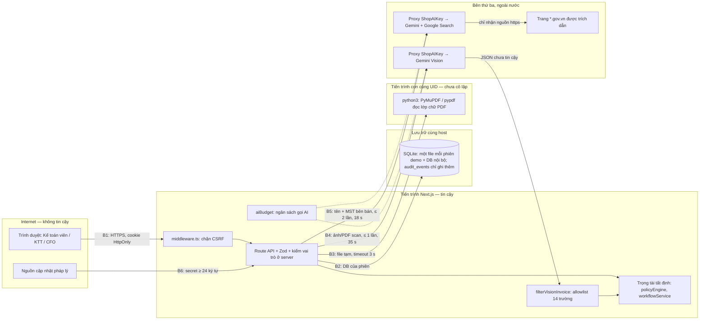

# Mô hình mối đe dọa và bảo mật hệ có agent AI

> **Tax Referee** · trả lời câu hỏi Q1 của BTC Track VNG: định danh, đặc quyền tối thiểu, ranh giới thực thi tất định, cách ly.
> Phạm vi: mã trên `main` từ merge PR #7 (`d882768`, gồm nội dung PR #6); PR #8 (`e496ab4`) bổ sung tự sinh khóa audit và ghi commit vào bản build. Cập nhật 17/10/2026 (bảng mục 6 thêm XML-01/02/03, TMP-01 của `v1.1.0`, chưa deploy lên live). Những chỗ trong bài ghi live 16/10 còn `hmac:false` và commit `unknown` là trạng thái trước deploy; sau deploy PR #8, live báo commit `e496ab4`, HMAC bật (`keySource: file`) ([`live-2026-10-16-post-deploy.json`](../evidence/live-2026-10-16-post-deploy.json)). Mỗi khẳng định về hệ thống trỏ tới file và hàm.
> OWASP, NIST và các bài báo được dẫn là **chuẩn tham chiếu tự nguyện**, không phải tuyên bố tuân thủ. Mã LLMxx theo bản OWASP LLM Top 10 2025; theo nguồn thứ cấp, bản 2026 đã xếp lại thứ tự.

## 1. Tóm tắt

1. **Agent AI không được quyền quyết định.** Nhóm rủi ro, người duyệt và phương án A/B do bộ quy tắc tất định quyết (`queryJevReferee` → `evaluateInvoiceLocally`, `decisionAuthority: 'LOCAL_POLICY_ENGINE'` trong `services/jevService.ts`). Đường quyết định có 0 lần gọi LLM.
2. AI chỉ làm hai việc hẹp và không có công cụ ghi: đọc ảnh/PDF scan thành tối đa 14 trường (Gemini Vision), tìm nguồn `*.gov.vn` cho MST bên bán (grounding). Agent diễn đạt câu hỏi (Q-Gen) tắt mặc định.
3. **Rủi ro agentic không biến mất mà chuyển sang dữ liệu: mỗi trường AI viết ra mà quy tắc dùng tới là một quyền.** Vì vậy quyền đó được cấp theo allowlist, có danh tính agent, có ngân sách gọi, và đi qua đúng các quy tắc áp cho dữ liệu người nhập.
4. Ngày 16/10 đội tự audit đối kháng; mục 6 liệt kê 9 lỗi tiêu biểu thuộc đúng bốn trụ (các mã lỗi khác ghi trong thông điệp commit). 8 lỗi đã sửa trong mã kèm test; lỗi thứ 9 (cấu hình fail-open trên live) đã được làm lộ ra trên `/api/health` và đang được đóng bằng cấu hình tối 16/10 (mục 6).
5. Bằng chứng trực tiếp trên live: `/trust` chạy 12 phép thử tấn công trên mã đang deploy, mỗi phép thử một DB `:memory:` riêng; `/api/health` công bố `commit`, `audit.hmac`, khối `ai` và `warnings`.

## 2. Tài sản cần bảo vệ và kẻ tấn công giả định

| Tài sản | Vì sao quan trọng | Nơi lưu / mã |
|---|---|---|
| Quyết định khấu trừ, trạng thái hồ sơ | Tiền thuế thật được khấu trừ; chứng từ hạch toán sinh từ đây | Bảng `invoices`, `internal_vouchers`; `services/workflowService.ts` |
| Thẩm quyền phê duyệt | Hạn mức KTT, sàn CFO, bất kiêm nhiệm là kiểm soát nội bộ cốt lõi | `approvalBlock`, `applyWorkflowAction` |
| Policy đang hiệu lực | Đổi policy là đổi mọi quyết định sau đó | Bảng `policy_versions`; `services/policyService.ts` |
| Nhật ký kiểm toán | Bằng chứng giải trình: ai (người hay máy), theo policy nào, trên dữ liệu nào | Bảng `audit_events`; `lib/server/audit.ts` |
| Chứng từ gốc, dữ liệu hóa đơn | Dữ liệu kinh doanh; có thể chứa dữ liệu cá nhân (MST, tên cá nhân) | Bảng `document_artifacts`, `extraction_reviews` |
| Bí mật vận hành | Khóa API AI, `TAX_REFEREE_AUDIT_KEY`, `LEGAL_WEBHOOK_SECRET`, mật khẩu tài khoản | Biến môi trường của tiến trình |

| # | Kẻ tấn công | Năng lực giả định | Mục tiêu điển hình |
|---|---|---|---|
| A1 | Người nhập gian lận (Kế toán viên) | Nhập/sửa hồ sơ, gọi thẳng API bằng phiên của mình | Để máy tự duyệt hóa đơn không đủ điều kiện; "rửa" ca đã bị chuyển tiếp |
| A2 | Kế toán trưởng vượt quyền | Mọi quyền KTT: xác minh, giữ/hoàn tác, soạn policy | Né CFO, tự duyệt hồ sơ mình nhập, nới policy không qua người thứ hai |
| A3 | Hóa đơn/ảnh chứa prompt injection | Điều khiển nội dung ảnh, tên hàng, file XML, tên file | Khiến agent khai sự kiện giả hoặc làm đổi quyết định |
| A4 | Agent AI bị chiếm hoặc ảo giác | Toàn quyền trên JSON mà agent trả về | Như A3, cộng đọc sai số tiền một cách cân đối |
| A5 | Người có quyền ghi file DB | Sửa SQLite trực tiếp, gỡ trigger, lấy được bản sao lưu | Sửa/xóa dấu vết, cắt đuôi nhật ký |
| A6 | Bên ngoài gọi API | Không có phiên, hoặc trang khác lợi dụng cookie; gửi file độc | CSRF, đốt ngân sách AI, XXE, làm treo instance duy nhất |

Ngoài phạm vi bản demo: kẻ chiếm toàn quyền máy chủ (có cả DB lẫn khóa HMAC). Phần này thuộc lộ trình ở mục 7.

## 3. Sơ đồ luồng dữ liệu và ranh giới tin cậy

| Ranh giới | Thứ đi qua | Kiểm soát chính (mã) |
|---|---|---|
| B1 Trình duyệt ↔ API | Thao tác của người, file tải lên | Cookie phiên `HttpOnly`, `SameSite=Lax`; `middleware.ts`; Zod; vai trò kiểm ở server |
| B2 API ↔ SQLite theo phiên | Mọi đọc/ghi | `withRequestDatabase` (AsyncLocalStorage) chọn DB của phiên; nhật ký chỉ ghi thêm (`lib/server/db.ts`, `lib/server/audit.ts`) |
| B3 API ↔ tiến trình Python | PDF thô → văn bản | File tạm tên ngẫu nhiên, timeout 3 s (`extractTextFromPdfBuffer`); văn bản qua bộ phân tích tất định |
| B4 API ↔ proxy Gemini | Ảnh/PDF scan → JSON | Prompt cố định (`buildVisionPrompt`), `filterVisionInvoice`, `allowVisionCall` |
| B5 API ↔ tra cứu có grounding | Tên + MST bên bán → trích dẫn | Chỉ nguồn https `*.gov.vn` (`isOfficialHost`), tối đa 2 lần trong 18 s, `allowGroundingCall` |
| B6 Webhook pháp lý → API | Văn bản pháp luật mới | Secret ≥ 24 ký tự, `timingSafeEqual`; chỉ tạo ứng viên `NEEDS_REVIEW` (`app/api/webhooks/legal-update/route.ts`) |

## 4. Bốn trụ

Các test dưới đây nằm trong `tests/unit/` và chạy trong CI (Ubuntu + Windows). Mã phép thử (I1, L2…) là các dòng trên trang `/trust`, sinh từ `services/securityProbeService.ts`.

### 4.1 Định danh — ai (người hay máy) đã làm gì

- **Thách thức thật.** Agent trong doanh nghiệp hay chạy bằng credential dùng chung với người hoặc dịch vụ, nên khi có sự cố không truy được trách nhiệm. Concept paper dự thảo của NIST NCCoE (2/2026, đang lấy ý kiến) đề xuất khám phá cách định danh agent để hệ quản lý truy cập "distinguish between agent and human identities" ([NCCoE](https://www.nccoe.nist.gov/projects/software-and-ai-agent-identity-and-authorization)); OWASP Top 10 for Agentic Applications 2026 có mục *ASI03 Identity & Privilege Abuse* ([OWASP](https://genai.owasp.org/resource/owasp-top-10-for-agentic-applications-for-2026/)).
- **Cơ chế trong Tax Referee.**
  - 8 principal tách biệt, mỗi principal có danh tính, việc được làm và không được làm: `PRINCIPALS` trong `lib/capabilities.ts` (3 vai người, `SYSTEM_REFEREE`, 3 agent AI, `LEGAL_WEBHOOK`).
  - Máy không mượn danh tính người: `recordAction` (`services/workflowService.ts`) ghi `actorRole: SYSTEM_REFEREE`, `actorId` rỗng, kèm `policyHash`, `inputHash`, `contractVersion`, `commit`.
  - Agent đọc ảnh có danh tính `agent:vision@<model>#<12 ký tự SHA-256 của prompt>` cùng `droppedKeys` (`extractInvoiceImageWithGeminiVision`). `evaluateWorkflow` mang `llmProvenance` vào review của hồ sơ, nên mọi sự kiện nhật ký sau đó biết agent và phiên bản prompt nào đã đọc chứng từ.
  - Bất kiêm nhiệm ở bốn cửa: người nhập không tự xác minh (`evaluateWorkflow`, 403), không tự duyệt (`approvalBlock`), không tự trả lời câu hỏi (`answerHandoff`), không tự hậu kiểm (`reviewPostAudit`).
  - Đổi vai chỉ trong demo riêng; ngoài sandbox trả 403, mỗi lần đổi ghi `ROLE_SWITCHED` (`app/api/auth/switch/route.ts`).
  - Danh tính của bản mã đang chạy: `/api/health` trả `commit` (`runningCommit` đọc biến môi trường, `.git-commit` hoặc `.git`), `policyHash`, `contractVersion`.
- **Bằng chứng chạy được.** I1 (máy tự duyệt → nhật ký ghi `SYSTEM_REFEREE`), I2 (KTT tự nhập rồi tự xác minh → 403); `securityProbes.test.ts`, `executionBoundaries.test.ts`.
- **Lỗi tự phát hiện 16/10.** IDLP-03: KTT tự nhập rồi tự xác minh dữ liệu AI đọc, hồ sơ tự duyệt mà không có người thứ hai → `e479ac2`. Vision không để lại danh tính agent → `7f9b698`. `/api/health` vẫn báo `ok` khi thiếu khóa audit và commit (F7) → `482f831` thêm `warnings`, `8bcfbb0` đọc commit từ `.git`.
- **Giới hạn còn lại.** Định danh là vai trò mô phỏng: một người đổi được 3 vai trong demo; chưa có SSO, chưa có MFA; token phiên lưu nguyên văn trong bảng `sessions`. Ngày 16/10, live còn `hmac:false` và `commit: unknown`; khóa và commit được xử lý tối 16/10 theo `docs/handoff/huong-dan-ban-giao.md` (A5c).

### 4.2 Đặc quyền tối thiểu — quyền của người và quyền của từng trường AI

- **Thách thức thật.** OWASP *LLM06:2025 Excessive Agency* nêu ba gốc rễ: chức năng, quyền hạn và mức tự chủ vượt nhu cầu ([OWASP](https://genai.owasp.org/llmrisk/llm062025-excessive-agency/)). Với agent đọc chứng từ, "quyền" không chỉ là lời gọi công cụ mà còn là **trường dữ liệu agent được phép khai**.
- **Cơ chế trong Tax Referee.**
  - 20 quyền trong `CAPABILITIES` (`lib/capabilities.ts`): 15 quyền của người, 5 quyền của trọng tài, agent AI và webhook; mỗi quyền ghi hàm thực thi. Quyền kiểm ở server, không chỉ ẩn nút (`applyWorkflowAction` chặn Kế toán viên bằng 403).
  - Thẩm quyền một chiều ("bánh cóc"): ca từng cần CFO thì người khác CFO sửa dữ liệu không hạ được thẩm quyền (`cfoFloor`/`floorHold` trong `evaluateWorkflow`, sự kiện `ROUTINE_HELD_AUTHORITY_FLOOR`). KTT không duyệt đè ca `WAITING_CFO`. Lệnh giữ thuế do CFO đặt chỉ CFO gỡ (`RELEASE_TAX_HOLD`).
  - Policy: thay đổi nới lỏng cần CFO khác người soạn (`publishPolicy` + `policyLoosening`, so trên danh mục **có hiệu lực**); quay về bản lỏng hơn cũng cần CFO (`rollbackPolicy`). Danh bạ nhà cung cấp nhập tay luôn ghi nguồn `MANUAL` kèm sự kiện `SUPPLIER_MASTER_UPDATED` (`app/api/suppliers/route.ts`).
  - Agent đọc ảnh: không công cụ, không ghi DB. Đầu ra chỉ giữ `VISION_ALLOWED_KEYS` (14 trường nhìn thấy trên chứng từ) qua `filterVisionInvoice`. Sự kiện không thể thấy trên ảnh (có UNC, có bảng kê, trạng thái MST, hóa đơn điều chỉnh, dòng hàng, trạng thái duyệt) bị loại và ghi vào `droppedKeys`. Lớp chữ PDF cũng không được tự khai UNC/bảng kê (`app/api/documents/parse/route.ts`).
  - Agent tra cứu: chỉ nguồn https thuộc `*.gov.vn`, kể cả sau khi theo redirect của Google, mới được tính là bằng chứng (`isOfficialHost` trong `services/officialSupplierLookupService.ts`).
  - Agent Q-Gen: chỉ thay chuỗi câu hỏi sau `isGroundedQuestion` (`services/questionGuard.ts`); nhóm rủi ro, phương án và `requiresCFO` giữ nguyên từ engine (`queryJevReferee`).
- **Bằng chứng chạy được.** L1 (Kế toán viên gọi thẳng API giữ thuế → 403), L2 (KTT duyệt đè ca 330 triệu → 403), L3 (hạ 330 → 198 triệu vẫn chờ CFO), D2; `authzMatrix.test.ts` gọi chính hàm thực thi với từng vai trò trong DB cô lập, nên bảng quyền trên `/trust` lệch mã thì CI đỏ; `policyMakerChecker.test.ts`.
- **Lỗi tự phát hiện 16/10.** PI-01: đầu ra Vision được nhận nguyên object, mô hình "khai" được `hasBankSlip`, `sellerStatus`… và đường mã cho phép các giá trị này dẫn tới tự duyệt → `7f9b698`. EB-02: KTT sửa ca 330 triệu xuống 198 triệu thì máy tự duyệt, CFO không bao giờ thấy → `e479ac2`. F2: KTT tự công bố được policy đặt danh mục "ngoài phạm vi SOP" rỗng → `d133d9e`.
- **Giới hạn còn lại.** 14 trường được phép vẫn gồm số tiền (mục 7). Một số quyền thực thi ở route chỉ được kiểm bằng sự có mặt của cổng vai trò trong mã nguồn (`ROUTE_GATES` trong `authzMatrix.test.ts`), chưa bằng phép thử hành vi. Tiến trình Python thừa hưởng toàn bộ biến môi trường của ứng dụng.

### 4.3 Ranh giới thực thi tất định — dữ liệu không được điều khiển luồng

- **Thách thức thật.** Prompt injection gián tiếp (OWASP *LLM01:2025*, [OWASP](https://genai.owasp.org/llm-top-10/)) chưa có lời giải ở tầng mô hình: tấn công thích ứng vượt qua 12 cơ chế phòng thủ gần đây, đa số với tỉ lệ thành công trên 90% ([Nasr, Carlini và cộng sự, arXiv:2510.09023](https://arxiv.org/abs/2510.09023)). Hướng bền vững là kiến trúc: dữ liệu không tin cậy không được tác động tới luồng chương trình ([CaMeL, arXiv:2503.18813](https://arxiv.org/abs/2503.18813)); đầu vào không tin cậy phải bị ràng buộc sao cho "impossible for that input to trigger any consequential actions" ([Beurer-Kellner và cộng sự, arXiv:2506.08837](https://arxiv.org/abs/2506.08837), phần nguyên tắc chung). Theo các mẫu trong bài này, Tax Referee gần với Dual LLM (agent đọc ảnh bị cách ly, không có công cụ, chỉ trả JSON) và Action-Selector (Q-Gen chỉ được chọn trong hai phương án A/B có sẵn). Context-Minimization mới đạt một phần, vì prompt Q-Gen vẫn chứa tên hàng và tên bên bán.
- **Cơ chế trong Tax Referee.**
  - Tên thao tác do server quy định: `WORKFLOW_ACTIONS` (7 thao tác); thao tác ngoài danh sách trả 400.
  - Quyết định do quy tắc tất định: `evaluateInvoiceLocally` (`services/policyEngine.ts`), ba kiểu dừng theo thứ tự OUT_OF_POLICY > EXCEED_AUTHORITY > UNCERTAIN_INFO (`lib/riskTaxonomy.ts`). Chữ trong tên hàng chỉ là dữ liệu để so khớp, không phải chỉ dẫn.
  - Zod ở biên ghi (`InvoiceInputSchema`, `RefereeDecisionSchema`), `checkHandoff` cho câu hỏi chuyển tiếp; hàng rào `revision` + `attemptId` loại kết quả đến trễ.
  - Chuyển trạng thái ngược không nới lỏng kiểm soát: `undoCandidate` không nhận `LINKED_CASH_HOLD` hay `ROUTINE_HELD_AUTHORITY_FLOOR`; thao tác nới lỏng chỉ do chính người đã làm hoàn tác; giữ thuế do hậu kiểm "không đồng ý" không hoàn tác được. Chỉ duyệt khi hồ sơ đang chờ quyết định của lượt đánh giá hiện hành (409).
  - Công tắc dừng toàn hệ thống: `setAutomationPaused` (`services/automationControl.ts`); khi dừng, ca thường quy chờ KTT duyệt tay.

Ngân sách gọi AI (OWASP *LLM10:2025 Unbounded Consumption*, [OWASP](https://genai.owasp.org/llmrisk/llm102025-unbounded-consumption/)). Số liệu lấy từ hằng số trong mã và được công bố qua `aiRuntimeInfo` trên `/api/health`:

| Đường xử lý | Lần gọi LLM | Thời hạn | Nguồn trong mã |
|---|---|---|---|
| Quyết định (nhóm rủi ro, người duyệt, phương án) | 0 | — | `decisionPathLlmCalls: 0` |
| Đọc XML / PDF có lớp chữ | 0 (tra cứu bên bán tính ở dòng cuối) | Python 3 s (chỉ PDF) | `parseXml`, `extractTextFromPdfBuffer` |
| Đọc ảnh hoặc PDF scan | Tối đa 1 (Vision) | 35 s | `VISION_TIMEOUT_MS` |
| Tra cứu danh tính bên bán (mọi loại chứng từ, kể cả XML, khi chưa có bản ghi cục bộ và tra cứu MST có cấu trúc không xác nhận được) | Tối đa 2 (grounding) | 18 s cho các lời gọi mô hình | `GROUNDING_MAX_CALLS`, `GROUNDING_BUDGET_MS` |
| Diễn đạt câu hỏi (Q-Gen) | Tắt mặc định (`QGEN_AI`) | 3,5 s | `QGEN_TIMEOUT_MS` |

Trần theo giờ (`lib/server/aiBudget.ts`): Vision 60 lần/người dùng và 600 lần/tiến trình; grounding 60 lần/phiên và 300 lần/tiến trình. Vượt trần thì fail-closed: 429 hoặc `SOURCE_UNAVAILABLE` (xác minh thủ công), không gọi mô hình.

- **Bằng chứng chạy được.** D1 (`APPROVE_ALL` → 400), D2 (trước/sau ranh giới: tin nguyên đầu ra AI thì hóa đơn 55 triệu tự duyệt, qua bộ lọc thì phải hỏi người), D3 (hoàn tác lệnh giữ theo luật → không có thao tác an toàn, kể cả CFO), D4 (lệnh chèn trong tên hàng → quyết định giống bản sạch); `executionBoundaries.test.ts`, `engineProperties.test.ts` (bất biến tất định bằng fast-check), `aiBudget.test.ts`.
- **Lỗi tự phát hiện 16/10.** EB-01: "Hoàn tác" khôi phục được trạng thái Đã duyệt đè lên lệnh giữ thuế theo luật (cụm tiền mặt) → `e479ac2`. EB-04: Kế toán viên lật dữ kiện kích hoạt phát hiện (ví dụ trạng thái MST) sau khi ca đã chuyển tiếp → `e479ac2` (`guardedFields`). LLM10: đường gọi Vision và grounding không có ngân sách, `forceRefresh` vượt cả cache → `e88eace`.
- **Giới hạn còn lại.** "Tất định" nghĩa là cùng (hóa đơn, `policyHash`, ngữ cảnh DB, đồng hồ) cho cùng kết quả. Ngữ cảnh (sổ nhà cung cấp, hóa đơn cùng ngày, hệ số K) chưa được chụp lại, nên chưa phát lại được từng quyết định từ nhật ký (DET-01). Quy tắc nhận diện khoản chi ngoài phạm vi dựa trên danh mục từ khóa, nên cách diễn đạt chưa có trong danh mục có thể lọt; ca U2 của buổi thử 16/10 là ví dụ, đã đóng ở `02b8a24`.

### 4.4 Cách ly — sự cố ở một vùng không lan sang vùng khác

- **Thách thức thật.** Zero Trust ([NIST SP 800-207](https://csrc.nist.gov/pubs/sp/800/207/final)) bỏ niềm tin ngầm dựa trên vị trí mạng; áp vào đây, một thành phần không được tin chỉ vì nó chạy cùng hệ thống. Bề mặt thù địch nhất của hệ đọc chứng từ là bộ đọc file: MuPDF (nền của PyMuPDF) có lỗi tràn số nguyên dẫn tới ghi ngoài vùng heap, CVE-2026-3308 ([CERT/CC VU#951662](https://kb.cert.org/vuls/id/951662)); CERT khuyến nghị render PDF trong tiến trình sandbox quyền thấp.
- **Cơ chế trong Tax Referee.**
  - Mỗi phiên demo một file SQLite, chọn qua `withRequestDatabase` (AsyncLocalStorage). Cookie tự đặt (UUID bất kỳ) không tạo được DB mới: `demoExists` chỉ mở phiên đã được `/api/demo/session` tạo.
  - Phép thử trên `/trust` chạy trong DB `:memory:` riêng (`runIsolated`), không gọi mạng (`forceLocalOnly`).
  - Nhật ký: trigger chặn UPDATE/DELETE; chuỗi SHA-256; HMAC nối chuỗi khi có `TAX_REFEREE_AUDIT_KEY` (≥ 32 ký tự); mốc `TAX_REFEREE_AUDIT_SIGNED_SINCE` (đặt ngoài DB) làm cho "xóa hết chữ ký rồi tính lại chuỗi" bị coi là không hợp lệ; điểm neo ký HMAC (`auditAnchor`, `verifyAgainstAnchor`) phát hiện cắt đuôi và viết lại.
  - Chứng từ tải lên được phục vụ với header `nosniff` và CSP `sandbox` (trừ PDF) (`app/api/documents/artifacts/[id]/route.ts`).
  - XML chứa `<!DOCTYPE`/`<!ENTITY` bị từ chối trước khi phân tích (`assertValidXml` trong `lib/documentParser.ts`).
  - CSRF: `middleware.ts` chặn yêu cầu ghi tới `/api/*` (trừ webhook) có `Sec-Fetch-Site` khác `same-origin`/`none`; khi thiếu header này thì chặn nếu `Origin` khác host.
- **Bằng chứng chạy được.** S1 (DB của phiên không đổi, DB thử là DB khác), S2 (gỡ trigger rồi sửa một sự kiện → `verifyAuditChain` phát hiện), S3 (XXE bị từ chối); `auditIntegrity.test.ts`, `securityFixes.test.ts`.
- **Lỗi tự phát hiện 16/10.** SBX-06: người ghi được DB xóa hết HMAC rồi tính lại chuỗi băm mà `verifyAuditChain` vẫn trả "hợp lệ kèm cảnh báo" → `482f831` thêm mốc bắt buộc ký. Trang `/trust` (`cc4dc8d`) ra đời để chứng minh bốn trụ bằng phép thử chạy trên chính mã đang deploy, không bằng slide.
- **Giới hạn còn lại.** Đây là cô lập logic: cùng tiến trình, cùng khóa HMAC, cùng host. Tiến trình Python không còn thừa hưởng biến bí mật (env đã lọc, `pdfChildEnv`, commit `1d4b8d9`) nhưng vẫn chạy cùng UID, chưa có container/seccomp. Mốc chống hạ cấp chỉ có hiệu lực khi đặt cả khóa lẫn `TAX_REFEREE_AUDIT_SIGNED_SINCE`. Khi thiếu khóa (như live ngày 16/10) chỉ còn chuỗi băm, và mẫu hậu kiểm đoán trước được (`postAuditDraw` dùng SHA-256 không khóa).

## 5. STRIDE theo ranh giới

| Ranh giới | Mối đe dọa chính | Kiểm soát hiện có | Còn hở |
|---|---|---|---|
| B1 Trình duyệt ↔ API | S: giả vai, CSRF · E: Kế toán viên gọi thẳng API · D: spam lời gọi AI | Cookie `HttpOnly`/`SameSite=Lax`, `middleware.ts`; quyền kiểm ở server; `aiBudget`; 413 khi thân yêu cầu > 16 MB | Vai trò mô phỏng, chưa MFA; rate limit nằm trong bộ nhớ một tiến trình |
| B2 API ↔ SQLite | T: sửa DB · R: chối bỏ thao tác · I: lộ bản sao lưu | Trigger chỉ ghi thêm, chuỗi băm, HMAC, mốc ký, điểm neo; DB riêng mỗi phiên | Khóa cùng host; token phiên lưu nguyên văn; `deployment/backup.sh` tạo tar.gz không mã hóa |
| B3 API ↔ Python | T/E: PDF độc khai thác bộ đọc · I: đọc biến môi trường · D: `execSync` chặn event loop | File tạm tên ngẫu nhiên, timeout 3 s, env đã lọc (không có khóa API/khóa audit — `pdfChildEnv`); văn bản qua bộ phân tích tất định, không được khai UNC/bảng kê | Chưa cô lập ở tầng hệ điều hành (UID, mạng) |
| B4 API ↔ proxy Gemini | T: prompt injection trong ảnh · I: chứng từ ra nước ngoài · D: cạn quota | Prompt cố định, allowlist 14 trường, từ chối kết quả bị cắt (`MAX_TOKENS`), ngân sách | Proxy bên thứ ba; khóa API gửi cả trong query string lẫn header; đọc sai cân đối |
| B5 API ↔ grounding | S: trang giả cơ quan nhà nước · T: nội dung web chèn lệnh | Chỉ nguồn https `*.gov.vn`, kể cả sau redirect; tối đa 2 lần/18 s; ngân sách | Phụ thuộc chỉ mục tìm kiếm; chưa có kênh tra cứu chính thức bằng API |
| B6 Webhook → API | S: giả nguồn · T: văn bản giả | Secret ≥ 24 ký tự, so sánh thời gian hằng; chỉ tạo `NEEDS_REVIEW`, người duyệt mới áp dụng | Secret tĩnh, không ký nội dung và thời điểm nên chưa chống phát lại |

## 6. Lỗi tự tìm → bản sửa → test

| Mã | Lỗi tự tìm (audit 16/10) | Bản sửa | Commit | Test / phép thử |
|---|---|---|---|---|
| PI-01 | Vision "khai" sự kiện không nhìn thấy (UNC, trạng thái MST…), đường mã cho phép dẫn tới tự duyệt | `VISION_ALLOWED_KEYS` + `filterVisionInvoice`; prompt cố định không chứa tên file; `VISION_PROMPT_SHA256`, provenance | `7f9b698` | `executionBoundaries.test.ts` (3 ca Vision) · D2 |
| EB-01 | Hoàn tác gỡ được lệnh giữ thuế theo luật và giữ thuế do hậu kiểm; gỡ giữ thuế rồi duyệt đè không cần đánh giá lại | `undoCandidate` không nới lỏng; chỉ duyệt khi hồ sơ ở `WAITING_*` hoặc `FORWARDED` | `e479ac2` | `executionBoundaries.test.ts` · D3 |
| EB-02 | KTT hạ 330 → 198 triệu để máy tự duyệt, né CFO | Bánh cóc thẩm quyền, sự kiện `ROUTINE_HELD_AUTHORITY_FLOOR` | `e479ac2` | `executionBoundaries.test.ts` · L3 |
| IDLP-03 | Người nhập tự xác minh dữ liệu của chính mình | 403 trong `evaluateWorkflow` | `e479ac2` | `executionBoundaries.test.ts` · I2 |
| EB-04 | Lật dữ kiện kích hoạt phát hiện sau khi chuyển tiếp để "rửa" ca | `guardedFields` gồm `triggerFields` của phát hiện còn mở | `e479ac2` | `executionBoundaries.test.ts` |
| F2 | KTT tắt quy tắc "ngoài phạm vi SOP" bằng policy có danh mục rỗng | `policyLoosening` so trên danh mục có hiệu lực, tính cả đổi MST doanh nghiệp; rollback lỏng hơn cần CFO | `d133d9e` | `policyMakerChecker.test.ts` |
| LLM10 | Gọi Vision/grounding không ngân sách; `forceRefresh` vượt cache | `lib/server/aiBudget.ts`, fail-closed; bỏ `forceRefresh`; trả 413 sớm | `e88eace` | `aiBudget.test.ts` |
| SBX-06 | Xóa hết HMAC rồi tính lại chuỗi vẫn "hợp lệ kèm cảnh báo" | Mốc `TAX_REFEREE_AUDIT_SIGNED_SINCE` đặt ngoài DB | `482f831` | `auditIntegrity.test.ts` |
| F7 | Cấu hình fail-open âm thầm: thiếu khóa audit, commit `unknown` | `warnings` trên `/api/health`; đọc commit từ `.git` | `482f831`, `8bcfbb0` | Chưa có test đơn vị; kiểm `/api/health` theo checklist A5c |
| XML-01 | Bộ trích XML bằng regex bỏ nội dung CDATA, không giải mã `&#NN;`, bị PI và `>` trong thuộc tính đánh lừa: app đọc 2.880.000₫ trong khi bộ đọc chuẩn đọc 22.880.000₫ (CodeQL + phản biện, 17/10) | `canonicalXmlForRegex` (bỏ chú thích, PI, thuộc tính; mở CDATA) + `decodeXmlText` chặt cho cả regex lẫn cây dự phòng; từ chối tham chiếu tới ký tự cấm | `221c614`, `7206a2f`, `d1ef3d0` | `xmlIntegrity.test.ts` |
| XML-03 | Regex lấy phần tử trùng tên đầu tiên: khối mở rộng đặt trước phần tổng thật làm hóa đơn 220 triệu thành 2,2 triệu, tự duyệt | `assertUnambiguousXml`: trùng tên ở phần đầu, trùng khối bên bán/mua, dòng hàng lồng → từ chối (fail-closed). Còn lại: thẻ đồng nghĩa ưu tiên cao hơn — cần trích theo đường dẫn schema | `7206a2f` | `xmlIntegrity.test.ts` |
| XML-02 | XML sổ cái (beta) chèn giá trị thô: số hóa đơn tạo được phần tử giả; CSV không nhân đôi nháy kép tạo được dòng tiền giả | `xmlEscape` (kèm loại ký tự cấm), `csvCell` (nháy kép, vô hiệu công thức) | `781aa0e`, `64919f5` | `xmlIntegrity.test.ts` |
| TMP-01 | PDF tải lên ghi vào `/tmp` dùng chung với quyền mặc định | `mkdtemp` riêng, file 600, luôn dọn; xóa `convertPdfToPngBase64` không dùng | `2c5cf09`, `240f59f` | `xmlIntegrity.test.ts` |

## 7. Rủi ro còn lại và lộ trình

| Rủi ro còn lại | Hiện trạng trong mã | Lộ trình production |
|---|---|---|
| Định danh là vai trò mô phỏng | 3 tài khoản cục bộ, đổi vai trong demo (`switchRole`); phiên 8 giờ | SSO/OIDC; MFA step-up khi CFO duyệt ca vượt hạn mức; SCIM để thu hồi quyền; băm token phiên |
| Parser PDF chưa cô lập ở tầng hệ điều hành | `execSync python3` cùng UID; env đã lọc bí mật từ 16/10 (`pdfChildEnv`, `lib/server/pdfToImage.ts`) | Worker riêng: UID/container riêng, không mạng, không secret, rootfs chỉ đọc, seccomp hoặc gVisor; hàng đợi thay `execSync` |
| Khóa HMAC cùng host | Một khóa cho ba mục đích (chuỗi nhật ký, chữ ký điểm neo, chọn mẫu hậu kiểm); `verifyAuditChain` chỉ biết một khóa, chưa có `key_id` | KMS/HSM; mỗi khóa một mục đích, có chu kỳ xoay ([NIST SP 800-57 Pt.1 Rev.5](https://csrc.nist.gov/pubs/sp/800/57/pt1/r5/final)); neo đầu chuỗi định kỳ ra kho lưu trữ chỉ ghi thêm bên ngoài |
| Một instance | SQLite WAL (mọi tiến trình phải cùng máy, [sqlite.org/wal.html](https://sqlite.org/wal.html)); rate limit và ngân sách AI trong bộ nhớ | CSDL quản trị có bản sao, cô lập tenant bằng RLS; ngân sách và rate limit ở kho dùng chung hoặc AI gateway |
| Dữ liệu qua proxy ra nước ngoài | Ảnh/PDF scan và tên/MST bên bán đi qua ShopAIKey tới Google; nội dung XML được đọc tất định, không gửi cho AI. Khi gọi Gemini API, Google lưu prompt và đầu ra 55 ngày để giám sát lạm dụng ([ai.google.dev](https://ai.google.dev/gemini-api/docs/abuse-monitoring)); qua proxy còn phụ thuộc điều khoản của proxy | Mô hình đặt trong nước hoặc hợp đồng xử lý dữ liệu; ưu tiên XML; đánh giá theo Luật Bảo vệ dữ liệu cá nhân 91/2025/QH15 (hiệu lực 01/01/2026); chỉ gửi khóa qua header |
| Chưa xác thực chữ ký XML | `signature_status` của XML là `UNVERIFIED` (`app/api/documents/parse/route.ts`) | Kiểm XMLDSig và đối chiếu dữ liệu hóa đơn điện tử của cơ quan thuế |
| Agent đọc sai số tiền một cách cân đối | 14 trường gồm số tiền; trường Vision cân đối vẫn mang trạng thái `VERIFIED` (`fieldEvidence` trong route parse); hậu kiểm 10%, gấp 3 trong dải 85–100% ngưỡng (`stratifiedRate`) | Dual-read (hai lần đọc độc lập, lệch thì UNCERTAIN_INFO); bắt người xác minh trường Vision trên ngưỡng trọng yếu; giữ hậu kiểm và đo tỉ lệ đồng thuận người–máy |
| Chưa phát lại được quyết định (DET-01) | Engine đọc sổ nhà cung cấp, hóa đơn cùng ngày, đồng hồ hệ thống | Chụp ngữ cảnh đánh giá vào nhật ký để phát lại đúng từng quyết định |
| Vòng đời dữ liệu demo | File DB và chứng từ của phiên còn trên host đến khi dọn tay (`scripts/ops/cleanup-demo.py`) | Dọn tự động theo hạn; chạy dọn ngay sau Demo Day |

**Kiểm chứng nhanh trên live:** (1) mở `/api/health`, so `commit` với GitHub, xem `audit.hmac` và `warnings`; (2) mở `/trust`, bấm chạy 12 phép thử và đọc dòng "Quan sát" của từng phép thử; (3) chạy `npm test` trên mã nguồn để thấy cùng các phép thử trong CI.
